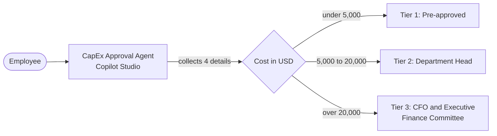

# CapEx & Expense Policy Approval Agent — Copilot Studio workshop

Build a finance guardrail agent that collects a purchase request, checks it against a spending policy, and tells the employee which approval route applies. The agent needs **no backend, no database and no Power Automate flow**.

> [!WARNING]
> **Learning use only.** The agent evaluates a request and explains the route. It does **not** submit, approve or record anything. Don't use it as a real approval system, and don't type confidential purchase details.

## What you'll build



| Policy | Rule |
| --- | --- |
| Under USD 5,000 | **Tier 1** — Auto-approved under the standard department operating budget |
| USD 5,000 to 20,000 (both inclusive) | **Tier 2** — Department Head sign-off |
| Over USD 20,000 | **Tier 3** — CFO and Executive Finance Committee sign-off |

The agent collects four details: **item**, **cost (USD)**, **department** (IT, Marketing, Operations or Sales) and a one-sentence **justification**.

## Two ways to build it

| | **Main path: GitHub Copilot harness** | **Alternative: standard harness (topics)** |
| --- | --- | --- |
| How the agent works | Reads written instructions and decides what to ask and say | Follows a topic you draw: Question nodes, a Power Fx formula, a Message node |
| What you build | One agent, and one block of instructions | One agent and one topic |
| Tier decision | The model applies the written policy | A Power Fx formula applies it, so it's deterministic |
| Wording | Varies between runs | Identical every time |
| Billing | Copilot Credits, from the moment you start building | Per the standard-harness licensing in your tenant |
| Best for learning | Writing clear rules and testing an AI's behavior | Exact logic and repeatable output |

The two agents can't be converted into each other: a topic-based agent and a GitHub Copilot harness agent are separate. Do the main path first, then the alternative if you want to compare.

## Workshop modules

| # | Module | Time | What you'll do |
| --- | --- | --- | --- |
| 1 | [Create the agent](./lab/01-create-agent.md) | 15 min | Start from a prompt, replace the generated instructions, and turn memory off |
| 2 | [Test the policy](./lab/02-test-the-policy.md) | 25 min | Run boundary, missing-detail, invalid-input and policy-bypass tests |
| 3 | [Alternative: build it with a topic](./lab/03-topic-version.md) | 40 min | Rebuild it on the standard harness with Question nodes and Power Fx |
| 4 | [Compare, export, and clean up](./lab/04-compare-export-clean-up.md) | 15 min | Compare both builds, package the agent in a solution, and delete your test agents |

**Total:** about 95 minutes, or 40 minutes for the main path (Modules 1 and 2) only.

## Prerequisites

- Access to [Copilot Studio](https://copilotstudio.microsoft.com), and permission to create agents in your environment.
- For the main path: the **GitHub Copilot harness** (the **New experience**) with **Copilot Credits** available.
- For Module 3: access to the **standard harness** (**Other ways to build** on the home page, or the classic experience).
- To export in Module 4: at least the **System Customizer** role in the environment.

## Folder contents

```text
CapEx Approval Agent/
├── README.md
└── lab/
    ├── 01-create-agent.md
    ├── 02-test-the-policy.md
    ├── 03-topic-version.md
    └── 04-compare-export-clean-up.md
```

## Where this differs from the source blueprint

The workshop follows the blueprint's policy, four details and output. These parts changed on purpose:

| Blueprint | This workshop | Why |
| --- | --- | --- |
| One topic on the standard harness | GitHub Copilot harness first; the topic is the alternative | You chose both. Instructions replace topics on the GitHub Copilot harness. |
| 3 trigger phrases | 8 trigger phrases | Microsoft Learn recommends 5 to 10 to train a topic. |
| Three tiers only | Adds checks for zero, negative, non-USD and split costs, and exact boundaries | A guardrail agent should handle values at and around the limits. |
| "Single portable `.zip`, import in 2 minutes" | Export is a documented step, with limits listed | Learn says some components, such as topics, might not export unless you add them. Imported agents need checking. See Module 4. |

## What has been verified

Checked against Microsoft Learn on **2 November 2026**: topic creation, Question nodes, Power Fx in topics, harness differences, and solution export and import.

**Not tenant-tested:** the builder prompt, the instruction behavior, the Power Fx nodes and the export. An instructor should run each module once in the teaching environment. The numeric test cases below are exact; the wording an AI produces is not.