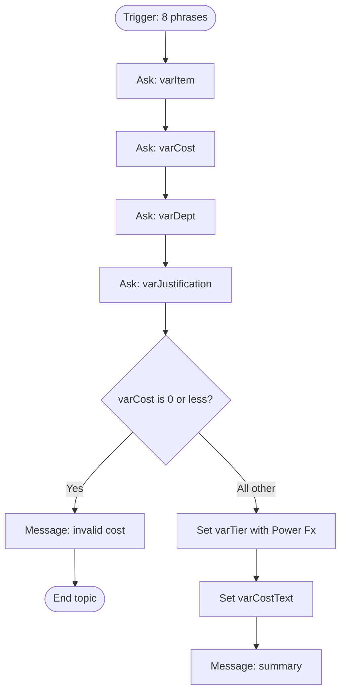

# Module 3 — Alternative: build it with a topic

[← Previous: Test the policy](./02-test-the-policy.md) · [Workshop home](../README.md) · **Module 3 of 4** · [Next: Compare, export, and clean up →](./04-compare-export-clean-up.md)

| | |
| --- | --- |
| **Time** | 40 minutes |
| **You will** | Build the same agent on the **standard harness**, with one topic: four Question nodes, one Power Fx formula, and one Message node |
| **You need** | Access to the standard harness, and the policy from the [README](../README.md) |

On the standard harness you draw the conversation yourself. A **Power Fx** formula decides the tier, so the answer is **deterministic**: the same cost always gives the same tier, with identical wording.

> [!NOTE]
> This is a **separate agent** from Module 1. A GitHub Copilot harness agent and a standard-harness agent can't be converted into each other. Name this one `CapEx Approval Agent (Topic)` so you can tell them apart. See [Harnesses in Copilot Studio](https://learn.microsoft.com/microsoft-copilot-studio/harnesses-overview).

## Step 1 — Create a standard-harness agent

1. On the Copilot Studio home page, select **Other ways to build**, and create a new agent. Alternatively, select the three dots (**…**) at the bottom of the side bar, and select **Open classic experience** ([Learn](https://learn.microsoft.com/microsoft-copilot-studio/agents-experience/switch-experiences)).
2. Name it `CapEx Approval Agent (Topic)`. You can skip the description.
3. Create the agent. You should see **Topics** in the agent's navigation. If you don't, you're still on the GitHub Copilot harness.

If the agent has an **Instructions** field, you can paste the **Role** and **Rules** sections from [Module 1](./01-create-agent.md) there. The topic doesn't depend on them.

## Step 2 — Create the topic and the trigger phrases

1. Go to **Topics**, select **Add a topic**, and then select **From blank**.
2. Select the three dots (**…**) of the **Trigger** node, and select **Properties**. Select **Phrases**, and paste these eight phrases, one per line:

   ```text
   submit capex request
   i need expense approval
   buy new equipment
   capex approval
   request purchase approval
   check my spending limit
   i want to buy something for my department
   do i need approval for a purchase
   ```

   Learn recommends 5 to 10 phrases per topic ([Learn](https://learn.microsoft.com/microsoft-copilot-studio/authoring-create-edit-topics)).
3. Select **Details** on the toolbar, and enter the name `CapEx Request`. **Don't use a period (`.`) in a topic name**: a solution with an agent that has one can't be exported.
4. Select **Save**.

## Step 3 — Add four Question nodes

Select **Add node (+)** under the trigger, and select **Ask a question**. Add these four nodes in order ([Learn: Ask a question](https://learn.microsoft.com/microsoft-copilot-studio/authoring-ask-a-question)).

| # | Message | Identify | Save response as | Variable type |
| --- | --- | --- | --- | --- |
| 1 | `What equipment or service are you requesting approval for?` | **User's entire response** | `varItem` | Text |
| 2 | `What is the total estimated cost in USD? Enter a plain number, for example 4999.99.` | **Number** | `varCost` | Number |
| 3 | `Which department cost center is this for?` | **Multiple choice options**, with `IT`, `Marketing`, `Operations`, `Sales` | `varDept` | Choice |
| 4 | `Please give a brief one-sentence business justification.` | **User's entire response** | `varJustification` | Text |

To rename the variable on each node, select the variable name under **Save user response as**, and change the name in the **Variable properties** panel.

Leave **Reprompt** on its default (**Repeat up to 2 times**).

## Step 4 — Guard against an invalid cost

Add a **Condition** node under the fourth Question node.

1. On the **Condition** node, select the three dots (**…**), and select **Change to formula**.
2. In the first branch, in the **Function** box, enter this formula, and select **Insert**:

   ```text
   Topic.varCost <= 0
   ```

3. In that branch, add a **Send a message** node: `The cost must be greater than zero. Please start again with a valid USD amount.` Then add **End current topic**.

Everything else goes under the **All other conditions** branch. Add the next nodes **inside that branch**.

> [!TIP]
> In Power Fx formulas, topic variables need the `Topic.` prefix, and the formula uses US number format: a period for decimals and commas to separate parameters ([Learn: Power Fx](https://learn.microsoft.com/microsoft-copilot-studio/advanced-power-fx)).

## Step 5 — Decide the tier with Power Fx

Inside **All other conditions**, add **Set a variable value** twice.

**First node:**

1. For **Set variable**, select **Create new**, and name it `varTier`.
2. For **To value**, select the **>** arrow, open the **Formula** tab, and enter this on one line:

   ```text
   If(Topic.varCost < 5000, "Tier 1: Pre-Approved (Standard Budget)", If(Topic.varCost <= 20000, "Tier 2: Department Head Review Required", "Tier 3: CFO & Executive Committee Approval Required"))
   ```

3. Select **Insert**.

**Second node:** create `varCostText`, and set it with this formula:

```text
Text(Topic.varCost, "#,##0.00")
```

How the formula reads: below 5,000 is Tier 1. Otherwise, up to and including 20,000 is Tier 2. Everything above is Tier 3. It's the blueprint's three branches written as one `If`, so exactly 5,000 and exactly 20,000 are both Tier 2.

## Step 6 — Send the summary

Add a **Send a message** node under the second Set node. Type the text below, and insert each variable with the **{x}** button where you see `{Topic.…}`:

```text
### CapEx Request Evaluation Summary

- **Item:** {Topic.varItem}
- **Department cost center:** {Topic.varDept}
- **Total request amount:** USD {Topic.varCostText}
- **Business justification:** {Topic.varJustification}

---
**Approval status / routing:** {Topic.varTier}

*Evaluation only. No purchase request has been submitted.*
```

Select **Save**.

The finished topic looks like this:



## Step 7 — Test

Open the **Test** panel and start a new conversation. Type `i need expense approval`, and answer the questions. The expected results are exact:

| Cost | Expected `Approval status / routing` |
| --- | --- |
| 4999.99 | Tier 1: Pre-Approved (Standard Budget) |
| 5000 | Tier 2: Department Head Review Required |
| 20000 | Tier 2: Department Head Review Required |
| 20000.01 | Tier 3: CFO & Executive Committee Approval Required |
| 0 | The invalid-cost message. No tier. |

Run the four tier rows twice. The summary should be identical both times, apart from the variable values.

### ✅ Checkpoint

- All five rows match, including both boundaries.
- Typing `buy new equipment` also starts the topic.
- The summary shows the thousands separators, for example `85,000.00`.

## Troubleshooting

| Problem | What to do |
| --- | --- |
| No **Topics** page | You're on the GitHub Copilot harness. Use **Other ways to build** or the classic experience. |
| The trigger phrase doesn't start the topic | Check that the topic is saved and turned on. If the agent uses generative orchestration, the topic's **Description** can matter. Ask your instructor. |
| `Name isn't valid` in a formula | Add the `Topic.` prefix, and check the spelling of the variable name. |
| A formula error with decimals or commas | Use a period for decimals and commas between parameters. Don't type a thousands separator in the number. |
| The cost question accepts text or `5k` | Number recognition can be lenient. Reprompt, and enter a plain number. Test how your tenant treats `$5,000`. |
| The department shows blank, or as a record | The Choice variable can display differently by channel. Tell your instructor; compare `{Topic.varDept}` with the **Variables** panel. This wasn't tenant-tested. |
| The Condition's later nodes never run | You added them to the wrong branch. Put them under **All other conditions**. |
| The message shows `{Topic.varTier}` literally | You typed it. Delete it, and insert the variable with the **{x}** button. |

---

[← Previous: Test the policy](./02-test-the-policy.md) · [Workshop home](../README.md) · [Next: Compare, export, and clean up →](./04-compare-export-clean-up.md)
