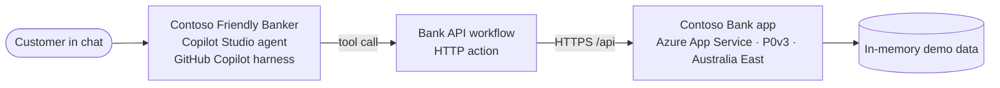

# Contoso Bank — Copilot Studio banking agent lab

Build **Contoso Friendly Banker**, a Microsoft Copilot Studio agent that helps customers check balances, transfer money, pay bills, and buy vouchers. The agent is built with the **GitHub Copilot harness** in Copilot Studio. It works from written instructions and one tool, a workflow that calls a banking app that you deploy yourself to Azure App Service.

> [!WARNING]
> **Learning use only.** The app uses in-memory mock data and has no real authentication, authorization, fraud controls, or audit trail. Never use it with real customer data or real money.

## What you'll build



You don't build topics or conversation flows. You give the agent two things:

- **Instructions** that say who it is, what it may do, and the rules it must follow. These include a safe order for anything that moves money: *get details, check funds, summarize, confirm, act, report*.
- **One tool**, a **workflow** named **Bank API**. It makes the HTTP request to the banking app and returns the answer. The agent uses it for sign-in, balances, `/check-funds` (the reusable balance check), saved accounts, bills, vouchers, and transfers.

The workflow accepts only listed read paths, or listed POST paths with the Boolean `Confirmed` set to true. That flag comes from the agent: it is **not proof** that a customer confirmed. The conversation tests check whether the agent actually asked first.

## Choose your starting point

| Your class setup | Start here |
| --- | --- |
| Each student deploys their own backend | [Module 1](./lab/01-deploy-backend.md), then Modules 2–7. Best for independent tests and predictable balances. |
| The instructor provides the existing backend | Check [health](https://contoso-bank-mtt-fsi-67227.azurewebsites.net/health), then start at [Module 2](./lab/02-create-agent.md). API base URL: `https://contoso-bank-mtt-fsi-67227.azurewebsites.net/api`. No Azure deployment is needed. |

**Keep the first milestone small:** create the agent, connect one workflow, and get sign-in and balance working (Modules 2–4). Then try transfers, bills and vouchers. You do not need to publish the agent to test it in Preview.

> [!IMPORTANT]
> **Shared backend = shared balances and bills.** It does not isolate each student's data. Run money-moving exercises one learner at a time, or use separate deployments. Students must not restart or delete the instructor's app. The numeric examples assume a fresh app with no other users.

### What has been verified

Reviewed against Microsoft Learn on **2 November 2026**: the natural-language builder, the GitHub Copilot harness, workflow-tool requirements and Preview. The existing backend's health, login and error responses were also checked using read-only requests.

**Not tenant-tested:** generated agents/workflows, availability of the generic HTTP action, and the complete Copilot Studio journeys. The builder is a preview feature; its output must pass Module 3's checks before money-moving exercises. An instructor should run the lab once in the actual teaching environment.

## Lab modules

Work through the modules in order. Use the **✅ Checkpoints** and troubleshooting tables to verify your work.

| # | Module | Time | What you'll do |
| --- | --- | --- | --- |
| 1 | [Deploy the banking app](./lab/01-deploy-backend.md) | 25 min | Create a resource group and a P0v3 plan in Australia East, then deploy with PowerShell |
| 2 | [Create the agent](./lab/02-create-agent.md) | 15 min | Start with a prompt, replace the generated instructions, and turn memory off |
| 3 | [Build the Bank API workflow](./lab/03-build-bank-workflow.md) | 30 min | Generate the HTTP workflow from a prompt, inspect and test it, and connect it once |
| 4 | [Sign in and check balances](./lab/04-sign-in-and-balance.md) | 20 min | Test sign-in, balances, saved accounts, and "can I afford it?" |
| 5 | [Transfer money](./lab/05-transfer.md) | 25 min | Test a transfer, cancellation and insufficient funds; verify actual confirmation |
| 6 | [Pay bills and buy vouchers](./lab/06-bills-and-vouchers.md) | 25 min | Apply the same pattern to bills and vouchers |
| 7 | [Test, share, and clean up](./lab/07-test-and-clean-up.md) | 20 min | Run an end-to-end test, check credit usage, and delete your resources |

**Total:** about 2 hours 40 minutes, or 2 hours 15 minutes using the existing backend. Allow extra time if the generated workflow needs corrections.

## Prerequisites

- For your own deployment: an Azure subscription where you can create resource groups, and a Windows PowerShell terminal (5.1 or 7). [Module 1](./lab/01-deploy-backend.md) covers Azure CLI and Git. The shared-backend path doesn't require an Azure subscription or those installations.
- Access to [Copilot Studio](https://copilotstudio.microsoft.com) in an environment that:
  - allows agents powered by the **GitHub Copilot harness** (the **New experience** in Copilot Studio), and
  - has **Copilot Credits** available. This harness is billed by usage and **starts billing when you start building**, including when you test in **Preview** ([Learn](https://learn.microsoft.com/microsoft-copilot-studio/agents-experience/billing-credit-overview)). Workflows also use capacity for each action they run.
- An environment where workflows and the generic **HTTP** action are available and allowed by policy/licensing. Instructors must check this before class; a missing action can have causes other than data policy.

## Project structure

The folder has three parts: this home page, the lab instructions, and the application code.

```text
Contoso Banking Backend/
├── README.md                  ← You are here: lab overview
├── lab/                       ← Student instructions (Modules 1–7)
│   ├── 01-deploy-backend.md
│   ├── 02-create-agent.md
│   ├── 03-build-bank-workflow.md
│   ├── 04-sign-in-and-balance.md
│   ├── 05-transfer.md
│   ├── 06-bills-and-vouchers.md
│   └── 07-test-and-clean-up.md
└── app/                       ← The application. This is the folder you deploy.
    ├── server.js              ← Starts the server and connects the routes
    ├── package.json           ← Dependencies and the start command
    ├── package-lock.json
    ├── api/                   ← Backend: the banking REST API
    │   ├── bankingApi.js      ← Endpoint logic (login, balance, check-funds, transfer, bills, vouchers)
    │   ├── mockDb.js          ← In-memory demo accounts and transactions
    │   └── response.js        ← Standard JSON success and error responses
    ├── mcp/                   ← Optional MCP endpoint (not used by the lab)
    │   └── mcpServer.js       ← Tool definitions, and the Streamable HTTP handler
    └── web/                   ← Website: pages students see in the browser
        ├── index.html         ← Home page
        ├── FAQ.html           ← Customer FAQ
        ├── api-docs.html      ← API reference
        ├── error.html         ← 404 page
        ├── styles.css, app.js ← Styles and script for the FAQ page
        └── new-campaign/      ← Mortgage campaign pages
```

| Folder | What it's for | Who uses it |
| --- | --- | --- |
| `lab/` | Step-by-step instructions | Students |
| `app/api/` | Banking REST API code | Instructors who want to change the API |
| `app/mcp/` | Optional MCP endpoint with the same actions as ten tools | Instructors who want to try MCP |
| `app/web/` | The website, served at the root of the app URL | Instructors who want to change the pages |
| `app/` | Everything that runs on Azure App Service | Deployment ([Module 1](./lab/01-deploy-backend.md)) |

The static website serves `app/web/`, not the server source or package files.

## Demo users

| User ID | Account | Owner | Starting balance |
| --- | --- | --- | --- |
| `USER001` | `ACC001` | Chihiro Kimura | USD 5,280.50 |
| `USER002` | `ACC002` | Camila Botelho | USD 1,240.00 |
| `USER003` | `ACC003` | Michelle Caruana | USD 12,400.75 |

IDs aren't case-sensitive, so `user001` works too. Restarting the app resets all balances and bills.

## The API the workflow calls

The workflow calls `https://<your-host>/api` plus the agent's path. The full reference is at `https://<your-host>/api-docs`.

| Method and path | Changes a balance? | Used in |
| --- | --- | --- |
| `GET /api/login?userId=USER001` | No | Modules 3, 4 |
| `GET /api/balance?accountId=ACC001` | No | Module 4 |
| `GET /api/check-funds?accountId=ACC001&amount=100` | No | Modules 4, 5, 6 |
| `GET /api/saved-accounts?accountId=ACC001` | No | Modules 4, 5 |
| `GET /api/transactions?accountId=ACC001&limit=10` | No | Module 4 |
| `POST /api/transfer` | **Yes** | Module 5 |
| `GET /api/bills?accountId=ACC001` | No | Module 6 |
| `POST /api/bills/pay` | **Yes** | Module 6 |
| `GET /api/vouchers` | No | Module 6 |
| `POST /api/voucher/purchase` | **Yes** | Module 6 |

The bank's own rules apply to every call: a transfer, bill payment, or voucher purchase is rejected when the balance is too low, and a transfer can't be more than USD 10,000.

For API-handler JSON responses, `x-status-in-body: true` changes the HTTP status to 200 and returns the original code as `httpStatus`. The workflow uses this so that "user not found" reaches the agent as data. It does not hide network failures or errors that occur before the API middleware, such as malformed request JSON.

The backend retains a legacy `GET /api/transfer` route. The lab workflow must **block** that route; only the seven listed GET paths are read-only.

## Run locally (for instructors)

Requires Node.js 22 or later. Run the commands from the `app` folder:

```powershell
cd app
npm install
npm start
```

Keep the server running. In a **second** PowerShell terminal:

```powershell
Invoke-RestMethod 'http://localhost:8080/api/login?userId=USER001'
```

Then open `http://localhost:8080/` for the website and `http://localhost:8080/api-docs` for the API reference.

To change the REST API, edit the files in `app/api/`. To change the website, edit the files in `app/web/`. Restart `npm start` after you change server code.

The optional MCP endpoint is at `/mcp`. Set the `MCP_API_KEY` environment variable (or app setting) to require an `x-api-key` header on it.

## Microsoft Learn references

- [Create a new agent (GitHub Copilot)](https://learn.microsoft.com/microsoft-copilot-studio/agents-experience/build-new-agent)
- [Create agents and workflows using natural language](https://learn.microsoft.com/microsoft-copilot-studio/create-automation-natural-language)
- [Configure agent details and instructions (GitHub Copilot)](https://learn.microsoft.com/microsoft-copilot-studio/agents-experience/authoring-instructions)
- [Add a tool to an agent (GitHub Copilot)](https://learn.microsoft.com/microsoft-copilot-studio/agents-experience/add-tools-custom-agent)
- [Add a workflow as a tool](https://learn.microsoft.com/microsoft-copilot-studio/agents-experience/tools-add-workflow) and [workflow-tool requirements](https://learn.microsoft.com/microsoft-copilot-studio/workflows-experience/flow-agent)
- [Workflow designer and whole-workflow tests](https://learn.microsoft.com/microsoft-copilot-studio/workflows-experience/flow-designer)
- [Preview and test an agent](https://learn.microsoft.com/microsoft-copilot-studio/agents-experience/preview-overview) and [Use the activity trace to debug your agent](https://learn.microsoft.com/microsoft-copilot-studio/agents-experience/authoring-activity-trace)
- [Memory (GitHub Copilot)](https://learn.microsoft.com/microsoft-copilot-studio/agents-experience/memory-overview)
- [Overview of usage-based billing](https://learn.microsoft.com/microsoft-copilot-studio/agents-experience/billing-credit-overview)
- [Harnesses in Copilot Studio](https://learn.microsoft.com/microsoft-copilot-studio/harnesses-overview)
- [Deploy a Node.js web app to App Service](https://learn.microsoft.com/azure/app-service/quickstart-nodejs) and [Configure the Premium v3 tier](https://learn.microsoft.com/azure/app-service/app-service-configure-premium-v3-tier)

## Limitations

The data resets whenever the app restarts or you redeploy it. That's intentional for a classroom. A production banking system would also need persistent storage, real identity and authorization enforced in the API and not only in the agent, idempotent transactions, audit logging, secret management, monitoring, and a formal security review.
