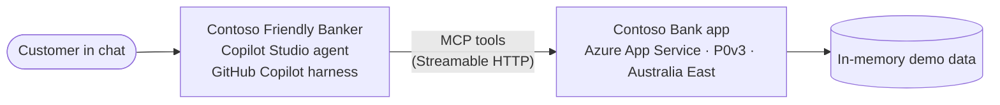

# Contoso Bank — Copilot Studio banking agent lab

Build **Contoso Friendly Banker**, a Microsoft Copilot Studio agent that helps customers check balances, transfer money, pay bills, and buy vouchers. The agent is built with the **GitHub Copilot harness** in Copilot Studio. It works from written instructions and a set of tools, and the tools call a banking app that you deploy yourself to Azure App Service.

> [!WARNING]
> **Learning use only.** The app uses in-memory mock data and has no real authentication, authorization, fraud controls, or audit trail. Never use it with real customer data or real money.

## What you'll build



You don't build topics or conversation flows. You give the agent two things:

- **Instructions** that say who it is, what it may do, and the rules it must follow. These include a safe order for anything that moves money: *get details, check funds, summarize, confirm, act, report*.
- **Tools** that let it act. The app has an **MCP endpoint** that offers ten banking tools. One of them, `check_funds`, is a reusable balance check that transfers, bill payments, and voucher purchases all use.

The three tools that change a balance also refuse to run unless they're called with `confirmed=true`, so the confirmation rule is enforced in the tool as well as in the instructions.

## Lab modules

Work through the modules in order. Each one ends with a **✅ Checkpoint** and a troubleshooting table.

| # | Module | Time | What you'll do |
| --- | --- | --- | --- |
| 1 | [Deploy the banking app](./lab/01-deploy-backend.md) | 25 min | Create a resource group and a P0v3 plan in Australia East, then deploy with PowerShell |
| 2 | [Create the agent](./lab/02-create-agent.md) | 20 min | Create an agent with the GitHub Copilot harness, add its instructions, and turn memory off |
| 3 | [Connect the bank tools](./lab/03-connect-bank-tools.md) | 20 min | Add the bank's MCP server as a tool, and read the activity trace |
| 4 | [Sign in and check balances](./lab/04-sign-in-and-balance.md) | 20 min | Test sign-in, balances, saved accounts, and "can I afford it?" |
| 5 | [Transfer money](./lab/05-transfer.md) | 25 min | Test a transfer, the cases where it must stop, and the two safety layers |
| 6 | [Pay bills and buy vouchers](./lab/06-bills-and-vouchers.md) | 25 min | Apply the same pattern to bills and vouchers |
| 7 | [Test, share, and clean up](./lab/07-test-and-clean-up.md) | 20 min | Run an end-to-end test, check credit usage, and delete your resources |

**Total:** about 2 hours 35 minutes.

## Prerequisites

- An Azure subscription where you can create resource groups.
- A Windows PC with a PowerShell terminal (Windows PowerShell 5.1 or PowerShell 7). [Module 1](./lab/01-deploy-backend.md) shows how to install the Azure CLI and Git. You can also use Azure Cloud Shell in PowerShell mode.
- Access to [Copilot Studio](https://copilotstudio.microsoft.com) in an environment that:
  - allows agents powered by the **GitHub Copilot harness** (the **New experience** in Copilot Studio), and
  - has **Copilot Credits** available. This harness is billed by usage and **starts billing when you start building**, including when you test in **Preview** ([Learn](https://learn.microsoft.com/microsoft-copilot-studio/agents-experience/billing-credit-overview)).
- A data policy that allows a **custom MCP server**. Instructors should confirm this with the Power Platform administrator before class. If a policy blocks it, the **Contoso Bank** server shows as **Blocked by policy** in Module 3.

## Project structure

The folder has three parts: this home page, the lab instructions, and the application code.

```text
Contoso Banking Backend/
├── README.md                  ← You are here: lab overview
├── lab/                       ← Student instructions (Modules 1–7)
│   ├── 01-deploy-backend.md
│   ├── 02-create-agent.md
│   ├── 03-connect-bank-tools.md
│   ├── 04-sign-in-and-balance.md
│   ├── 05-transfer.md
│   ├── 06-bills-and-vouchers.md
│   └── 07-test-and-clean-up.md
└── app/                       ← The application. This is the folder you deploy.
    ├── server.js              ← Starts the server and connects the routes
    ├── package.json           ← Dependencies and the start command
    ├── package-lock.json
    ├── api/                   ← Backend: the banking REST API
    │   ├── bankingApi.js      ← Endpoint logic (login, balance, transfer, bills, vouchers)
    │   ├── mockDb.js          ← In-memory demo accounts and transactions
    │   └── response.js        ← Standard JSON success and error responses
    ├── mcp/                   ← The MCP endpoint that gives an AI agent the banking tools
    │   └── mcpServer.js       ← Tool definitions, and the Streamable HTTP handler
    └── web/                   ← Website: pages students see in the browser
        ├── index.html         ← Home page
        ├── FAQ.html           ← Customer FAQ
        ├── api-docs.html      ← API and MCP reference
        ├── error.html         ← 404 page
        ├── styles.css, app.js ← Styles and script for the FAQ page
        └── new-campaign/      ← Mortgage campaign pages
```

| Folder | What it's for | Who uses it |
| --- | --- | --- |
| `lab/` | Step-by-step instructions | Students |
| `app/api/` | Banking REST API code | Instructors who want to change the API |
| `app/mcp/` | The agent's tools: names, descriptions, inputs, and the confirmation rule | Instructors who want to change or add tools |
| `app/web/` | The website, served at the root of the app URL | Instructors who want to change the pages |
| `app/` | Everything that runs on Azure App Service | Deployment ([Module 1](./lab/01-deploy-backend.md)) |

Only `app/web/` is served as static files, so the server code and package files can't be downloaded from the website. The MCP tools call the same code as the REST API, so the two always behave the same way.

## Demo users

| User ID | Account | Owner | Starting balance |
| --- | --- | --- | --- |
| `USER001` | `ACC001` | Chihiro Kimura | USD 5,280.50 |
| `USER002` | `ACC002` | Camila Botelho | USD 1,240.00 |
| `USER003` | `ACC003` | Michelle Caruana | USD 12,400.75 |

IDs aren't case-sensitive, so `user001` works too. Restarting the app resets all balances and bills.

## The agent's tools

The agent reaches the banking functions through the MCP endpoint at `https://<your-host>/mcp`. The full reference is at `https://<your-host>/api-docs`.

| MCP tool | Changes a balance? | REST endpoint it uses | Used in |
| --- | --- | --- | --- |
| `demo_login` | No | `GET /api/login?userId=USER001` | Modules 3, 4 |
| `get_balance` | No | `GET /api/balance?accountId=ACC001` | Module 4 |
| `check_funds` | No | `GET /api/balance`, plus `hasEnoughFunds` and `shortfall` | Modules 4, 5, 6 |
| `list_saved_accounts` | No | `GET /api/saved-accounts?accountId=ACC001` | Modules 4, 5 |
| `list_transactions` | No | `GET /api/transactions?accountId=ACC001&limit=10` | Module 4 |
| `transfer_money` | **Yes**, needs `confirmed=true` | `POST /api/transfer` | Module 5 |
| `list_bills` | No | `GET /api/bills?accountId=ACC001` | Module 6 |
| `pay_bill` | **Yes**, needs `confirmed=true` | `POST /api/bills/pay` | Module 6 |
| `list_vouchers` | No | `GET /api/vouchers` | Module 6 |
| `purchase_voucher` | **Yes**, needs `confirmed=true` | `POST /api/voucher/purchase` | Module 6 |

The bank's own rules apply to every tool: a transfer, bill payment, or voucher purchase is rejected when the balance is too low, and a transfer can't be more than USD 10,000.

## Run locally (for instructors)

Requires Node.js 22 or later. Run the commands from the `app` folder:

```powershell
cd app
npm install
npm start
Invoke-RestMethod 'http://localhost:8080/api/login?userId=USER001'
(Invoke-RestMethod -Method Post -Uri 'http://localhost:8080/mcp' -ContentType 'application/json' -Headers @{Accept='application/json, text/event-stream'} -Body '{"jsonrpc":"2.0","id":1,"method":"tools/list"}').result.tools.name
```

Then open `http://localhost:8080/` for the website and `http://localhost:8080/api-docs` for the API and MCP reference.

To change the REST API, edit the files in `app/api/`. To change the agent's tools, edit `app/mcp/mcpServer.js`. To change the website, edit the files in `app/web/`. Restart `npm start` after you change server code.

To require a key on the MCP endpoint, set the `MCP_API_KEY` environment variable (or app setting). Requests then need an `x-api-key` header with the same value.

## Microsoft Learn references

- [Create a new agent (GitHub Copilot)](https://learn.microsoft.com/microsoft-copilot-studio/agents-experience/build-new-agent)
- [Configure agent details and instructions (GitHub Copilot)](https://learn.microsoft.com/microsoft-copilot-studio/agents-experience/authoring-instructions)
- [Add a tool to an agent (GitHub Copilot)](https://learn.microsoft.com/microsoft-copilot-studio/agents-experience/add-tools-custom-agent) and [Add an MCP server to your agent as a tool](https://learn.microsoft.com/microsoft-copilot-studio/agents-experience/tools-add-mcp-server)
- [Preview and test an agent](https://learn.microsoft.com/microsoft-copilot-studio/agents-experience/preview-overview) and [Use the activity trace to debug your agent](https://learn.microsoft.com/microsoft-copilot-studio/agents-experience/authoring-activity-trace)
- [Memory (GitHub Copilot)](https://learn.microsoft.com/microsoft-copilot-studio/agents-experience/memory-overview)
- [Overview of usage-based billing](https://learn.microsoft.com/microsoft-copilot-studio/agents-experience/billing-credit-overview)
- [Harnesses in Copilot Studio](https://learn.microsoft.com/microsoft-copilot-studio/harnesses-overview)
- [Deploy a Node.js web app to App Service](https://learn.microsoft.com/azure/app-service/quickstart-nodejs) and [Configure the Premium v3 tier](https://learn.microsoft.com/azure/app-service/app-service-configure-premium-v3-tier)

## Limitations

The data resets whenever the app restarts or you redeploy it. That's intentional for a classroom. A production banking system would also need persistent storage, real identity and authorization enforced in the API and not only in the agent, idempotent transactions, audit logging, secret management, monitoring, and a formal security review.
