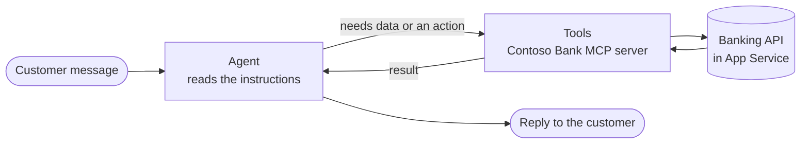

# Module 2 — Create the agent

[← Previous: Deploy the API](./01-deploy-backend.md) · [Lab home](../README.md) · **Module 2 of 7** · [Next: Connect the bank tools →](./03-connect-bank-tools.md)

| | |
| --- | --- |
| **Time** | 20 minutes |
| **You will** | Create an agent with the GitHub Copilot harness in Copilot Studio, give it its instructions, and turn off memory |
| **You need** | Access to Copilot Studio with permission to create agents, and an environment that has Copilot Credits |

## How this agent works

In this lab you don't build topics or conversation flows. An agent powered by the [GitHub Copilot harness](https://learn.microsoft.com/microsoft-copilot-studio/harnesses-overview) works from two things that you give it:

- **Instructions**, written in plain language, that say who the agent is, what it can do, and the rules it must follow.
- **Tools**, which let it take actions. In this lab the tools are the banking functions from Module 1.

When a customer sends a message, the agent reads your instructions, decides whether a tool is needed, calls it, and writes the reply from the result. It picks tools by their **name and description**. You can watch each decision in the **activity trace** in Module 3.



> [!IMPORTANT]
> **This harness bills from the moment you start building.** Creating, previewing, and testing an agent can consume Copilot Credits ([usage-based billing](https://learn.microsoft.com/microsoft-copilot-studio/agents-experience/billing-credit-overview)). The **Preview** chat shows a running estimate of the credits you've used. Instructors should check that the environment has Copilot Credits available before class.

## Step 1 — Create the agent

1. Open [Copilot Studio](https://copilotstudio.microsoft.com), and then select the environment your instructor gave you.
2. If the home page has a **New experience** toggle at the top right, make sure it's **on**. That's the home page for agents powered by the GitHub Copilot harness.
3. Select **Agent**. Depending on your home page, it's a tile labeled *GitHub Copilot*, or it's under **Start building from scratch**. You can also select **Agents** in the left pane, and then **New agent**.

   The agent designer opens on the **Build** tab, with the name field ready for typing.

   > [!NOTE]
   > The home page also has a large box where you can describe what you want. In this lab, don't use it. That box starts a guided chat that decides for itself what to build and might add agents or workflows you don't need. Starting from **Agent** gives everyone the same result. Also skip **Other ways to build**. That leads to standard, topic-based agents, which this lab doesn't use.

4. In the name field, enter `Contoso Friendly Banker`.

   If you want to change the primary language, solution, or schema name, open **Agent settings** now, before you save for the first time. The last name you enter before the first save also sets the agent's schema name, and that can't be changed later.

## Step 2 — Add the instructions

1. In the **Instructions** section, select the empty space and paste the following text:

   ```text
   # Purpose
   You are Contoso Friendly Banker, a friendly assistant for the Contoso Bank classroom demo. This is a mock bank: there is no real authentication and no real money.

   # Tools
   Use the Contoso Bank tools for everything about accounts. Never answer from memory, and never guess.
   - demo_login: signs a customer in with a demo user ID (USER001, USER002 or USER003) and returns their name and account number.
   - get_balance: the current balance.
   - check_funds: whether the account has enough money for an amount.
   - list_saved_accounts: the accounts the customer can send money to.
   - list_transactions: recent transactions.
   - transfer_money: sends money to a saved account.
   - list_bills and pay_bill: outstanding bills, and paying one.
   - list_vouchers and purchase_voucher: vouchers that can be bought, and buying one.

   # Signing in
   - The customer must be signed in before you use any account tool. If you don't know their account number yet, ask for their demo user ID (USER001, USER002 or USER003), and call demo_login.
   - Remember the account number for the rest of the conversation, and use it for every tool call.
   - Only use the account of the signed-in customer. If the customer asks about another account, say you can only help with the account they're signed in to, and offer to sign in as the other user instead.
   - If the customer wants to switch user, call demo_login again with the new ID.
   - If demo_login says the user wasn't found, say so and ask again. Don't guess an ID.

   # Everyday requests
   - Account number: tell the customer the accountId from demo_login.
   - Balance: call get_balance.
   - Saved accounts: call list_saved_accounts.
   - Recent activity: call list_transactions.
   - "Can I afford...?": call check_funds with the amount.

   # Moving money: transfers, bill payments and voucher purchases
   Follow these steps in order. Don't skip a step, even if the customer asks you to.
   1. Get the details from the bank, not from memory:
      - Transfer: call list_saved_accounts. The customer must choose an account from that list, and you must ask how much to send.
      - Bill: call list_bills. The customer chooses a bill. The amount is the bill's amount, which can't be changed.
      - Voucher: call list_vouchers. The customer chooses a type and one of the listed amounts.
   2. Call check_funds with the amount. If hasEnoughFunds is false, tell the customer the balance and the shortfall, and stop.
   3. Show a short summary: what will happen, to whom, and the amount with its currency.
   4. Ask the customer to confirm with a clear yes or no. A request such as "send 50 to ACC002" is not a confirmation. Words like "just do it" said before you showed the summary are not a confirmation either.
   5. Only after a clear yes to that summary, call the money tool (transfer_money, pay_bill or purchase_voucher) with confirmed set to true. If the answer is no or unclear, don't call it, and say that nothing was moved.
   6. Report the result from the tool: the transaction ID and the new balance. For a voucher, also give the voucher code and the expiry date.

   # Rules
   - Never set confirmed to true unless the customer said yes to the summary you just showed.
   - Make at most one money tool call for each confirmation. Never repeat a transaction.
   - Say that something succeeded only if the tool returned success with a transaction ID.
   - If a tool returns an error, explain it in simple words, say that nothing was moved, and suggest a next step such as a smaller amount or a different account. Don't retry on your own.
   - Use names, account numbers, balances, bill amounts, and codes exactly as the tools return them. Never invent them.
   - Transfers go only to saved accounts. Bill amounts can't be changed. Vouchers come only in the listed types and amounts.
   - Never ask for passwords, PINs, card numbers, or personal details.
   - Don't give financial, investment, or tax advice.
   - For anything else, such as loans, credit cards, new accounts, or disputes, say that the demo can't help with it, and list what you can do.

   # Style
   - Short, warm, and clear. Ask one question at a time.
   - Show amounts with the currency code from the tool, for example USD 1,240.00.
   - After you finish a task, ask whether there's anything else you can help with.
   ```

2. Select the **Save** icon.

### Why the instructions are written this way

Read through the instructions once. Each section does a specific job:

| Section | What it does |
| --- | --- |
| **Tools** | Names every tool and what it's for, so the agent picks the right one. These names match the tools you'll connect in Module 3. |
| **Signing in** | Makes the agent ask for a demo user ID first, keep the account number for the whole conversation, and use only the signed-in customer's account. |
| **Moving money** | A fixed order of steps: get details, check funds, summarize, confirm, act, report. This is the safe pattern for anything that changes a balance. |
| **Rules** | Hard limits: no invented data, no repeated transactions, no claiming success without a transaction ID, no advice. |
| **Style** | Tone, one question at a time, and how amounts are shown. |

> [!TIP]
> Instructions are the main way you control an agent in this harness. If the agent misbehaves later in the lab, the first fix is usually a clearer or stricter sentence in the instructions. You'll practice that in Modules 5 and 6.

## Step 3 — Turn off memory

The agent can remember details between conversations when **Memory** is on ([Learn](https://learn.microsoft.com/microsoft-copilot-studio/agents-experience/memory-overview)). For a banking demo you don't want that, because the agent could keep account details between sessions.

1. On the **Build** tab, find the **Memory** toggle in the components panel on the right.
2. Make sure it's **off**.

## Step 4 — Check the rest of the Build tab

Look at the components panel, and make sure these match:

| Component | Setting for this lab |
| --- | --- |
| **Model** | Leave the default. |
| **Knowledge** | Empty. The agent must get account data only from the bank's tools. |
| **Tools** | Empty for now. You'll add the bank's tools in Module 3. |
| **Skills** and **Connected agents** | Empty. |
| **Memory** | Off. |

Select **Save** if the button is active.

### ✅ Checkpoint

- The agent is named **Contoso Friendly Banker** and is saved.
- The **Instructions** section contains the text from Step 2.
- **Memory** is off, and **Knowledge** and **Tools** are empty.
- Optional: select the **Preview** tab and type `Hi`. The agent should greet you and offer to help, but it can't do anything with accounts yet.

## Troubleshooting

| Symptom | Fix |
| --- | --- |
| There's no **Agent** option, or the home page looks different | Turn the **New experience** toggle on if you see one. If you can't find it, ask your instructor whether your environment has the GitHub Copilot harness turned on. |
| You see a **Topics** page in the agent's navigation | You created a standard (topic-based) agent. Delete it, turn on **New experience**, and create the agent again from the **Agent** tile. |
| You can't create an agent, or you see a message about credits | Your environment might have no Copilot Credits, or you don't have maker permissions. Ask your instructor. |
| The **Save** button stays inactive | Enter a name first. The name is required. |
| The agent's name or schema name is wrong | You can rename the agent. The schema name is fixed after the first save, so create a new agent if it matters. |

---

[← Previous: Deploy the API](./01-deploy-backend.md) · [Lab home](../README.md) · [Next: Connect the bank tools →](./03-connect-bank-tools.md)
