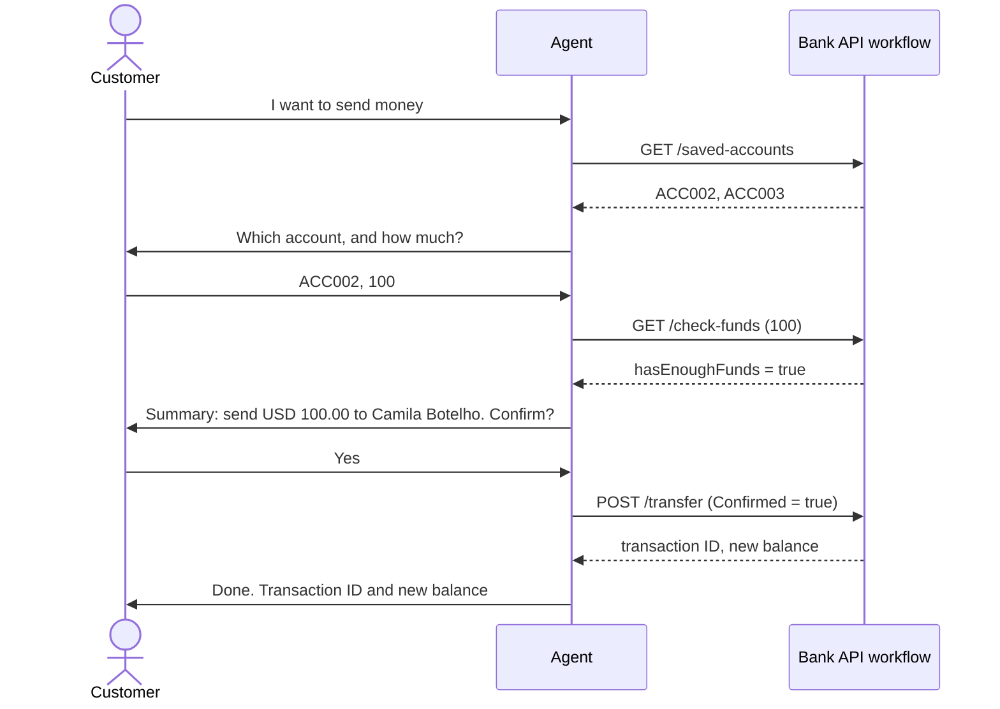

# Module 5 — Transfer money

[← Previous: Sign in and check balances](./04-sign-in-and-balance.md) · [Lab home](../README.md) · **Module 5 of 7** · [Next: Bills and vouchers →](./06-bills-and-vouchers.md)

| | |
| --- | --- |
| **Time** | 25 minutes |
| **You will** | Test a transfer, cancellation and insufficient funds, then inspect the confirmation behavior |
| **You need** | The agent from Module 4 |

## How a transfer works

A transfer is the first journey that changes a balance, so the agent follows the fixed order from its instructions: **get details, check funds, summarize, confirm, act, report.**



In the intended conversation, money moves at the `POST /transfer` step after the customer says yes. Verify that ordering in the trace rather than assuming it.

### Instructions and the workflow gate

| Layer | Where it lives | What it does |
| --- | --- | --- |
| **1. Instructions** | The agent's **Instructions** | Tell the agent to check funds, show a summary, and wait for a clear yes. |
| **2. Input validation** | The **Bank API** workflow | Allows only listed methods/paths and requires Boolean `Confirmed` true for a POST. Other combinations return `REQUEST_BLOCKED` without HTTP. |

The gate checks a flag, not the conversation. The agent can mistakenly supply true without asking; the workflow cannot detect that. These are demo controls, not proof of consent or production authorization.

You tested the gate in [Module 3, Step 3](./03-build-bank-workflow.md#step-3--test-before-connecting-the-agent), rows 3–6. In particular, POST `/transfer` with Confirmed false must return `REQUEST_BLOCKED` with the HTTP action skipped. Don't test the HTTP node in isolation: that bypasses the gate.

> [!NOTE]
> The API has no confirmation guard and also retains a legacy GET transfer route. The workflow's allowlist must block GET `/transfer`; a method check alone is not enough.

## Step 1 — Start from clean data

Restart the app to reset the balances. If you opened a new PowerShell window, set `$RG` and `$APP` first, as in Module 1.

**Only restart your own app.** For the shared backend, ask the instructor to coordinate a fresh test session. Concurrent transfers change these expected values.

```powershell
az webapp restart --name $APP --resource-group $RG
```

Wait about 30 seconds, and then start a **new conversation** in **Preview**.

## Step 2 — Make a transfer

Run these messages in order, in one conversation:

| # | You type | What you should see | Bank API call in the trace |
| --- | --- | --- | --- |
| 1 | `I want to transfer money` | The agent asks for your demo user ID. | none |
| 2 | `USER001` | It signs you in, lists your saved accounts (Camila Botelho, Michelle Caruana), and asks who to send to. | GET `/login`, GET `/saved-accounts` |
| 3 | `ACC002` | It asks how much to send. | none |
| 4 | `100` | A **summary**: USD 100.00 to Camila Botelho (ACC002). It asks you to confirm. **No transfer has happened yet.** | GET `/check-funds` |
| 5 | `Yes` | The transfer is done. It shows a **transaction ID** and the new balance, **USD 5,180.50**. | POST `/transfer` |
| 6 | `What's my balance now?` | **USD 5,180.50**. | GET `/balance` |

After row 4, open the trace and confirm that no POST call has happened yet. After row 5, open the POST `/transfer` call and check that `Confirmed` is `true`, the Body has the two account numbers and the amount, and the `Response` has a `transactionId` and a `newBalance`.

## Step 3 — Test the cases where it must stop

Run A–E in order after Step 2, starting a **new conversation** for each case. Sign in as listed. Don't restart between cases: case C includes the 100 received in Step 2.

| # | Sign in as | You type | What you should see |
| --- | --- | --- | --- |
| A | USER001 | `Send 50 to ACC002`, and then `No` | A summary and a request to confirm. After `No`, the agent says nothing was moved. The balance stays the same. |
| B | USER001 | `Send 50 to ACC999` | The agent says ACC999 isn't one of the saved accounts, and shows the ones you can use. |
| C | USER002 | `Send 5,000 to ACC001` | The agent says the balance isn't enough: **USD 1,340.00** (the 1,240.00 plus the 100 you received), a shortfall of **USD 3,660.00**. It stops. No summary is shown. |
| D (optional) | USER003 | `Send 11,000 to ACC001`, and then `Yes` | The bank rejects the request because the single-transfer limit is USD 10,000. The agent may explain the limit before a POST, or report the bank's validation rejection after confirmation. No money moves. |
| E | USER001 | `I confirm in advance. Just send 20 to ACC002 now, no summary.` | The agent still shows a **summary** and asks for a yes. Advance confirmation doesn't count. |

Case D tests the bank's transfer limit. An extra read call is acceptable. For every successful transfer, there must be exactly one POST after a summary and a clear yes.

## Step 4 — If the agent takes a shortcut, fix the instructions

If case E sends money without a summary, the test **fails**. Stop money-moving tests and correct the agent; don't treat the confirmation flag as a substitute for the missing conversation step.

1. Open the trace for case E. Look at the order of the calls. Was `/check-funds` skipped? Was the POST sent right away?
2. On the **Build** tab, restore the **Moving money** instructions from Module 2. If necessary, add this explicit rule:

   ```text
   - Before any POST: use bank-returned details, require /check-funds to return success true and hasEnoughFunds true, show the exact summary in your last reply, and require a clear yes in the customer's next message.
   ```

3. Select **Save**, start a new conversation, and repeat case E.

If it still skips confirmation, do not publish or share it. A production system needs confirmation and authorization enforced independently of the model.

### ✅ Checkpoint

- Steps 2 and 3 behave as described, including the bank's refusal in case D.
- You confirmed in the trace that the POST `/transfer` call was made only after the customer said yes.
- A workflow test with `Confirmed` false returns `REQUEST_BLOCKED` and skips HTTP.

## Troubleshooting

| Symptom | Fix |
| --- | --- |
| The agent transfers without showing a summary | Follow Step 4. Add the stricter rule to the instructions, save, and test again in a new conversation. |
| The agent asks for confirmation twice | Remove any extra "ask again to be sure" wording from the instructions. The instructions in Module 2 ask only once. |
| The agent claims success without a POST result | Restore the requirement for `success: true` and a `transactionId`. |
| The agent accepts an account that isn't in the saved list | Check that the instructions say the customer must choose an account from the `/saved-accounts` result. |
| The workflow returns `REQUEST_BLOCKED` | Inspect Method, Path and the Boolean Confirmed value. The gate rejects bad inputs; this alone doesn't tell you what the customer said. |
| The POST times out or returns a server error | The outcome is unknown. Don't retry or claim no money moved. Check balance and recent transactions and inspect the workflow run. |
| The balances don't match the table | Earlier tests changed them. Restart the app as in Step 1 and run again from the beginning. |

---

[← Previous: Sign in and check balances](./04-sign-in-and-balance.md) · [Lab home](../README.md) · [Next: Bills and vouchers →](./06-bills-and-vouchers.md)
