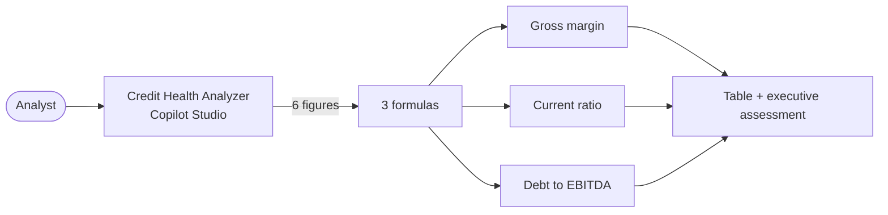

# Financial Ratio & Credit Health Analyzer — Copilot Studio workshop

Build an analyst agent that takes six financial figures typed into a chat, calculates three ratios, compares them with risk benchmarks, and explains the result in plain language. The agent needs **no backend, no database and no Power Automate flow**.

> [!WARNING]
> **Learning use only.** The agent is an educational screening, not a credit decision, a rating, or lending, accounting or investment advice. Use made-up or public figures, not confidential client data.

## What you'll build



| Metric | Formula | Benchmark |
| --- | --- | --- |
| **Gross margin %** | (Revenue − COGS) ÷ Revenue × 100, 1 decimal | Above 40.0% = strong pricing power |
| **Current ratio** | Current assets ÷ current liabilities, 2 decimals | Above 1.5x healthy · 1.0x to 1.5x adequate · below 1.0x high risk |
| **Debt to EBITDA** | Total debt ÷ EBITDA, 2 decimals | Below 3.0x conservative · 3.0x to 4.5x moderate · above 4.5x excessive |

The blueprint defines only the healthy and risky ends. This workshop names the middle bands "adequate" and "moderate", and says that a value **exactly on a boundary is not "above" or "below"** it. A status uses the **rounded value shown** in the table, so a reader can check the table against the label.

## Two ways to build it

| | **Main path: GitHub Copilot harness** | **Alternative: standard harness (topics)** |
| --- | --- | --- |
| How the agent works | The model reads the formulas and calculates | Power Fx calculates; the model isn't involved in the maths |
| Arithmetic | Needs checking: models can make arithmetic slips | Exact, every time |
| Commentary | Written by the model from the numbers | Chosen by formulas, so it's identical each time |
| Handling unusual input | Flexible, for example a zero denominator | Only what you built |
| Billing | Copilot Credits, from the moment you start building | Per the standard-harness licensing in your tenant |

This workshop's central lesson: **a language model can reason about numbers, but you should verify its arithmetic.** Module 2 includes a way to check every result.

## Workshop modules

| # | Module | Time | What you'll do |
| --- | --- | --- | --- |
| 1 | [Create the agent](./lab/01-create-agent.md) | 15 min | Start from a prompt, replace the generated instructions, and turn memory off |
| 2 | [Test the calculations](./lab/02-test-the-calculations.md) | 30 min | Test seven cases with exact expected values, and verify the maths with PowerShell |
| 3 | [Alternative: build it with a topic](./lab/03-topic-version.md) | 45 min | Rebuild it on the standard harness with six Question nodes and Power Fx |
| 4 | [Compare, export, and clean up](./lab/04-compare-export-clean-up.md) | 15 min | Compare accuracy and flexibility, package the agent, and delete your test agents |

**Total:** about 1 hour 45 minutes, or 45 minutes for the main path (Modules 1 and 2) only.

## Prerequisites

- Access to [Copilot Studio](https://copilotstudio.microsoft.com), and permission to create agents in your environment.
- For the main path: the **GitHub Copilot harness** (the **New experience**) with **Copilot Credits** available.
- For Module 3: access to the **standard harness** (**Other ways to build** on the home page, or the classic experience).
- For the verification step in Module 2: a PowerShell terminal (Windows PowerShell 5.1 or PowerShell 7). It's optional; a calculator also works.
- To export in Module 4: at least the **System Customizer** role in the environment.

## Folder contents

```text
Credit Health Analyzer/
├── README.md
└── lab/
    ├── 01-create-agent.md
    ├── 02-test-the-calculations.md
    ├── 03-topic-version.md
    └── 04-compare-export-clean-up.md
```

## Where this differs from the source blueprint

| Blueprint | This workshop | Why |
| --- | --- | --- |
| One topic on the standard harness | GitHub Copilot harness first; the topic is the alternative | You chose both. |
| The output message has `[Generative commentary ...]` placeholders | The topic uses Power Fx to pick the commentary; the instruction agent writes it | A Message node doesn't generate text from a placeholder: it would print the brackets as typed. |
| Formulas with no guard | Zero denominators, zero or negative EBITDA, and negative inputs are handled | `Topic.varCurrentAssets / Topic.varCurrentLiab` fails or misleads when the denominator is zero. |
| Status column says "Calculated" | Status shows a real classification | The point of a benchmark is to compare with it. |
| Only the benchmark ends | Middle bands and exact boundaries are defined | Without them, values such as 1.25x or 3.67x have no label. |
| "Single portable `.zip`, import in 2 minutes" | Export is a documented step, with limits listed | Learn says components such as topics might not export unless added. See Module 4. |
| 3 trigger phrases | 8 trigger phrases | Microsoft Learn recommends 5 to 10. |

## What has been verified

Checked against Microsoft Learn on **2 November 2026**: topic creation, Question nodes, Power Fx in topics, harness differences, and solution export and import. The expected ratio values in the test cases were **calculated with PowerShell**, rounding half away from zero (like Power Fx `Round`).

**Not tenant-tested:** the builder prompt, the instruction behavior, the Power Fx nodes and the export. An instructor should run each module once in the teaching environment. The expected numbers are exact; the AI's wording isn't.