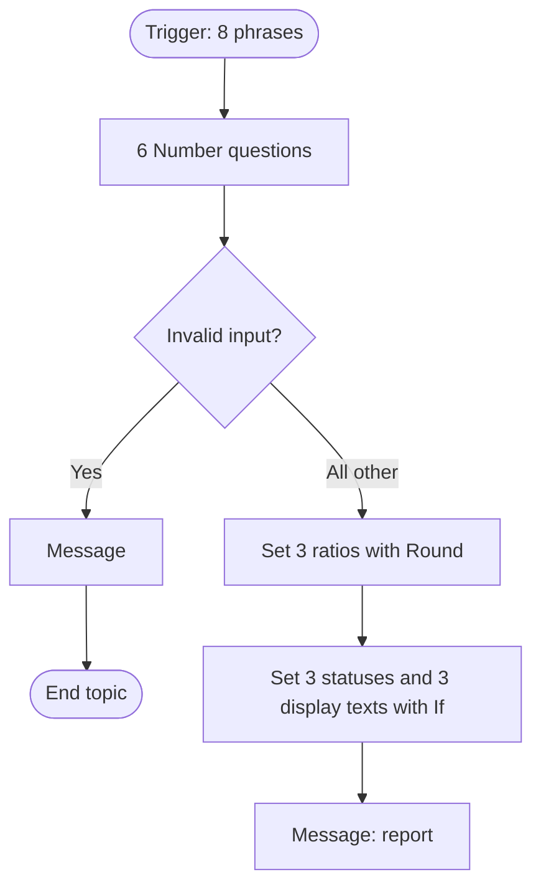

# Module 3 — Alternative: build it with a topic

[← Previous: Test the calculations](./02-test-the-calculations.md) · [Workshop home](../README.md) · **Module 3 of 4** · [Next: Compare, export, and clean up →](./04-compare-export-clean-up.md)

| | |
| --- | --- |
| **Time** | 45 minutes |
| **You will** | Build the same analyst on the **standard harness**, with one topic: six Question nodes, Power Fx formulas, and one Message node |
| **You need** | Access to the standard harness, and the formulas and benchmarks from the [README](../README.md) |

On the standard harness, **Power Fx does the maths**. The model isn't involved in the calculation, so the result is exact and identical every time. The status text is chosen by formulas too.

> [!NOTE]
> This is a **separate agent** from Module 1. A GitHub Copilot harness agent and a standard-harness agent can't be converted into each other. Name this one `Credit Health Analyzer (Topic)`. See [Harnesses in Copilot Studio](https://learn.microsoft.com/microsoft-copilot-studio/harnesses-overview).

## Step 1 — Create a standard-harness agent

1. On the Copilot Studio home page, select **Other ways to build**, and create a new agent. Alternatively, select the three dots (**…**) at the bottom of the side bar, and select **Open classic experience** ([Learn](https://learn.microsoft.com/microsoft-copilot-studio/agents-experience/switch-experiences)).
2. Name it `Credit Health Analyzer (Topic)`, and create it.
3. Check that **Topics** appears in the agent's navigation. If it doesn't, you're still on the GitHub Copilot harness.

## Step 2 — Create the topic and trigger phrases

1. Go to **Topics**, select **Add a topic**, and then select **From blank**.
2. Select the three dots (**…**) of the **Trigger** node, select **Properties**, and then **Phrases**. Paste these eight phrases, one per line:

   ```text
   analyze financials
   run ratio check
   evaluate credit risk
   check financial health
   calculate financial ratios
   credit health check
   analyze a company's liquidity
   assess leverage and margin
   ```

3. Select **Details**, and name the topic `Financial Ratio Check`. **Don't use a period (`.`) in a topic name**; it blocks solution export.
4. Select **Save**.

## Step 3 — Ask for the six figures

Add six **Ask a question** nodes in order, one under the other ([Learn: Ask a question](https://learn.microsoft.com/microsoft-copilot-studio/authoring-ask-a-question)). Each one uses **Identify = Number**, and the variable type is **Number**.

| # | Message | Save response as |
| --- | --- | --- |
| 1 | `Total revenue? Enter a plain number with no currency symbol or commas, for example 2400000.` | `varRev` |
| 2 | `Cost of goods sold (COGS)? Use the same unit.` | `varCOGS` |
| 3 | `Total current assets? Same unit.` | `varCurrentAssets` |
| 4 | `Total current liabilities? Same unit.` | `varCurrentLiab` |
| 5 | `Total debt? Same unit.` | `varDebt` |
| 6 | `EBITDA? Same unit. It can be negative.` | `varEBITDA` |

Select the variable name under **Save user response as** to rename it in the **Variable properties** panel.

## Step 4 — Guard against invalid input

Add a **Condition** node under question 6. Select the three dots (**…**), select **Change to formula**, enter this formula in the first branch, and select **Insert**:

```text
Topic.varRev <= 0 || Topic.varCurrentLiab <= 0 || Topic.varCOGS < 0 || Topic.varCurrentAssets < 0 || Topic.varDebt < 0
```

In that branch, add **Send a message**: `Revenue and current liabilities must be greater than zero, and COGS, current assets and debt can't be negative. Please start again.` Then add **End current topic**.

Put **all remaining nodes inside the All other conditions branch**.

This topic **stops** on a zero denominator. The Module 1 agent can instead report "n/a" for that metric. That's a real difference between the two builds; you'll compare them in Module 4.

> [!TIP]
> Topic variables need the `Topic.` prefix in Power Fx. Formulas use US format: a period for decimals, and commas to separate parameters ([Learn: Power Fx](https://learn.microsoft.com/microsoft-copilot-studio/advanced-power-fx)).

## Step 5 — Calculate with Power Fx

Inside **All other conditions**, add a **Set a variable value** node for each row. For each one: select **Set variable → Create new**, enter the name, open **To value → > → Formula**, enter the formula, and select **Insert**.

| Variable | Type | Formula |
| --- | --- | --- |
| `varGrossMargin` | Number | `Round(((Topic.varRev - Topic.varCOGS) / Topic.varRev) * 100, 1)` |
| `varCurrentRatio` | Number | `Round(Topic.varCurrentAssets / Topic.varCurrentLiab, 2)` |
| `varDebtToEBITDA` | Number | `If(Topic.varEBITDA > 0, Round(Topic.varDebt / Topic.varEBITDA, 2), 0)` |

`Round` rounds halves away from zero. The `If` guards the division: with zero or negative EBITDA the value is a placeholder `0`, which the next steps never show.

## Step 6 — Choose the status text with Power Fx

Add more **Set a variable value** nodes. All variables are **Text**:

| Variable | Formula |
| --- | --- |
| `varMarginStatus` | `If(Topic.varGrossMargin > 40, "Strong pricing power", "Below the 40% benchmark")` |
| `varLiquidityStatus` | `If(Topic.varCurrentRatio > 1.5, "Healthy liquidity", If(Topic.varCurrentRatio >= 1, "Adequate, monitor", "High risk"))` |
| `varLeverageStatus` | `If(Topic.varEBITDA <= 0, "Not meaningful: EBITDA is zero or negative (high risk)", If(Topic.varDebtToEBITDA < 3, "Conservative leverage", If(Topic.varDebtToEBITDA <= 4.5, "Moderate leverage", "Excessive debt risk")))` |
| `varMarginText` | `Text(Topic.varGrossMargin, "0.0") & "%"` |
| `varLiquidityText` | `Text(Topic.varCurrentRatio, "0.00") & "x"` |
| `varLeverageText` | `If(Topic.varEBITDA > 0, Text(Topic.varDebtToEBITDA, "0.00") & "x", "n/m")` |

These statuses are the same rules as Module 1: above 40, above 1.5, and below 3.0 or above 4.5 are strict, and values exactly on a limit fall into the middle band.

The blueprint's `[Generative commentary ...]` placeholder can't be typed into a Message node: it would print the brackets. Here, the formulas choose the commentary instead, which keeps it exact.

## Step 7 — Send the report

Add **Send a message** under the last Set node. Type the text, and insert each `{Topic.…}` variable with the **{x}** button:

```text
### Financial Health & Credit Assessment Report

| Financial metric | Calculated value | Target benchmark | Status |
| :--- | :--- | :--- | :--- |
| **Gross margin** | {Topic.varMarginText} | above 40.0% | {Topic.varMarginStatus} |
| **Current ratio (liquidity)** | {Topic.varLiquidityText} | above 1.5x | {Topic.varLiquidityStatus} |
| **Debt / EBITDA (leverage)** | {Topic.varLeverageText} | below 3.0x | {Topic.varLeverageStatus} |

*Educational screening only. Not a credit decision or financial advice.*
```

Select **Save**.

> [!NOTE]
> A Markdown table might not render on every channel. If it doesn't render in the test panel, the text is still correct. Check the variables instead.

The finished topic:



## Step 8 — Test

Open the **Test** panel, start a new conversation, type `run ratio check`, and answer the six questions with plain numbers. The expected results are exact:

| Case | Revenue · COGS · CA · CL · Debt · EBITDA | Margin | Current ratio | Debt / EBITDA |
| --- | --- | --- | --- | --- |
| **A** | 5000000 · 2800000 · 1800000 · 900000 · 2000000 · 1000000 | 44.0% · Strong | 2.00x · Healthy | 2.00x · Conservative |
| **B** | 2400000 · 1560000 · 750000 · 600000 · 3300000 · 900000 | 35.0% · Below | 1.25x · Adequate | 3.67x · Moderate |
| **C** | 1000000 · 720000 · 400000 · 520000 · 4000000 · 800000 | 28.0% · Below | 0.77x · High risk | 5.00x · Excessive |
| **D** | 1000000 · 600000 · 1500000 · 1000000 · 3000000 · 1000000 | 40.0% · Below | 1.50x · Adequate | 3.00x · Moderate |
| **E** | 1000000 · 550000 · 1000000 · 1000000 · 4500000 · 1000000 | 45.0% · Strong | 1.00x · Adequate | 4.50x · Moderate |
| **F** | 800000 · 600000 · 300000 · 250000 · 1000000 · -100000 | 25.0% · Below | 1.20x · Adequate | n/m · Not meaningful |
| **G** | 800000 · 500000 · 300000 · 0 · 1000000 · 200000 | The invalid-input message (current liabilities are zero) | | |

Run case B twice. The report must be identical both times.

### ✅ Checkpoint

- Cases A to F match exactly, including boundary cases D and E.
- Case G shows the invalid-input message instead of a ratio.
- Typing `evaluate credit risk` also starts the topic.

## Troubleshooting

| Problem | What to do |
| --- | --- |
| No **Topics** page | You're on the GitHub Copilot harness. Use **Other ways to build**, or the classic experience. |
| A formula says the name isn't valid | Add the `Topic.` prefix, and check the spelling of the variable name. |
| A formula error with decimals or commas | Use a period for decimals and commas between parameters. Don't type thousands separators in a Question answer. |
| A Number question rejects `2,400,000` or `$2.4M` | Type a plain number: `2400000`. How the Number entity reads symbols can vary. |
| `Text(...)` shows a long number, or the wrong format | Check the format string: `"0.00"` or `"0.0"`. Quotes must be straight. |
| The later nodes never run | You added them to the wrong branch. Put them under **All other conditions**. |
| The table shows as plain text | The channel doesn't render Markdown tables. The values are still correct. |
| A status is wrong at a boundary | Compare the operators: `>` for "above", `>=` for "from", `<=` for "up to and including". |

---

[← Previous: Test the calculations](./02-test-the-calculations.md) · [Workshop home](../README.md) · [Next: Compare, export, and clean up →](./04-compare-export-clean-up.md)
