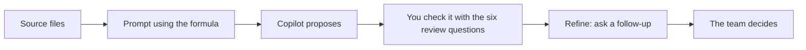

# Meridian Retail Engagement — Microsoft 365 Copilot for finance and audit teams

Join the audit team of a fictional retailer and let Microsoft 365 Copilot help. This is a set of six short, standalone workshops, one for each app: **Word, Excel, PowerPoint, Outlook, Teams and Copilot Chat**. All six use one client, **Meridian Retail Group Pte. Ltd.**. In each one, Copilot proposes and you verify every answer against the source files.

> [!WARNING]
> **Training use only.** All Meridian names, entities, amounts, transactions, emails, chats and findings are fictional training data. Copilot proposes; the team verifies. This is a training exercise, not audit or tax advice. Never paste real client data into the prompts.

## What you’ll learn



Every workshop follows the same rhythm: **Scenario → Concept → Demo → Try Out → Review → Refine → Takeaways**. You learn one prompt formula and one review habit, then practise them in a different app each time.

## Workshops

Each workshop stands alone and takes about 60 minutes, so start with the app you use most. You do not need to do them in order.

| # | Workshop | Hands-on | What you do | Files |
| --- | --- | --- | --- | --- |
| 1 | [Word: Understand the client and write professional findings](./lab/01-word.md) | 35 min | Summarise a client file, turn interview notes into evidence and write a finding. | `01_Client_Background.docx`<br>`02_Audit_Interview_Notes.docx`<br>`03_Audit_Findings_Draft.docx` |
| 2 | [Excel: Investigate 1,800 transactions and find exceptions](./lab/02-excel.md) | 35 min | Flag risky entries and find the exceptions hiding in 1,800 transactions. | `04_Audit_Analytics.xlsx`<br>`05_Corporate_Tax_Computation.xlsx` |
| 3 | [PowerPoint: Build an executive briefing for leadership](./lab/03-powerpoint.md) | 35 min | Turn findings into a clear briefing for senior leaders. | `01_Client_Background.docx`<br>`03_Audit_Findings_Draft.docx`<br>`06_Supporting_Documents.pdf` |
| 4 | [Outlook: Handle a complex email with attachments](./lab/04-outlook.md) | 35 min | Work out what an urgent email needs, then reply with the right tone. | `Meridian_Retail_Email.eml`<br>`01_Client_Background.docx`<br>`03_Audit_Findings_Draft.docx`<br>`06_Supporting_Documents.pdf` |
| 5 | [Teams: Catch up on the engagement and prepare a meeting](./lab/05-teams.md) | 35 min | Catch up on three days of chat and prepare tomorrow’s status meeting. | `Meridian-Teams-channel-transcript.txt` |
| 6 | [Copilot Chat: Investigate evidence across multiple files](./lab/06-copilot-chat.md) | 37 min | Follow six suspicious matters across the client file, the data and the documents. | `01_Client_Background.docx`<br>`04_Audit_Analytics.xlsx`<br>`06_Supporting_Documents.pdf` |

## Prerequisites

- A Microsoft 365 Copilot licence, and everyone can sign in. Check this a day before.
- A place to save the sample files that Copilot can open, such as OneDrive or SharePoint. Check in your own environment that Copilot can open them.
- The desktop or web app for your chosen session. Menus and button names change often, so check in your own environment.
- Outlook session: your Outlook can open the `.eml` email. Teams session: use a TRAINING chat only, never a real client chat.
- Basic familiarity with finance or audit terms is helpful, but each lab explains the words you will meet.

## Meet Meridian

Meridian Retail Group Pte. Ltd. is a fictional regional retailer of consumer electronics and home accessories, with 18 physical stores, 1 e-commerce platform and 3 distribution centres. Its financial year ended 31 December 2026, and it reports in SGD, MYR, THB.

| Company | Country | Ownership | What it does |
| --- | --- | --- | --- |
| Meridian Retail Group Pte. Ltd. | Singapore | Parent | Head office, e-commerce, 8 stores |
| Meridian Retail Malaysia Sdn. Bhd. | Malaysia | 100% owned | 6 stores and distribution |
| Meridian Retail Thailand Co., Ltd. | Thailand | 85% owned | 4 stores and service centre |

**FY2026 at a glance (SGD millions, not yet audited)**

| Measure | In plain words | FY2026 | Change vs FY2025 |
| --- | --- | --- | --- |
| Revenue | sales | 151.8 | +20.1% |
| Gross profit | after product costs | 45.1 | +15.1% |
| Operating expenses | running costs | 39.6 | +25.7% |
| Profit before tax | after all costs | 5.5 | −28.6% |
| Inventory | stock | 29.7 | +42.8% |
| Trade receivables | owed by customers | 13.9 | +67.5% |

_Sales are up, but profit is down. Stock and the money customers owe have grown much faster than sales._

**What changed in FY2026**

| When | What happened |
| --- | --- |
| Jul 2026 | New online-store system went live on 1 July; staff adjusted records by hand |
| Sep 2026 | Stock is now valued with a daily, not monthly, average cost |
| Oct 2026 | The supplier-payments supervisor left; system access was switched off six weeks later |
| Nov 2026 | Two Singapore stores renovated and reopened |
| Dec 2026 | Big December campaign with extended returns to 31 January 2027 |
| Ongoing | Year-end reporting team has two vacancies |

**What Meridian wants**

- Audit completed before the board meeting on 20 February 2027
- Reliable profit figures for each country — management is considering a regional distribution partnership
- Clear, practical findings management can act on

**What the engagement team must do**

- Understand key processes and changes
- Identify significant reporting and control risks
- Use data analysis to investigate unusual transactions
- Check whether tax adjustments are supported
- Communicate findings clearly to management

> [!NOTE]
> Your role: You have just joined the engagement team reviewing Meridian’s FY2026 results. Copilot is your assistant.

## Sample data

All sample files are fictional and are in [sample-files](./sample-files). Upload the ones for your session to OneDrive or SharePoint before you start, or use the ready-made ZIP for each session.

| File | Type | Size | What it is | Used in |
| --- | --- | --- | --- | --- |
| [`01_Client_Background.docx`](./sample-files/01_Client_Background.docx) | DOCX | 30 KB | Company, group structure, FY2026 financials, events, prior-year findings, objectives and training questions. | Word, PowerPoint, Outlook, Copilot Chat |
| [`02_Audit_Interview_Notes.docx`](./sample-files/02_Audit_Interview_Notes.docx) | DOCX | 29 KB | Raw notes from the Finance Director, Financial Controller, Inventory Manager and IT Manager interviews. | Word |
| [`03_Audit_Findings_Draft.docx`](./sample-files/03_Audit_Findings_Draft.docx) | DOCX | 30 KB | Six draft findings (F-01 to F-06), some vague or incomplete, a management-response area and a quality checklist. | Word, PowerPoint, Outlook |
| [`04_Audit_Analytics.xlsx`](./sample-files/04_Audit_Analytics.xlsx) | XLSX | 207 KB | 1,800 general-ledger transactions, vendors, employees, expenses, budget vs actual and an output sheet for your findings. | Excel, Copilot Chat |
| [`05_Corporate_Tax_Computation.xlsx`](./sample-files/05_Corporate_Tax_Computation.xlsx) | XLSX | 13 KB | Ten tax adjustments with evidence status, a summary tax computation, the training assumptions and a Review_Summary sheet for your conclusions. | Excel |
| [`06_Supporting_Documents.pdf`](./sample-files/06_Supporting_Documents.pdf) | PDF | 14 KB | Invoices, hotel receipt, bank extract, inventory count sheet and evidence request list. | PowerPoint, Outlook, Copilot Chat |
| [`Meridian_Retail_Email.eml`](./sample-files/Meridian_Retail_Email.eml) | EML | 103 KB | The urgent email from the Finance Director about year-end evidence and the 20 February board deadline, with three attachments. | Outlook |

**Session packs**

| ZIP | Size | Session | Contains |
| --- | --- | --- | --- |
| [Meridian-Word-sample-files.zip](./sample-files/session-packs/Meridian-Word-sample-files.zip) | 78 KB | Word | `01_Client_Background.docx`, `02_Audit_Interview_Notes.docx`, `03_Audit_Findings_Draft.docx` |
| [Meridian-Excel-sample-files.zip](./sample-files/session-packs/Meridian-Excel-sample-files.zip) | 206 KB | Excel | `04_Audit_Analytics.xlsx`, `05_Corporate_Tax_Computation.xlsx` |
| [Meridian-PowerPoint-sample-files.zip](./sample-files/session-packs/Meridian-PowerPoint-sample-files.zip) | 60 KB | PowerPoint | `01_Client_Background.docx`, `03_Audit_Findings_Draft.docx`, `06_Supporting_Documents.pdf` |
| [Meridian-Outlook-sample-files.zip](./sample-files/session-packs/Meridian-Outlook-sample-files.zip) | 127 KB | Outlook | `Meridian_Retail_Email.eml`, `01_Client_Background.docx`, `03_Audit_Findings_Draft.docx`, `06_Supporting_Documents.pdf` |
| [Meridian-Teams-sample-files.zip](./sample-files/session-packs/Meridian-Teams-sample-files.zip) | 3 KB | Teams | `Meridian-Teams-channel-transcript.txt` |
| [Meridian-Chat-sample-files.zip](./sample-files/session-packs/Meridian-Chat-sample-files.zip) | 230 KB | Copilot Chat | `01_Client_Background.docx`, `04_Audit_Analytics.xlsx`, `06_Supporting_Documents.pdf` |

> [!NOTE]
> Not every file is a safe source. Each lab has a table that says how far to trust each file and what to watch for. The client background document says it intentionally contains some inconsistencies, so a good answer reports them instead of picking one.

## Ground rules

- All Meridian data is fictional — no real client information
- Do not add personal or client data to prompts
- Copilot can be wrong: verify numbers before you reuse them
- No personal information about members of the public in prompts
- Follow your agency’s AI-use and classification guidance

## Resources

| Resource | Use it for |
| --- | --- |
| [Prompt formula and review questions](./reference.md) | The seven-part prompt formula, the status labels and the six review questions that every workshop uses |
| [Prompt pack](./prompt-pack.md) | Every prompt and follow-up, ready to copy |
| [Instructor guide](./instructor-guide.md) | The Meridian story, a 60-minute run of show and what to say, ask and watch at every step |

## Folder layout

```text
M365 Copilot/
├── README.md
├── reference.md
├── prompt-pack.md
├── instructor-guide.md
├── lab/
│   ├── 01-word.md
│   ├── 02-excel.md
│   ├── 03-powerpoint.md
│   ├── 04-outlook.md
│   ├── 05-teams.md
│   └── 06-copilot-chat.md
├── images/                 (one flow infographic per session)
└── sample-files/
    ├── 01 … 06 documents, the .eml email and the Teams transcript
    └── session-packs/      (one ZIP per session)
```

## Microsoft Learn references

- <https://learn.microsoft.com/microsoft-365/copilot/>
- <https://learn.microsoft.com/microsoft-365/copilot/previous-year-release-notes#february-4,-2025>
- <https://learn.microsoft.com/microsoft-365/copilot/release-notes-archive#march,-2024>
- <https://learn.microsoft.com/microsoft-365/copilot/release-notes>
- <https://learn.microsoft.com/training/modules/present-copilot-microsoft-powerpoint/>
- <https://learn.microsoft.com/microsoft-365/admin/activity-reports/microsoft-365-copilot-usage#interpret-the-microsoft-copilot-usage-report>
- <https://learn.microsoft.com/microsoft-365/copilot/previous-year-release-notes#august-19,-2025>
- <https://learn.microsoft.com/microsoft-365/copilot/release-notes#august-11,-2026>
- <https://learn.microsoft.com/microsoft-365/copilot/copilot-overview>

## Source

This workshop is the Markdown edition of the interactive **Finance** Copilot journey in [AzureInfographics.github.io](https://github.com/AzureInfographics/AzureInfographics.github.io/tree/main/journeys/Copilot/Finance). The prompts are verbatim from the instructor deck and developer guide, and example answers are labelled **illustrative**.
