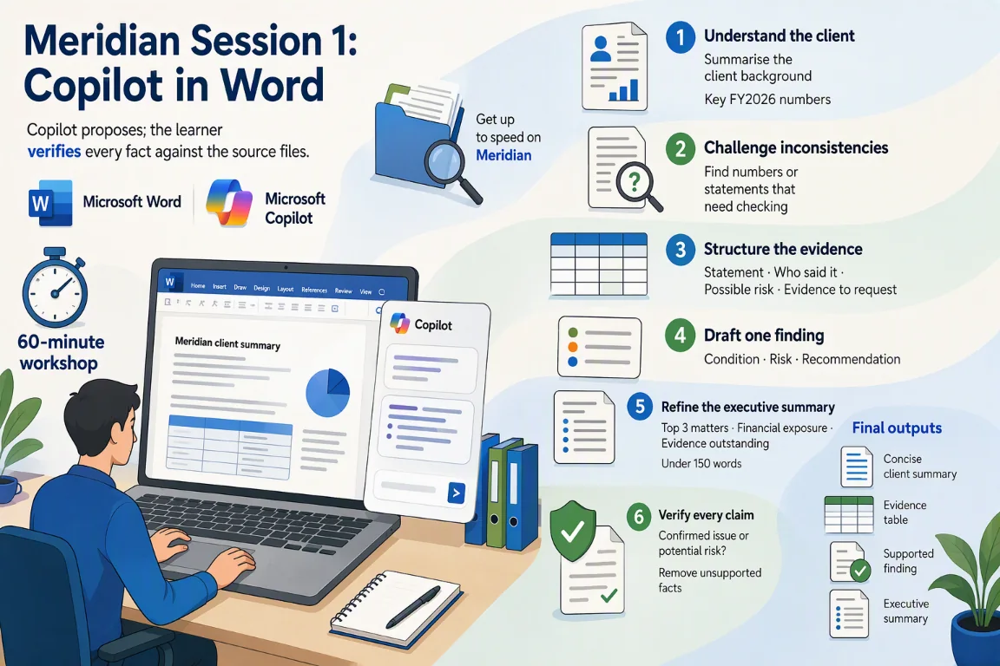

# Session 1: Copilot in Word — Understand the client and write professional findings

[Workshop home](../README.md) · **Session 1 of 6** · [Next: Excel →](./02-excel.md)

|   |   |
| --- | --- |
| **Time** | 60 minutes: about 35 minutes of hands-on work, plus the story, setup and review |
| **You will produce** | a client summary; an evidence table and one finding; an executive summary |
| **You need** | A Microsoft 365 Copilot licence, Word, and the sample files for this session |
| **Files** | [`01_Client_Background.docx`](../sample-files/01_Client_Background.docx)<br>[`02_Audit_Interview_Notes.docx`](../sample-files/02_Audit_Interview_Notes.docx)<br>[`03_Audit_Findings_Draft.docx`](../sample-files/03_Audit_Findings_Draft.docx)<br>or the ZIP: [Meridian-Word-sample-files.zip](../sample-files/session-packs/Meridian-Word-sample-files.zip) |

> [!IMPORTANT]
> All Meridian names, entities, amounts, transactions, emails, chats and findings are fictional training data. Copilot proposes; the team verifies. This is a training exercise, not audit or tax advice.



## The flow of this session

| # | Stage | What you do |
| --- | --- | --- |
| 1 | Understand the client | Try Out 1 · summary and key FY2026 numbers |
| 2 | Challenge inconsistencies | Try Out 1 follow-up · what needs checking |
| 3 | Structure the evidence | Try Out 2 · who said it, risk, evidence |
| 4 | Draft one finding | Try Out 2 follow-up · condition, risk, advice |
| 5 | Refine the executive summary | Refine · under 150 words (mandatory) |
| 6 | Verify every claim | Review · remove what the file cannot support |

## The story in three beats

1. **You join an audit engagement mid-flight.** Get up to speed on Meridian from the client file.
2. **The client file and the interview notes do not agree.** Challenge what looks inconsistent and structure the evidence.
3. **Turn notes into a finding the team can stand behind.** Draft one finding, write a summary under 150 words and verify every claim.

## Your role and your job today

You have just joined the engagement team reviewing Meridian’s FY2026 results. Copilot is your assistant.

You need to get up to speed on Meridian fast, turn messy interview notes into evidence, and fix a poorly written finding.

| You will produce | What good looks like |
| --- | --- |
| A client summary | Eight bullets, with the figures quoted correctly |
| An evidence table and one finding | A finding in three parts, written from the interview notes |
| An executive summary | Under 150 words, with anything unsupported removed |

New to Meridian? Read [Meet Meridian](../README.md#meet-meridian) first. It takes two minutes, and every session starts with the same story.

### Words you will meet today

| Word | What it means |
| --- | --- |
| Engagement team | The group of auditors working on one client. You have just joined it. |
| Finding | A problem the team spotted, written up: what happened, why it matters, what to do. |
| Evidence | Proof you can point to: a document, a record or a number from the files. |
| Inconsistency | Two places that say different things about the same fact. |
| Executive summary | A short note for busy leaders. Only the main points. |
| Source file | The document an answer came from, so you can check it. |

## Step 1 — Which file do you trust?

Three Word files. Some are more reliable than others, and each has a warning.

| Source | Role | How far to trust it | Watch for | Used in |
| --- | --- | --- | --- | --- |
| [`01_Client_Background.docx`](../sample-files/01_Client_Background.docx) · Client Background | Controls the client facts | The controlling record for facts about Meridian: group, FY2026 figures (unaudited), events and objectives. | The document says it intentionally contains some inconsistencies. | Try Out 1 |
| [`02_Audit_Interview_Notes.docx`](../sample-files/02_Audit_Interview_Notes.docx) · Audit Interview Notes | What people said, not proof | What people said. Nothing here is proof until evidence supports it. | Interview statements. Some amounts do not agree with the client background. | Try Out 2 |
| [`03_Audit_Findings_Draft.docx`](../sample-files/03_Audit_Findings_Draft.docx) · Audit Findings Draft | Draft to improve | A working draft. Ratings, recommendations, owners and dates are missing on some findings. | Draft: deliberately vague or incomplete. The executive summary is left for you to write. | Refine, and the Try Out 2 stretch |

> [!NOTE]
> Example: `02_Audit_Interview_Notes.docx` has the Finance Director saying two bank accounts still have differences from September. `01_Client_Background.docx` and `03_Audit_Findings_Draft.docx` say three. Do not pick one. Ask for the bank reconciliations (bank statements matched to the books).

> [!IMPORTANT]
> When two files disagree, say so. Do not pick one silently.

## Step 2 — Download the three Word files

Fictional Meridian files, made for practice. Download each file, or take them all.

**DO:** Download the three Word files, or the ZIP with all three, to your computer.

> [!NOTE]
> The files are the same ones every Meridian session uses.

- [01_Client_Background.docx](../sample-files/01_Client_Background.docx) (DOCX, 30 KB): Company, group structure, FY2026 financials, events, prior-year findings, objectives and training questions.
- [02_Audit_Interview_Notes.docx](../sample-files/02_Audit_Interview_Notes.docx) (DOCX, 29 KB): Raw notes from the Finance Director, Financial Controller, Inventory Manager and IT Manager interviews.
- [03_Audit_Findings_Draft.docx](../sample-files/03_Audit_Findings_Draft.docx) (DOCX, 30 KB): Six draft findings (F-01 to F-06), some vague or incomplete, a management-response area and a quality checklist.

Or take them all: [Meridian-Word-sample-files.zip](../sample-files/session-packs/Meridian-Word-sample-files.zip).

## Step 3 — Save all three in OneDrive

Copilot can only read files saved in OneDrive or SharePoint. Make a folder for them.

**DO:** Upload the three files to a OneDrive folder called Meridian Word.

> [!NOTE]
> Open OneDrive in your browser, create the folder, then upload or drag the three files into it.

## Step 4 — The prompt formula and three habits

A prompt is what you type to Copilot. A good one covers seven things: role, task, source, focus, format, limit and a check.

**READ:** Read the formula and the three habits. Then spot each part in the Meridian example.

**The prompt formula**

```text
Act as [role]. [Task] using /[file]. Focus on [what matters]. Give me [format]. Keep it [length / tone / audience]. Show where each point comes from.
```

**Example for Meridian**

```text
Act as an audit senior. Summarise the three most significant findings using /03_Audit_Findings_Draft.docx. Focus on financial exposure and evidence still outstanding. Give me 3 bullet points. Keep it under 100 words for the engagement leader. Show where each point comes from.
```

**Three habits**

- Say who it is for, what you want and the format
- Point Copilot at the source file (type / to reference it)
- Always check the answer against the source

Then: **Always ask a follow-up — the first answer is a starting point.**

See the [prompt formula and review questions](../reference.md) for the seven parts, the status labels and the ground rules.

## Step 5 — Explore the client file

Know the file before you ask about it.

**READ:** Open `01_Client_Background.docx` in Word. Scan sections 4, 5 and 6 and note three things you would check.

> [!NOTE]
> Scan sections 4, 5 and 6. Notice which figures you will need to quote exactly.

**4 · Selected financial information**

|   | What to notice |
| --- | --- |
| ✓ | Revenue SGD 151.8m, up 20.1% |
| ✓ | Gross profit SGD 45.1m, up 15.1% |
| ✓ | Operating expenses SGD 39.6m, up 25.7% |
| ⚠ | Profit before tax SGD 5.5m, down 28.6% |
| ⚠ | Inventory SGD 29.7m, up 42.8% |
| ⚠ | Trade receivables SGD 13.9m, up 67.5% |

**5 · Significant events in FY2026**

|   | What to notice |
| --- | --- |
| ✓ | E-commerce platform live on 1 July |
| ✓ | Costing changed in September |
| ⚠ | AP supervisor left in October; access disabled six weeks later |
| ✓ | Two Singapore stores renovated |
| ✓ | December campaign: returns to 31 January 2027 |

**6 · Prior-year findings**

|   | What to notice |
| --- | --- |
| ⚠ | Bank reconciliations: three accounts with old items |
| ⚠ | Former employees kept access (High) |
| ✓ | Inventory counts: Thailand used a local template |
| ⚠ | Manual journals: some attachments inaccessible (High) |

- ✓ Stated in the file. Quote it exactly.
- ⚠ Worth checking. Ask Copilot, then verify.

## Step 6 — Open Copilot in Word

Open the file, then click Copilot. Copilot already sees the file you have open, so there is nothing to select.

**DO:** Open file 01 in Word and click Copilot. Copilot already sees the open file.

> [!NOTE]
> The files must be saved in OneDrive or SharePoint. Check the exact method in your own environment.

## Step 7 — Try Out 1: Get to know the client

Ask Copilot for an eight-bullet summary, then ask what needs checking.

**Where:** Word › open the file › Copilot · **Suggested time:** 7 min to do, 4 min to check

**File:** [01_Client_Background.docx](../sample-files/01_Client_Background.docx)

1. Open `01_Client_Background.docx` in Word, saved in OneDrive.
2. Click Copilot to open the Copilot pane.
3. Paste prompt 1 and press Send. Then paste the follow-up.

**Prompt**

```text
Summarise this client background for a new engagement team member in no more than 8 bullet points. Include what the business does, the group structure, the key FY2026 numbers and the three changes that increase risk the most.
```

**Follow-up**

```text
Which numbers or statements in this document look inconsistent or need checking? Tell me the section for each one.
```

**Look for:** Figures quoted correctly (e.g. revenue SGD 151.8m, profit before tax down 28.6%)

> [!NOTE]
> Copilot in Word works on the file you have open. Check the exact method in your own environment.

### Check the answer

Compare every figure with the file. Mark what the file says and what Copilot only worked out.

**EXAMINE:** Compare figures with `01_Client_Background.docx`. Which bullets are Copilot’s own?

**Check**

- [ ] Revenue SGD 151.8m and profit before tax down 28.6%, as in `01_Client_Background.docx`?
- [ ] Eight bullets or fewer?
- [ ] Which three changes matter most? Do you agree?
- [ ] Does every follow-up item name its section?

> [!NOTE]
> Copilot picked the three biggest risks, so those bullets are inferred.

<details>
<summary>Illustrative example (your Copilot answer will differ)</summary>

**Prompt 1 · Client summary, 8 bullets**

| Point | Status | Source |
| --- | --- | --- |
| Regional electronics and home-accessories retailer | ✓ Confirmed | §1 |
| Parent in Singapore; Malaysia 100%, Thailand 85% owned | ✓ Confirmed | §2 |
| Revenue SGD 151.8m (+20.1%); gross profit SGD 45.1m (+15.1%) | ✓ Confirmed | §4 |
| Operating expenses SGD 39.6m (+25.7%); PBT SGD 5.5m (−28.6%) | ✓ Confirmed | §4 |
| Inventory SGD 29.7m (+42.8%); receivables SGD 13.9m (+67.5%) | ✓ Confirmed | §4 |
| Risk: e-commerce platform live 1 July, manual adjustments | ≈ Inferred | §5 |
| Risk: inventory costing changed to daily weighted average | ≈ Inferred | §5 |
| Risk: ex-AP supervisor access disabled six weeks late | ≈ Inferred | §5 |

**Follow-up · Needs checking**

| Point | Status | Source |
| --- | --- | --- |
| Inventory +42.8% and receivables +67.5% vs revenue +20.1%: valuation and collectability | … Unresolved | §4 |
| “Six weeks later”: prior-year review evidence is unavailable for Oct–Nov | … Unresolved | §5, §6 |
| Three distribution centres, but only Malaysia lists “local distribution” | … Unresolved | §2, §3 |
| Rates update monthly “except certain urgent manual entries”: which ones? | … Unresolved | §3 |

</details>

## Step 8 — Try Out 2: From interview notes to a finding

Turn raw interview notes into an evidence table, then into one finding.

**Where:** Word › open the file › Copilot · **Suggested time:** 8 min to do, 4 min to check

**File:** [02_Audit_Interview_Notes.docx](../sample-files/02_Audit_Interview_Notes.docx)

1. Open `02_Audit_Interview_Notes.docx` in Word.
2. Click Copilot to open the Copilot pane.
3. Paste prompt 2 and press Send. Then paste the follow-up.

**Prompt**

```text
From the Financial Controller and Inventory Manager interviews, create a table with the columns: Statement, Who said it, Possible risk, Evidence to request.
```

**Follow-up**

```text
Pick the most serious issue and write one audit finding with three headings: Condition, Risk, Recommendation. Use only facts from this document.
```

**Look for:** Every statement matched to the person who said it. No invented facts.

> [!NOTE]
> Interview notes are raw. The table and the finding must stay inside what was said.

### Check the table and the finding

Match every row to the person who said it.

**EXAMINE:** Match each row to who said it.

**Check**

- [ ] Does every row name an interviewee?
- [ ] Is each statement still unproven?
- [ ] Does the finding use only `02_Audit_Interview_Notes.docx` facts?
- [ ] Any invented number, name or date?

> [!WARNING]
> Interviews are clues, not proof. “About 430” stays unresolved until a list supports it.

<details>
<summary>Illustrative example (your Copilot answer will differ)</summary>

| Statement | Who said it | Possible risk | Evidence to request |
| --- | --- | --- | --- |
| About 430 manual journals in December, about 70 in the last three days | Financial Controller | Late, high-volume posting raises error risk | December journal listing with preparer, approver and date |
| One SGD 1.25m revenue entry posted 31 Dec, reversed 3 Jan | Financial Controller | Revenue in the wrong period | Support for the entry; December online returns after year-end |
| About SGD 2.3m in-transit inventory added manually after the count closed | Inventory Manager | Inventory existence and cut-off | In-transit listing and who approved the manual entry |

_Status of every row: … Unresolved._

**Follow-up · One finding**

| Part | Text |
| --- | --- |
| Condition | The Financial Controller said one SGD 1.25m revenue entry was posted on 31 December and reversed on 3 January, and called it a cut-off adjustment. Not yet corroborated. |
| Risk | Revenue may be recorded in the wrong period if the entry is not supported. |
| Recommendation | Request the support for the entry and confirm subsequent returns for December online sales. |

</details>

## Step 9 — Optional stretch: Rewrite finding F-02

Not in the main path. Use spare time to rewrite one weak finding.

**TRY:** Optional. Open `03_Audit_Findings_Draft.docx`, select finding F-02 and ask Copilot to rewrite it. Write the prompt yourself.

> [!NOTE]
> A rating is a judgement. Copilot can propose one. You decide.

**Your task:** Open `03_Audit_Findings_Draft.docx`, select finding F-02 and ask Copilot to rewrite it in neutral, professional language with a risk rating.

**Check**

- [ ] Is the language neutral and professional?
- [ ] Did Copilot keep every draft fact, and add none?
- [ ] Is the rating labelled a proposal?
- [ ] Is the missing date left visible?

> [!TIP]
> Write your own prompt with the formula: role, task, source, focus, format, length, and “show where each point comes from”.

<details>
<summary>Illustrative example</summary>

**Draft finding F-02 (before)**

| Field | Draft |
| --- | --- |
| Finding | A former accounts payable supervisor retained system access for approximately six weeks after leaving. |
| Risk | Unauthorized changes to vendor or payment data may occur. |
| Rating | (blank) |
| Recommendation | Disable leavers promptly and evidence a monthly access review. |
| Owner | IT Manager |
| Target date | (blank) |

**Example rewrite (after)**

| Field | Rewrite | Status |
| --- | --- | --- |
| Condition | A former accounts payable supervisor’s system access remained active for approximately six weeks after leaving. | — |
| Risk | Unauthorised changes to vendor or payment data could occur. | — |
| Rating | High (proposed). The draft leaves it blank, so this is your call. | ? Assumed |
| Recommendation | Disable leavers’ access promptly and keep evidence of a monthly access review. | — |
| Owner | IT Manager | ✓ Confirmed |
| Target date | Not in the draft. Ask the owner. | … Unresolved |

</details>

## Step 10 — Refine: Write the executive summary

Mandatory. Write a summary of the draft findings in under 150 words, then ask Copilot to check it.

**Where:** Word › open the file › Copilot · **Suggested time:** 6 min to do, 3 min to check · **Mandatory**

**File:** [03_Audit_Findings_Draft.docx](../sample-files/03_Audit_Findings_Draft.docx)

1. Open `03_Audit_Findings_Draft.docx` in Word.
2. Click Copilot to open the Copilot pane.
3. Paste the Refine prompt and press Send. Then paste the follow-up.

**Refine prompt**

```text
Write the executive summary for this draft: the three most significant matters, the financial exposure and the evidence still outstanding, in under 150 words for the engagement leader.
```

**Follow-up**

```text
Check your summary against the document and list anything you cannot support.
```

**Look for:** Confirmed issue or only a potential risk? • Supported by the source? • Any added facts? • Practical recommendation? • Would management understand it?

> [!NOTE]
> Refine is where a first answer becomes a checked answer.

### Check the summary

Mandatory. Remove anything the file does not support.

**EXAMINE:** Mandatory. Check the summary against `03_Audit_Findings_Draft.docx` and remove anything you cannot support.

**Check**

- [ ] Confirmed issue or only a potential risk?
- [ ] Supported by the source?
- [ ] Any added facts?
- [ ] Practical recommendation?
- [ ] Would management understand it?

> [!WARNING]
> Date check: `03_Audit_Findings_Draft.docx` gives F-05 a target date of 28 Feb 2027, but `02_Audit_Interview_Notes.docx` says the board meets on 20 February. Flag the conflict.

<details>
<summary>Illustrative example (your Copilot answer will differ)</summary>

**Refine · Executive summary**

> Three High-rated matters need attention. F-01: a SGD 1.25m manual revenue journal was posted on 31 December and reversed on 3 January; dispatch evidence was not in the initial file. F-03: the system workflow was unavailable for four days and email approvals were used, but no complete approval population has been provided. F-06: urgent December deliveries came from an entity connected to management, with no signed contract initially available. Only the SGD 1.25m is quantified. Management has not agreed actions: the F-01 response disagrees without addressing dispatch evidence or period.

**Follow-up · Cannot support**

| Point | Status | Source |
| --- | --- | --- |
| Total exposure: only F-01 has an amount (SGD 1.25m). F-03 and F-06 have none | … Unresolved | F-01 |
| F-03 has no recommendation, so no management action can be stated | … Unresolved | F-03 |
| F-01 response says “We disagree”, but the reviewer says it misses dispatch evidence and period | ⇄ Conflicting | F-01 |
| The related entity is “connected to management”. Its name is not in the file | … Unresolved | F-06 |

</details>

## Step 11 — Review: The six questions

Mandatory. Run your final result through the same six questions every time.

**EXAMINE:** Mandatory. Run your final result through the six questions and mark each one.

| Dimension | Question | In this session |
| --- | --- | --- |
| Source | Did the learner use the correct controlling file or mock content record? | You used the files, not memory. |
| Evidence | Can each fact, number, owner, date, and conclusion be traced to the source? | Every number, owner and date has a file and a section. |
| Status | Are confirmed, inferred, assumed, conflicting, and unresolved points distinguished? | Every point has a status label. |
| Audience | Is the result suitable for the intended engagement leader, CFO, Finance Director, or team? | Short, plain and under 150 words. |
| Action | Does the output identify the decision, evidence request, owner, due date, or next step? | It names the evidence, the owner and the date, or says one is missing. |
| Professional boundary | Does the result avoid an audit opinion, tax advice, unsupported approval, or invented completion claim? | No audit opinion, no “management agreed”, no “done” claim. |

> [!IMPORTANT]
> Completing the checks does not approve the result. A person decides.

## What you learned today

Five skills you can use on Monday, and three habits to keep.

| Skill | Where you practised it |
| --- | --- |
| Brief yourself on a client fast | Try Out 1: an eight-bullet summary, with the figures quoted exactly |
| Spot what needs checking | Try Out 1 follow-up: inconsistent or unverified points, with the section for each |
| Turn interview notes into evidence | Try Out 2: statement, who said it, risk and the evidence to request |
| Write a supported finding | Condition, risk and recommendation, using only facts from the file |
| Verify an executive summary | Refine: under 150 words, then remove what you cannot support |

**Three habits to keep**

- **Check against the source.** Every figure, name, owner and date must trace to a file.
- **Keep the gaps visible.** Mark what is inferred, assumed, conflicting or unresolved.
- **The team decides.** Copilot proposes. A person makes the final call.

**Think about it:** Which document at work could you check against its source this week, using the six questions?

## Microsoft Learn references

- <https://learn.microsoft.com/microsoft-365/copilot/>
- <https://learn.microsoft.com/microsoft-365/copilot/previous-year-release-notes#february-4,-2025>

> [!NOTE]
> Copilot menus and button names change often. When a step says to check in your own environment, follow your tenant’s current behaviour.

[Workshop home](../README.md) · **Session 1 of 6** · [Next: Excel →](./02-excel.md)
