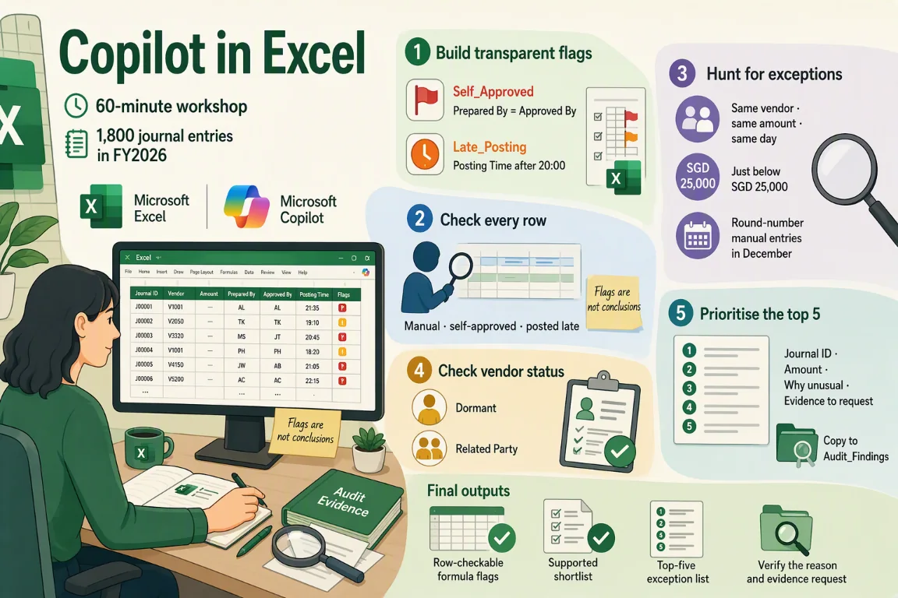

# Session 2: Copilot in Excel — Investigate 1,800 transactions and find exceptions

[Workshop home](../README.md) · **Session 2 of 6** · [← Previous: Word](./01-word.md) · [Next: PowerPoint →](./03-powerpoint.md)

|   |   |
| --- | --- |
| **Time** | 60 minutes: about 35 minutes of hands-on work, plus the story, setup and review |
| **You will produce** | flags you can check row by row; a shortlist of exceptions; a top five with evidence requests |
| **You need** | A Microsoft 365 Copilot licence, Excel, and the sample files for this session |
| **Files** | [`04_Audit_Analytics.xlsx`](../sample-files/04_Audit_Analytics.xlsx)<br>[`05_Corporate_Tax_Computation.xlsx`](../sample-files/05_Corporate_Tax_Computation.xlsx)<br>or the ZIP: [Meridian-Excel-sample-files.zip](../sample-files/session-packs/Meridian-Excel-sample-files.zip) |

> [!IMPORTANT]
> All Meridian names, entities, amounts, transactions, emails, chats and findings are fictional training data. Copilot proposes; the team verifies. This is a training exercise, not audit or tax advice.



## The flow of this session

| # | Stage | What you do |
| --- | --- | --- |
| 1 | Build transparent flags | Try Out 3 · Self_Approved and Late_Posting |
| 2 | Check every row | Try Out 3 · flags are indicators, not conclusions |
| 3 | Hunt for exceptions | Try Out 4 · duplicates, split amounts, round numbers |
| 4 | Check vendor status | Try Out 4 · dormant and related-party vendors |
| 5 | Prioritise the top 5 | Refine · top five with evidence to request |

## The story in three beats

1. **Meridian posted 1,800 journal entries in FY2026.** Start with two transparent flags: Self_Approved and Late_Posting.
2. **Some of them are not what they seem.** Hunt for duplicates, amounts just under a limit and round numbers, then check each vendor.
3. **Flags are indicators, not conclusions.** Prioritise a top five, each with the evidence to request.

## Your role and your job today

You have just joined the engagement team reviewing Meridian’s FY2026 results. Copilot is your assistant.

Meridian posted 1,800 journal entries (lines in its accounting records) in FY2026. Some are not what they seem. Find them.

| You will produce | What good looks like |
| --- | --- |
| Flags you can check row by row | Self_Approved and Late_Posting columns, then a count |
| A shortlist of exceptions | Duplicates, amounts just under a limit, round numbers and vendor flags, each with a reason |
| A top five with evidence requests | Copied into the Audit_Findings sheet, then compared with the answers |

New to Meridian? Read [Meet Meridian](../README.md#meet-meridian) first. It takes two minutes, and every session starts with the same story.

### Words you will meet today

| Word | What it means |
| --- | --- |
| Journal entry | One line in the company’s accounting records, in the General_Ledger sheet. Meridian has 1,800. |
| Manual journal | An entry typed in by a person, not created automatically by a till, online shop or system. |
| Self-approved | The same person prepared and approved the entry, so no second person signed it off. |
| Flag | A marker that says look here. It is a pointer for checking, not proof of anything. |
| Related party | A business closely linked to the company or its leaders. Deals with it get extra checking. |
| Dormant vendor | A supplier marked as inactive. A payment to one needs a good explanation. |

## Step 1 — Which file do you trust?

Two Excel workbooks. Each row says how far to trust it and what to watch for. The second one is an optional stretch.

| Source | Role | How far to trust it | Watch for | Used in |
| --- | --- | --- | --- | --- |
| [`04_Audit_Analytics.xlsx`](../sample-files/04_Audit_Analytics.xlsx) · Audit Analytics | Transaction evidence | The transaction record for the investigation. A training extract, not a full ledger. | Do not reconcile it to the financial statements. It contains a trainer sheet; leave it closed until the lab reveals it. | Try Out 3, Try Out 4 and Refine |
| [`05_Corporate_Tax_Computation.xlsx`](../sample-files/05_Corporate_Tax_Computation.xlsx) · Corporate Tax Computation | Optional stretch | A training tax review that uses simplified fictional assumptions. The calculated values are what the workbook computes. | Fictional simplified assumptions. Not current tax law. Not filing advice. The 2.5 donation multiple and 20% capital-allowance rate are listed but not applied by the formulas. | Optional tax stretch, after the Review |

> [!NOTE]
> Example: in the Financial Controller’s interview notes (a different Meridian file), about 430 manual journals were posted in December. This workbook has 51. Do not pick one. Ask for the full journal listing.

> [!IMPORTANT]
> When two sources disagree, say so. Do not pick one silently.

## Step 2 — Download the Excel workbooks

Two fictional Meridian workbooks, made for practice. Download each file, or take the ZIP.

**DO:** Download `04_Audit_Analytics.xlsx`, or the ZIP with both workbooks. 05 is only for the optional stretch.

> [!NOTE]
> Workbook 04 is also used in the Copilot Chat session. Workbook 05 is only for the optional stretch.

- [04_Audit_Analytics.xlsx](../sample-files/04_Audit_Analytics.xlsx) (XLSX, 207 KB): 1,800 general-ledger transactions, vendors, employees, expenses, budget vs actual and an output sheet for your findings.
- [05_Corporate_Tax_Computation.xlsx](../sample-files/05_Corporate_Tax_Computation.xlsx) (XLSX, 13 KB): Ten tax adjustments with evidence status, a summary tax computation, the training assumptions and a Review_Summary sheet for your conclusions.

Or take them all: [Meridian-Excel-sample-files.zip](../sample-files/session-packs/Meridian-Excel-sample-files.zip).

## Step 3 — Save them in OneDrive, AutoSave on

Copilot in Excel needs the workbook saved in OneDrive or SharePoint with AutoSave on. Make a folder for them.

**DO:** Upload the files to a OneDrive folder called Meridian Excel and turn AutoSave on. The data is already formatted as tables.

> [!NOTE]
> The data is already formatted as tables. Open OneDrive in your browser, create the folder, then upload the files.

## Step 4 — The prompt formula and three habits

A good prompt names a role, a task, a source, a focus, a format, a limit and a check.

**READ:** Read the formula and the three habits. Then spot each part in the Meridian example.

**The prompt formula**

```text
Act as [role]. [Task] using /[file]. Focus on [what matters]. Give me [format]. Keep it [length / tone / audience]. Show where each point comes from.
```

**Example for Meridian**

```text
Act as an audit senior. Summarise the three most significant findings using /03_Audit_Findings_Draft.docx. Focus on financial exposure and evidence still outstanding. Give me 3 bullet points. Keep it under 100 words for the engagement leader. Show where each point comes from.
```

**Three habits**

- Say who it is for, what you want and the format
- Point Copilot at the source file (type / to reference it)
- Always check the answer against the source

Then: **Always ask a follow-up — the first answer is a starting point.**

See the [prompt formula and review questions](../reference.md) for the seven parts, the status labels and the ground rules.

## Step 5 — Explore the workbook

Know the sheets before you ask about them.

**READ:** Open `04_Audit_Analytics.xlsx` in Excel. Skim the sheets and note three things you would check.

> [!NOTE]
> Skim the General_Ledger (the list of journal entries), Vendors, Employees and Expenses sheets. Notice what a flag, a simple Yes or No marker, could be built from.

**General_Ledger · 1,800 rows**

|   | What to notice |
| --- | --- |
| ✓ | Journal ID, dates, vendor, debit, credit, Local Amount |
| ✓ | Source, where the entry came from: POS 475, E-commerce 451, Manual 444, ERP 430 |
| ⚠ | Prepared By and Approved By: are they ever the same person? |
| ⚠ | Posting Time is text, such as 23:48 |
| ⚠ | Local Amount can be negative (a credit) |

**Vendors and Employees**

|   | What to notice |
| --- | --- |
| ✓ | Vendors (suppliers) V0001 to V0010 with Status and Related Party |
| ⚠ | V0005 Meridian Executive Logistics: Related Party Yes |
| ⚠ | V0006 OldTech Supplies: Status Dormant |
| ✓ | Employees E001 to E008 with department and role |

**Expenses and Audit_Findings**

|   | What to notice |
| --- | --- |
| ✓ | Expenses: 220 claims with Receipt and Approver |
| ⚠ | 20 claims have no receipt |
| ⚠ | 24 claims are approved by the person who submitted them |
| ○ | Audit_Findings is empty. It is your output table. |

- ✓ Stated in the file. Quote it exactly.
- ⚠ Worth checking. Ask Copilot, then verify.
- ○ Empty on purpose. You fill it.

## Step 6 — Open Copilot in Excel

Open the workbook, then click Copilot. Copilot already sees the workbook you have open, so there is nothing to select.

**DO:** Open `04_Audit_Analytics.xlsx` in Excel and click Copilot. Copilot already sees the open workbook.

> [!NOTE]
> The workbook must be saved in OneDrive or SharePoint. Check the exact method in your own environment.

## Step 7 — Try Out 3: Flag risky journals

Ask Copilot to add two Yes or No flag columns. Then ask which hand-entered (Manual) journals were approved by the same person who prepared them and posted late.

**Where:** Excel › General_Ledger sheet › Copilot · **Suggested time:** 7 min to do, 4 min to check

**File:** [04_Audit_Analytics.xlsx](../sample-files/04_Audit_Analytics.xlsx)

1. Open `04_Audit_Analytics.xlsx` in Excel, saved in OneDrive with AutoSave on.
2. Select the General_Ledger sheet, then click Copilot.
3. Paste the first prompt and press Send. Then paste the follow-up.

**Prompt**

```text
Add a column called Self_Approved that shows Yes when Prepared By equals Approved By, and a column called Late_Posting that shows Yes when Posting Time is after 20:00.
```

**Follow-up**

```text
How many Manual journals are both self-approved and posted late? List them with Journal ID, Description and Local Amount.
```

**Look for:** Formula columns you can check row by row

> [!NOTE]
> Copilot in Excel works on the table you have open. Check the exact method in your own environment.

### Check the flags

Check the formula columns row by row, then check the count.

**EXAMINE:** Check the Self_Approved and Late_Posting columns row by row. Does your count match the sheet?

**Check**

- [ ] Filter Self_Approved = Yes. Do you get exactly 2 rows, JRN-000002 and JRN-000006?
- [ ] Spot-check five rows. Do Prepared By and Approved By match the flag?
- [ ] JRN-000397 posts at exactly 20:00. Late_Posting should be No.
- [ ] Filter Source = Manual and Late_Posting = Yes. Do you get 41?
- [ ] Late_Posting is also Yes on other sources, such as JRN-000011. Did you count Manual only?
- [ ] Posting Time is text, like 23:48. Does the formula read it correctly?

> [!WARNING]
> Flags are indicators for investigation, not conclusions.

<details>
<summary>Illustrative example (your Copilot answer will differ)</summary>

**Expected answer**

The Manual journal that is both self-approved and posted late is **JRN-000002** (Urgent regional logistics, SGD 99,900).

| Count | What it is |
| --- | --- |
| 2 | self-approved |
| 41 | Manual journals after 20:00 |
| 1 | both self-approved and late |

**Rows worth opening to check the flags**

- JRN-000001
- JRN-000002
- JRN-000003
- JRN-000006
- JRN-000011
- JRN-000397

</details>

## Step 8 — Try Out 4: Hunt for exceptions

Ask for unusual transactions. Then ask Copilot to look up each vendor in the Vendors sheet.

**Where:** Excel › General_Ledger sheet › Copilot · **Suggested time:** 8 min to do, 4 min to check

**File:** [04_Audit_Analytics.xlsx](../sample-files/04_Audit_Analytics.xlsx)

1. Stay in `04_Audit_Analytics.xlsx` on the General_Ledger sheet.
2. Click Copilot to open the Copilot pane.
3. Paste the first prompt and press Send. Then paste the follow-up.

**Prompt**

```text
Find transactions that look unusual: the same amount paid to the same vendor on the same day, amounts just below SGD 25,000, and round-number manual entries in December. Explain why each one is unusual.
```

**Follow-up**

```text
Look up each Vendor ID in the Vendors sheet and flag payments to vendors that are Dormant or a Related Party.
```

**Look for:** A shortlist of exceptions with a reason for each — verify before you trust it

> [!NOTE]
> It is easy to flag too much. Keep the Vendors sheet open.

### Verify the shortlist

Verify every item. Then filter by amount and pattern before you trust the vendor flags.

**EXAMINE:** Verify each exception against the sheet. Then filter the vendor flags by amount and pattern.

**Check**

- [ ] Filter by Journal ID. Does each journal match its row in the sheet?
- [ ] Add the three 24,950 amounts. Do they total 74,850?
- [ ] Round-number rows: only Manual entries in December (51 in total)?
- [ ] Count the journals each vendor flag matches. Is that list usable?
- [ ] Filter by amount first. Which flagged rows are above SGD 25,000?
- [ ] JRN-000922 (24,548.54) is also just below 25,000. Is it a pattern?

> [!WARNING]
> A flag on a vendor is not a finding. Filter by amount and pattern, then verify.

<details>
<summary>Illustrative example (your Copilot answer will differ)</summary>

**Journals the three patterns should surface**

- JRN-000001
- JRN-000003
- JRN-000004
- JRN-000005
- JRN-000008
- JRN-000009
- JRN-000010

**Shortlist by pattern**

| Pattern | Journals | Amount (SGD) | Why it stands out |
| --- | --- | --- | --- |
| Same vendor, same day, same amount | JRN-000008, JRN-000009 | 100,000 each | V0007, 15 Dec, posted at 23:01 and 23:03 |
| Just below SGD 25,000 | JRN-000003 to JRN-000005 | 24,950 each · 74,850 | V0001, 28 Dec, two minutes apart |
| Round-number Manual entries in December | JRN-000001, 000008, 000009, 000010 | 1,250,000 · 100,000 · 100,000 · 450,000 | Posted by hand: 4 of the 51 Manual journals in December |

**Vendor flags**

| Journal | Vendor | Flag | Amount (SGD) | Note |
| --- | --- | --- | --- | --- |
| JRN-000002 | V0005 Meridian Executive Logistics | Related Party: Yes | 99,900 | Prepared and approved by E001, posted 22:55 |
| JRN-000010 | V0006 OldTech Supplies | Status: Dormant | 450,000 | Manual, posted 30 Dec at 20:15 |

_Noise to filter out:_ The lookup alone matches 101 journals for V0005 and 112 for V0006, mostly small. Over SGD 25,000: JRN-000002, JRN-000875 (V0005); JRN-000010, JRN-001470 (V0006).

</details>

## Step 9 — Optional stretch: Expenses duplicates

Not in the main path. Use spare time to test the same idea on the Expenses sheet.

**TRY:** Optional. Open the Expenses sheet, click Copilot and paste the stretch prompt.

> [!NOTE]
> The same checks apply: a duplicate or a self-approval is a warning sign, not proof.

**Check**

- [ ] Filter by Claim ID. Are EXP-00001 and EXP-00002 the same cost?
- [ ] Does EXP-00002 have a receipt and a different approver?
- [ ] Filter Approver = Employee ID. Do you get 24 claims?
- [ ] JRN-000006 has the same date and amount. Same cost? Do not add them.

> [!WARNING]
> Duplicates and self-approval are indicators. Ask for receipts and the business purpose.

<details>
<summary>Illustrative example</summary>

**Prompt to adapt:** Find duplicate claims and claims approved by the person who submitted them.

- EXP-00001 and EXP-00002: same employee (E007), same vendor (V0008), same amount (18,420), both dated 15 Nov 2026.
- 24 claims are self-approved. Largest: EXP-00001 (18,420, no receipt). Next: EXP-00180 (4,043.78).

</details>

## Step 10 — Refine: Prioritise your top 5

Mandatory. Ask Copilot for your top five exceptions, then copy them into the Audit_Findings sheet.

**Where:** Excel › Audit_Findings sheet › Copilot · **Suggested time:** 6 min to do, 3 min to check · **Mandatory**

**File:** [04_Audit_Analytics.xlsx](../sample-files/04_Audit_Analytics.xlsx)

1. Open the Audit_Findings sheet in `04_Audit_Analytics.xlsx`.
2. Click Copilot to open the Copilot pane.
3. Paste the Refine prompt and press Send. Then copy your top 5 into the sheet.

**Refine prompt**

```text
Summarise my top 5 exceptions by priority with Journal ID, amount, why it is unusual and the evidence we should request.
```

**Follow-up**

```text
Copy your top 5 into the Audit_Findings sheet and compare with the answers revealed by your instructor.
```

**Look for:** A reason and an evidence request for every item you keep

> [!NOTE]
> Refine is where a long list becomes five items you can defend.

### Check, then reveal the answers

Mandatory. Check your top five. Open the Trainer_Answer_Key sheet only when your list is done.

**EXAMINE:** Mandatory. Check your top 5, then open the Trainer_Answer_Key sheet and explain every difference.

**Check**

- [ ] Does every row have a reason and an evidence request?
- [ ] Do the amounts match the sheet? Check 8 + 9, and 3 to 5.
- [ ] Is the order your decision? Copilot only proposes it.
- [ ] Does the wording say “unusual”, not that someone did wrong?

> [!WARNING]
> The answers are a comparison, not a verdict. Keep a reason and an evidence request for every item you choose.

<details>
<summary>Answer key: open it only when your own list is done</summary>

**Top five exceptions (answer key)**

| Priority | Journal | Issue | Amount (SGD) | Why it is unusual | Evidence to request |
| --- | --- | --- | --- | --- | --- |
| High | JRN-000001 | Year-end online sales adjustment, marked as reversed | 1,250,000 | Round amount, posted 31 Dec at 23:48, Reversal = Yes | Sales support and why it was reversed |
| High | JRN-000010 | Payment to V0006 OldTech Supplies, a dormant vendor | 450,000 | Dormant vendor, round amount, Manual, posted 30 Dec at 20:15 | Why the vendor was used, invoice and approval |
| High | JRN-000008, JRN-000009 | Same vendor, same day, same amount (V0007) | 200,000 | Two 100,000 entries on 15 Dec, two minutes apart | Invoices, scope of work and a duplicate check |
| High | JRN-000002 | Related-party vendor V0005, self-approved, posted late | 99,900 | Prepared and approved by E001, posted at 22:55 | Contract, pricing support and approval |
| Medium | JRN-000003 to JRN-000005 | Three entries just below SGD 25,000 (V0001) | 74,850 | Each 24,950, same day (28 Dec), two minutes apart | Purchase order, contract and combined approval |

</details>

## Step 11 — Review: The six questions

Mandatory. Run your final result through the same six questions every time.

**EXAMINE:** Mandatory. Run your final result through the six questions and mark each one.

| Dimension | Question | In this session |
| --- | --- | --- |
| Source | Did the learner use the correct controlling file or mock content record? | The flags and the shortlist came from `04_Audit_Analytics.xlsx`, not from memory. |
| Evidence | Can each fact, number, owner, date, and conclusion be traced to the source? | Every journal ID, amount and time matches a row in the sheet. |
| Status | Are confirmed, inferred, assumed, conflicting, and unresolved points distinguished? | Flags are indicators. Mark what is confirmed in the data and what is unresolved. |
| Audience | Is the result suitable for the intended engagement leader, CFO, Finance Director, or team? | The top five is written for the engagement leader: priority, amount, reason. |
| Action | Does the output identify the decision, evidence request, owner, due date, or next step? | Each exception names the evidence to request. |
| Professional boundary | Does the result avoid an audit opinion, tax advice, unsupported approval, or invented completion claim? | No conclusion that anyone did something wrong. No audit opinion. |

> [!IMPORTANT]
> Completing the checks does not approve the result. A person decides.

## Step 12 — Optional stretch: Classify the tax adjustments

Not in the main path. Click each tax adjustment, pick how you would treat it, then compare it with the workbook.

**TRY:** Optional. Click each adjustment, classify it, then compare with the workbook.

> [!NOTE]
> Fictional simplified assumptions. Not current tax law. Not filing advice.

> [!WARNING]
> Fictional simplified assumptions. Not current tax law. Not filing advice.

**Suggested prompt** (not from the course pack)

```text
Act as an audit senior. In the Tax_Adjustments sheet, list the items whose Evidence Status is not Provided, with the evidence still needed and the row each comes from. Say these are training assumptions, not tax advice.
```

<details>
<summary>Illustrative example</summary>

**Tax_Adjustments sheet (SGD, training assumptions)**

| Item | Accounting amount | Proposed treatment | Evidence required | Evidence status | Adjustment |
| --- | --- | --- | --- | --- | --- |
| Accounting profit before tax | 5,500,000 | Starting point | Audited trial balance | Provided | 0 |
| Book depreciation | 1,200,000 | Add back | Fixed asset register | Provided | 1,200,000 |
| Capital allowances | -980,000 | Deduct | Capital allowance schedule | Draft only | -980,000 |
| Client entertainment | 310,000 | Add back 50% | Receipts, purpose, attendee list | Incomplete | 155,000 |
| Regulatory penalties | 85,000 | Add back 100% | Notices and payment proof | Provided | 85,000 |
| Approved donation | -225,000 | Enhanced deduction | Donation receipt | Provided | -225,000 |
| Related-party logistics fee | 640,000 | No adjustment pending support | Agreement, benefit evidence, benchmarking | Missing | 0 |
| General inventory provision | 440,000 | Add back pending specificity | Ageing, write-down policy, SKU analysis | Incomplete | 440,000 |
| Unrealized foreign exchange gain | -180,000 | No adjustment assumed | FX calculation | Provided | 0 |
| Qualifying digital development cost | -300,000 | Enhanced deduction assumption | Project records and staff time | Incomplete | -300,000 |
| Tax losses brought forward | -520,000 | Deduct subject to conditions | Prior assessments, ownership test | Provided | -520,000 |

</details>

## Step 13 — Optional stretch: Follow the tax computation

Follow the numbers from accounting profit to the tax figure, and see where each one comes from.

**READ:** Optional. Read the Tax_Computation sheet and follow the training tax credit from 910,350 to 835,350.

> [!NOTE]
> The training tax credit explains the gap between 910,350 and 835,350.

**Check**

- [ ] Does the answer show the 75,000 training tax credit? Without it, the tax is 910,350, not 835,350.
- [ ] The Assumptions sheet lists a 2.5 donation multiple and a 20% capital-allowance rate, but the formulas do not apply them. The donation and digital development cost are deducted at 100%, and capital allowances are only a draft figure. Verify any Copilot recalculation against the Tax_Computation sheet.

<details>
<summary>Illustrative example</summary>

**Tax_Computation sheet**

| Line | Value |
| --- | --- |
| Accounting profit before tax | 5,500,000 |
| Net tax adjustments | -145,000 |
| Estimated chargeable income | 5,355,000 |
| Training tax rate | 17% |
| Estimated tax before credits | 910,350 |
| Less: training tax credit | -75,000 |
| Estimated current tax | 835,350 |
| Effective tax rate | 15.19% |

_Net tax adjustments:_ 1,200,000 − 980,000 + 155,000 + 85,000 − 225,000 + 440,000 − 300,000 − 520,000

</details>

## Step 14 — Optional stretch: Write the review points

Write a conclusion and a next action for the four areas where evidence is incomplete.

**TRY:** Optional. Open Review_Summary and click Copilot. Paste the prompt, then write your own review points.

> [!NOTE]
> A review point names the evidence still needed. It is not a tax opinion.

**Suggested prompt** (not from the course pack)

```text
Act as an audit senior. In Review_Summary, draft a conclusion and next action for each area, naming the evidence still needed. No tax opinion: these are training assumptions.
```

**Check**

- [ ] The 640,000 related-party fee in this file is a different figure from the 99,900 related-party invoice in `04_Audit_Analytics.xlsx` and `06_Supporting_Documents.pdf`. Do not equate them.
- [ ] Does each conclusion say what evidence is still needed, and avoid a tax opinion?
- [ ] Does each next action have an owner and a date you can add?

<details>
<summary>Illustrative example</summary>

**Review_Summary: example conclusions**

| Area | Priority | Observation | Conclusion and next action |
| --- | --- | --- | --- |
| Related-party services | High | Agreement and benchmarking missing | Treatment unconfirmed while the evidence is missing. Request the agreement, evidence of benefit and benchmarking. |
| Inventory provision | Medium | Specific SKU support incomplete | The 440,000 add-back stays until support is specific. Request the ageing, write-down policy and SKU analysis. |
| Entertainment | Medium | Receipts and attendee evidence incomplete | 155,000 is added back. Support is incomplete. Request receipts, business purpose and attendee list. |
| Digital development | Medium | Project and staff-time evidence incomplete | The 300,000 deduction is not yet supported. Request project records and staff-time records. |

</details>

## What you learned today

Five skills you can use on Monday, and three habits to keep.

| Skill | Where you practised it |
| --- | --- |
| Flag risky journals with formulas | Try Out 3: Self_Approved and Late_Posting columns you can check row by row |
| Count what matters, then verify | Try Out 3 follow-up: Manual journals that are both self-approved and late |
| Hunt for exceptions | Try Out 4: duplicates, amounts just under a limit, round numbers and vendor flags |
| Separate signal from noise | Filter by amount and pattern before you trust a vendor lookup |
| Prioritise and request evidence | Refine: a top five with a reason and an evidence request for each |

**Three habits to keep**

- **Check against the source.** Every figure, name, owner and date must trace to a file.
- **Keep the gaps visible.** Mark what is inferred, assumed, conflicting or unresolved.
- **The team decides.** Copilot proposes. A person makes the final call.

**Think about it:** Which spreadsheet at work could you test with a flag column, and check row by row, this week?

## Microsoft Learn references

- <https://learn.microsoft.com/microsoft-365/copilot/>
- <https://learn.microsoft.com/microsoft-365/copilot/release-notes-archive#march,-2024>

> [!NOTE]
> Copilot menus and button names change often. When a step says to check in your own environment, follow your tenant’s current behaviour.

[Workshop home](../README.md) · **Session 2 of 6** · [← Previous: Word](./01-word.md) · [Next: PowerPoint →](./03-powerpoint.md)
