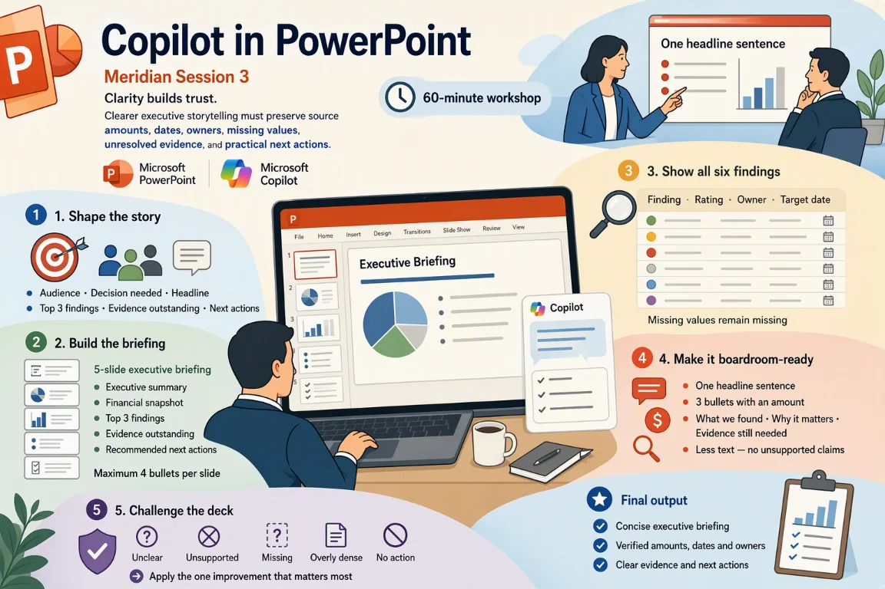

# Session 3: Copilot in PowerPoint — Build an executive briefing for leadership

[Workshop home](../README.md) · **Session 3 of 6** · [← Previous: Excel](./02-excel.md) · [Next: Outlook →](./04-outlook.md)

|   |   |
| --- | --- |
| **Time** | 60 minutes: about 35 minutes of hands-on work, plus the story, setup and review |
| **You will produce** | a five-slide executive briefing; a boardroom-ready message; a challenged deck |
| **You need** | A Microsoft 365 Copilot licence, PowerPoint, and the sample files for this session |
| **Files** | [`01_Client_Background.docx`](../sample-files/01_Client_Background.docx)<br>[`03_Audit_Findings_Draft.docx`](../sample-files/03_Audit_Findings_Draft.docx)<br>[`06_Supporting_Documents.pdf`](../sample-files/06_Supporting_Documents.pdf)<br>or the ZIP: [Meridian-PowerPoint-sample-files.zip](../sample-files/session-packs/Meridian-PowerPoint-sample-files.zip) |

> [!IMPORTANT]
> All Meridian names, entities, amounts, transactions, emails, chats and findings are fictional training data. Copilot proposes; the team verifies. This is a training exercise, not audit or tax advice.



## The flow of this session

| # | Stage | What you do |
| --- | --- | --- |
| 1 | Shape the story | Audience, decision needed, headline |
| 2 | Build the briefing | Try Out 5 · five slides, four bullets at most |
| 3 | Show all six findings | Try Out 5 follow-up · the findings table |
| 4 | Make it boardroom-ready | Try Out 6 · CFO headline, related-party slide |
| 5 | Challenge the deck | Refine · a sceptical board member |

## The story in three beats

1. **Senior management wants a short briefing.** Shape the story first: who it is for, the decision needed and the headline.
2. **The findings are in the file, all six of them.** Build five slides and a table that keeps every missing value visible.
3. **Then the deck has to survive the boardroom.** Lead with amounts, add the related-party slide, then challenge the deck.

## Your role and your job today

You have just joined the engagement team reviewing Meridian’s FY2026 results. Copilot is your assistant.

Senior management wants a short briefing on the engagement status and the matters that need their attention. Turn the findings into a clear executive presentation.

| You will produce | What good looks like |
| --- | --- |
| A five-slide executive briefing | Four bullets at most per slide, plus a table of all six findings |
| A boardroom-ready message | A CFO headline with amounts, and a related-party slide with its evidence gaps |
| A challenged deck | A sceptical board member reviews it, then you apply the one improvement that matters most |

New to Meridian? Read [Meet Meridian](../README.md#meet-meridian) first. It takes two minutes, and every session starts with the same story.

### Words you will meet today

| Word | What it means |
| --- | --- |
| Executive briefing | A short deck for leaders. A few slides, one clear message each. |
| Finding | A problem the team spotted, written up: what happened, why it matters, what to do. |
| Rating | How serious a finding is: High, Medium or Low. Some are blank in the draft. |
| Owner and target date | The person who will fix a finding, and the day they promise to do it. |
| Related party | A person or company linked to Meridian, so deals with them need extra care. |
| Speaker notes | Private words under a slide that help the presenter. The audience does not see them. |

## Step 1 — Which file do you trust?

Three files: two Word documents and one PDF. Each is trusted for a different thing, and each has a warning.

| Source | Role | How far to trust it | Watch for | Used in |
| --- | --- | --- | --- | --- |
| [`01_Client_Background.docx`](../sample-files/01_Client_Background.docx) · Client Background | Controls the client facts | The controlling record for facts about Meridian: group, FY2026 figures (unaudited), events and objectives. | The document says it intentionally contains some inconsistencies. | Try Out 6 |
| [`03_Audit_Findings_Draft.docx`](../sample-files/03_Audit_Findings_Draft.docx) · Audit Findings Draft | Draft to improve | A working draft. Ratings, recommendations, owners and dates are missing on some findings. | Draft: deliberately vague or incomplete. The executive summary is left for you to write. | Try Out 5 |
| [`06_Supporting_Documents.pdf`](../sample-files/06_Supporting_Documents.pdf) · Supporting Documents | Evidence to check against | Supporting evidence. Some pages are incomplete, so gaps are findings too. | Training extract: a count sheet with missing initials, an invoice with no PO, no related-party declaration shown. | Try Out 6 |

> [!NOTE]
> Example: `03_Audit_Findings_Draft.docx` gives F-01 a target date of 15 Feb 2027, owned by the Finance Director. `06_Supporting_Documents.pdf` (ER-01) asks Finance for dispatch evidence by 10 Feb. Do not pick one. Show both, and ask.

> [!IMPORTANT]
> When two files disagree, say so. Do not pick one silently.

## Step 2 — Download the three files

Fictional Meridian files, made for practice. Download each file, or take them all.

**DO:** Download the three files, or the ZIP with all three, to your computer.

> [!NOTE]
> The files are the same ones every Meridian session uses.

- [01_Client_Background.docx](../sample-files/01_Client_Background.docx) (DOCX, 30 KB): Company, group structure, FY2026 financials, events, prior-year findings, objectives and training questions.
- [03_Audit_Findings_Draft.docx](../sample-files/03_Audit_Findings_Draft.docx) (DOCX, 30 KB): Six draft findings (F-01 to F-06), some vague or incomplete, a management-response area and a quality checklist.
- [06_Supporting_Documents.pdf](../sample-files/06_Supporting_Documents.pdf) (PDF, 14 KB): Invoices, hotel receipt, bank extract, inventory count sheet and evidence request list.

Or take them all: [Meridian-PowerPoint-sample-files.zip](../sample-files/session-packs/Meridian-PowerPoint-sample-files.zip).

## Step 3 — Save all three in OneDrive

Copilot can only read files saved in OneDrive or SharePoint. Make a folder for them.

**DO:** Upload the three files to a OneDrive folder called Meridian PowerPoint.

> [!NOTE]
> Open OneDrive in your browser, create the folder, then upload or drag the three files into it.

## Step 4 — The prompt formula and three habits

A good prompt names a role, a task, a source, a focus, a format, a limit and a check.

**READ:** Read the formula and the three habits. Then spot each part in the Meridian example.

**The prompt formula**

```text
Act as [role]. [Task] using /[file]. Focus on [what matters]. Give me [format]. Keep it [length / tone / audience]. Show where each point comes from.
```

**Example for Meridian**

```text
Act as an audit senior. Summarise the three most significant findings using /03_Audit_Findings_Draft.docx. Focus on financial exposure and evidence still outstanding. Give me 3 bullet points. Keep it under 100 words for the engagement leader. Show where each point comes from.
```

**Three habits**

- Say who it is for, what you want and the format
- Point Copilot at the source file (type / to reference it)
- Always check the answer against the source

Then: **Always ask a follow-up — the first answer is a starting point.**

See the [prompt formula and review questions](../reference.md) for the seven parts, the status labels and the ground rules.

## Step 5 — Explore the findings and the evidence

Know the sources before you build slides from them.

**READ:** Open `03_Audit_Findings_Draft.docx` and `06_Supporting_Documents.pdf`. Note what is given, what is doubtful and what is missing.

> [!NOTE]
> Notice what the draft leaves open. A slide must not fill a gap with a guess.

**03 · Findings F-01 to F-06** — [03_Audit_Findings_Draft.docx](../sample-files/03_Audit_Findings_Draft.docx)

|   | What to notice |
| --- | --- |
| ✓ | F-01, F-03 and F-06 are rated High |
| ✓ | F-01: SGD 1.25m journal, reversed 3 January |
| ⚠ | F-04 is Medium; inventory up 42.8% |
| ⚠ | Management responses disagree or are brief |

**03 · What the draft leaves open** — [03_Audit_Findings_Draft.docx](../sample-files/03_Audit_Findings_Draft.docx)

|   | What to notice |
| --- | --- |
| ○ | Rating missing on F-02 and F-05 |
| ○ | Recommendation missing on F-03 |
| ○ | Owner and date missing on F-04 |
| ○ | F-02 target date missing |

**06 · Supporting documents** — [06_Supporting_Documents.pdf](../sample-files/06_Supporting_Documents.pdf)

|   | What to notice |
| --- | --- |
| ✓ | Invoice MEL-261231: SGD 99,900 |
| ⚠ | Related-party declaration: not shown |
| ⚠ | Harbour Legal HL-88310: no purchase order |
| ○ | ER-01 to ER-06: Open or Partial |

- ✓ Stated in the file. Quote it exactly.
- ⚠ Worth checking. Ask Copilot, then verify.
- ○ Missing. Leave it visible.

## Step 6 — Open Copilot in PowerPoint and find your file

Start a presentation, click Copilot, and type a forward slash to reference a file.

**DO:** Start a presentation in PowerPoint, click Copilot, then type / to see how you reference a file.

> [!NOTE]
> The files must be saved in OneDrive or SharePoint. Check the exact method in your own environment.

## Step 7 — Try Out 5: Build the executive briefing

Ask Copilot for a five-slide briefing from the findings draft, then for a table of all six findings.

**Where:** PowerPoint › New presentation › Copilot · **Suggested time:** 7 min to do, 4 min to check

**File:** [03_Audit_Findings_Draft.docx](../sample-files/03_Audit_Findings_Draft.docx)

1. Start a new presentation in PowerPoint, saved in OneDrive.
2. Click Copilot to open the Copilot pane.
3. Paste prompt 5 and press Send. Then paste the follow-up.

**Prompt**

```text
Create a 5-slide executive briefing for Meridian Retail Group's leadership from /03_Audit_Findings_Draft.docx. Slides: Executive summary, Financial snapshot, Top 3 findings, Evidence outstanding, Recommended next actions. Maximum 4 bullets per slide.
```

**Follow-up**

```text
Add a slide with a table of all six findings showing Finding, Rating, Owner and Target date.
```

**Look for:** Amounts and dates match the source document

> [!NOTE]
> Copilot in PowerPoint builds from the file you reference. Check the exact method in your own environment.

### Check the five slides

Match every amount and date on every slide to `03_Audit_Findings_Draft.docx`. Four bullets at most per slide.

**EXAMINE:** Check every amount and date on the five slides against `03_Audit_Findings_Draft.docx`.

**Check**

- [ ] Do the amounts and dates match `03_Audit_Findings_Draft.docx`?
- [ ] Are the three High findings the ones `03_Audit_Findings_Draft.docx` rates High?
- [ ] Four bullets or fewer on every slide?
- [ ] Is any figure not in `03_Audit_Findings_Draft.docx`? Trace it or remove it.

> [!WARNING]
> `03_Audit_Findings_Draft.docx` has no revenue or profit totals. If a slide shows them, check them in `01_Client_Background.docx` §4.

<details>
<summary>Illustrative example (your Copilot answer will differ)</summary>

**Slide 1 · Executive summary** — source: 03 · findings table

- Six draft findings; three rated High
- SGD 1.25m manual revenue journal, reversed 3 January
- Evidence outstanding on all three High findings
- No management action agreed in the draft

**Slide 2 · Financial snapshot** — source: 03 · F-01, F-04, F-05

- SGD 1.25m journal: posted 31 December, reversed 3 January
- Inventory up 42.8% year over year
- Three bank reconciliations with items over 90 days old
- No other finding has an amount

**Slide 3 · Top 3 findings** — source: 03 · F-01, F-03, F-06

- F-01 Revenue cut-off: SGD 1.25m journal posted 31 December. High
- F-03 Journal approvals: workflow down four days; email approvals used. High
- F-06 Related-party logistics: no signed contract initially available. High

**Slide 4 · Evidence outstanding** — source: 03 · conditions, comments

- F-01: dispatch evidence not in the initial file
- F-03: complete list of approvals not provided
- F-06: signed contract not initially available
- F-04: ageing and post-year-end sales requested

**Slide 5 · Recommended next actions** — source: 03 · recommendations

- F-01 · Finance Director · 15 Feb 2027: obtain dispatch evidence
- F-06 · Finance Director · 12 Feb 2027: obtain contract, pricing, approval
- F-03 · Financial Controller · 10 Feb 2027: **[recommendation missing]**
- F-04: ageing and value review; **[owner and date missing]**

</details>

### Check the findings table

A missing rating, owner or date must stay visible as missing.

**EXAMINE:** Compare the table with `03_Audit_Findings_Draft.docx`. Missing ratings, owners and dates must stay missing.

**Check**

- [ ] Are the ratings for F-02 and F-05 still missing?
- [ ] Is the owner for F-04 still missing?
- [ ] Are the target dates for F-02 and F-04 still missing?
- [ ] Did Copilot fill a gap with a guess?

> [!WARNING]
> The board meets on 20 Feb 2027. `03_Audit_Findings_Draft.docx` gives F-05 a target date of 28 Feb 2027. Flag the conflict. Do not change the date.

<details>
<summary>Illustrative example (your Copilot answer will differ)</summary>

**All six findings**

| Finding | Rating | Owner | Target date |
| --- | --- | --- | --- |
| F-01 Year-end revenue cut-off | High | Finance Director | 15 Feb 2027 |
| F-02 User access termination | _missing_ | IT Manager | _missing_ |
| F-03 Manual journal approvals | High | Financial Controller | 10 Feb 2027 |
| F-04 Slow-moving inventory review | Medium | _missing_ | _missing_ |
| F-05 Bank reconciliation ageing | _missing_ | Treasury Lead | 28 Feb 2027 |
| F-06 Related-party logistics arrangement | High | Finance Director | 12 Feb 2027 |

</details>

## Step 8 — Try Out 6: Make it boardroom-ready

Rewrite the summary slide for a busy CFO, then add a related-party slide from the supporting documents.

**Where:** PowerPoint › your new deck › Copilot · **Suggested time:** 8 min to do, 4 min to check

**Reference these files in your prompt (type / and pick each one):** [01_Client_Background.docx](../sample-files/01_Client_Background.docx), [06_Supporting_Documents.pdf](../sample-files/06_Supporting_Documents.pdf)

1. Open the deck you built in Try Out 5.
2. Click Copilot to open the Copilot pane.
3. Paste prompt 6 and press Send. Then paste the follow-up.

**Prompt**

```text
Rewrite the Executive summary slide for a busy CFO: one headline sentence and three bullets that each include an amount.
```

**Follow-up**

```text
Add a slide about the related-party logistics arrangement using /06_Supporting_Documents.pdf: what we found, why it matters, and what evidence we still need.
```

**Look for:** Less text, clearer message — and nothing Copilot invented

> [!NOTE]
> Less text must not mean more claims. The PDF is the evidence.

### Check the two slides

Check the amounts on the CFO slide and the evidence behind the related-party slide.

**EXAMINE:** Check each amount against the three files. Did Copilot invent anything?

**Check**

- [ ] One headline sentence and three bullets, each with an amount?
- [ ] Do all four amounts match `01_Client_Background.docx`, `03_Audit_Findings_Draft.docx` and `06_Supporting_Documents.pdf`?
- [ ] Does the slide still say the declaration is not shown?
- [ ] Did Copilot invent a contract, an approval or a price comparison?

> [!WARNING]
> `06_Supporting_Documents.pdf` shows no contract and no approval. If the slide says approved, signed or fairly priced, remove it.

<details>
<summary>Illustrative example (your Copilot answer will differ)</summary>

**Slide 1 · Executive summary** _(Rewritten for the CFO)_ — source: 01 §4 · 03 F-01, F-04 · 06 A

**Revenue grew 20.1% to SGD 151.8m, but profit before tax fell 28.6% to SGD 5.5m.**

- SGD 1.25m journal posted 31 December, reversed 3 January: dispatch evidence outstanding
- Inventory up 42.8% to SGD 29.7m: slow-moving report not reviewed since September
- SGD 99,900 logistics invoice dated 31 December: related-party declaration not shown

**Slide 7 · Related-party logistics arrangement** _(New slide)_ — source: 06 A, F · 03 F-06 · 01 §3

| Part | Status | Text |
| --- | --- | --- |
| What we found | ✓ Confirmed | Invoice MEL-261231, Meridian Executive Logistics: SGD 99,900 (74,900 + 25,000), dated 31 December 2026. Related-party declaration: **[not shown]**. |
| Why it matters | ≈ Inferred | F-06 notes the risk of incomplete disclosure and non-arm’s-length pricing. Payments above SGD 25,000 need two approvers. |
| Evidence we still need | … Unresolved | Declaration, signed contract, pricing comparison and approval evidence (F-06). ER-02: Finance Director, due 12 Feb, Open. |

</details>

## Step 9 — Optional stretch: Speaker notes under 60 words

Not in the main path. Use spare time to add speaker notes to every slide.

**TRY:** Optional. Ask Copilot for speaker notes under 60 words per slide, and check them against the slides.

> [!NOTE]
> Notes should say what the slide says, in the speaker’s voice. They must not add facts.

**Your task:** Add speaker notes to every slide, under 60 words each.

**Check**

- [ ] Is every note under 60 words?
- [ ] Does each note say only what its slide says?
- [ ] Did a note add a fact that is not on the slide or in a file?
- [ ] Is each note something you could say aloud in your own voice?

> [!TIP]
> Write your own prompt with the formula: role, task, source, focus, format, length, and “show where each point comes from”.

<details>
<summary>Illustrative example</summary>

**Slide 1 · Executive summary**

**Revenue grew 20.1% to SGD 151.8m, but profit before tax fell 28.6% to SGD 5.5m.**

- SGD 1.25m revenue journal: evidence outstanding
- Inventory up 42.8% to SGD 29.7m
- SGD 99,900 invoice: declaration not shown

**Speaker notes (50 words)**

> Revenue is up 20.1% to SGD 151.8m, but profit before tax is down 28.6% to SGD 5.5m. Three matters need attention: the SGD 1.25m revenue journal, the 42.8% rise in inventory and the SGD 99,900 invoice with no declaration shown. The FY2026 figures are unaudited, and evidence is still outstanding.

</details>

## Step 10 — Refine: Challenge your deck

Mandatory. Ask Copilot to review the deck as a sceptical board member, then apply the one improvement that matters most.

**Where:** PowerPoint › your briefing deck › Copilot · **Suggested time:** 6 min to do, 3 min to check · **Mandatory**

**File:** [03_Audit_Findings_Draft.docx](../sample-files/03_Audit_Findings_Draft.docx)

1. Open your executive briefing deck from Try Outs 5–6.
2. Click Copilot to open the Copilot pane.
3. Paste the Refine prompt and press Send. Then paste the follow-up.

**Refine prompt**

```text
Review this presentation as a sceptical board member. What is unclear, unsupported or missing? Suggest three improvements.
```

**Follow-up**

```text
Apply the one improvement that matters most.
```

**Look for:** Did you record the one improvement you applied, and why it helps the board decide?

> [!NOTE]
> Refine is where a first deck becomes a checked deck.

### Check the challenge

Mandatory. Choose one improvement, record why it matters, and apply it.

**EXAMINE:** Mandatory. Pick the one improvement that matters most, apply it and write down why.

**Check**

- [ ] Which one did you apply, and why?
- [ ] Does each suggestion trace to a file?
- [ ] Did the change touch only that slide?
- [ ] Are amounts and dates still as in the source?

> [!WARNING]
> Write down the one you applied and why it helps the board decide. Copilot’s review is a proposal: check the whole deck again.

<details>
<summary>Illustrative example (your Copilot answer will differ)</summary>

**Unclear**

| Point | Status | Source |
| --- | --- | --- |
| Amount at risk: only SGD 1.25m (F-01) has a figure | … Unresolved | Slides 1–3 |
| Who owns each piece of evidence, and by when? | … Unresolved | Slide 4 |

**Unsupported**

| Point | Status | Source |
| --- | --- | --- |
| The title says related-party; the invoice shows no declaration | ? Assumed | Slide 7 |
| Two CFO bullets rest on draft findings only | ? Assumed | Slide 1 |

**Missing**

| Point | Status | Source |
| --- | --- | --- |
| Ratings, owners and dates left blank on the findings table | … Unresolved | Slide 6 |
| Which evidence requests are open, and which are partial | … Unresolved | Slide 4 |
| The decision the board is asked to make | … Unresolved | Slide 5 |

**Three improvements · apply the one that matters most**

| Part | Text |
| --- | --- |
| 1 · Show who owns the evidence | Add an owner and due date to each item (06 §F: ER-01 to ER-06, due 8–14 Feb). |
| 2 · Keep the gaps visible | Mark blanks as missing. Flag F-05: 28 Feb 2027 is after the 20 Feb board. |
| 3 · Say what is not yet known | Show only SGD 1.25m as an amount. Keep “declaration not shown” on slide 7. |

</details>

## Step 11 — Review: The six questions

Mandatory. Run your final deck through the same six questions every time.

**EXAMINE:** Mandatory. Run your final deck through the six questions and mark each one.

| Dimension | Question | In this session |
| --- | --- | --- |
| Source | Did the learner use the correct controlling file or mock content record? | The deck came from `03_Audit_Findings_Draft.docx`, `01_Client_Background.docx` and `06_Supporting_Documents.pdf`, not from memory. |
| Evidence | Can each fact, number, owner, date, and conclusion be traced to the source? | Every amount, rating, owner and date has a file and a place. |
| Status | Are confirmed, inferred, assumed, conflicting, and unresolved points distinguished? | Chips are on: confirmed, inferred, assumed, conflicting, unresolved. Missing stays missing. |
| Audience | Is the result suitable for the intended engagement leader, CFO, Finance Director, or team? | Written for leadership: short, plain, four bullets at most per slide. |
| Action | Does the output identify the decision, evidence request, owner, due date, or next step? | It shows the evidence still needed, the owner and the date, or says it is missing. |
| Professional boundary | Does the result avoid an audit opinion, tax advice, unsupported approval, or invented completion claim? | No audit opinion, no “approved”, no completion claim. |

> [!IMPORTANT]
> Completing the checks does not approve the deck. A person decides.

## What you learned today

Five skills you can use on Monday, and three habits to keep.

| Skill | Where you practised it |
| --- | --- |
| Turn findings into an executive story | Try Out 5: five slides, four bullets at most on each |
| Add a table that keeps the gaps visible | Try Out 5 follow-up: a missing rating, owner or date stays missing |
| Rewrite a summary for a busy CFO | Try Out 6: one headline sentence, three bullets, an amount in each |
| Add a slide with evidence behind it | Try Out 6 follow-up: what we found, why it matters, what we still need |
| Challenge your own deck | Refine: a sceptical board member, three improvements, apply the best one |

**Three habits to keep**

- **Check against the source.** Every figure, name, owner and date must trace to a file.
- **Keep the gaps visible.** Mark what is inferred, assumed, conflicting or unresolved.
- **The team decides.** Copilot proposes. A person makes the final call.

**Think about it:** Which update could you send this week that a sceptical board member would test, and which gap would they find first?

## Microsoft Learn references

- <https://learn.microsoft.com/microsoft-365/copilot/release-notes>
- <https://learn.microsoft.com/training/modules/present-copilot-microsoft-powerpoint/>

> [!NOTE]
> Copilot menus and button names change often. When a step says to check in your own environment, follow your tenant’s current behaviour.

[Workshop home](../README.md) · **Session 3 of 6** · [← Previous: Excel](./02-excel.md) · [Next: Outlook →](./04-outlook.md)
