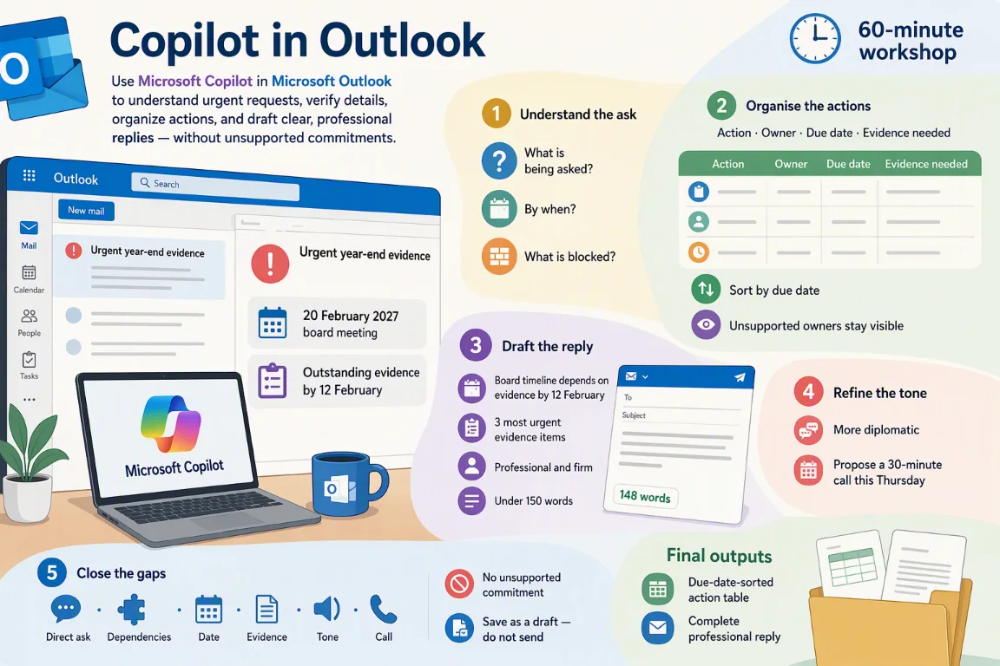

# Session 4: Copilot in Outlook — Handle a complex email with attachments

[Workshop home](../README.md) · **Session 4 of 6** · [← Previous: PowerPoint](./03-powerpoint.md) · [Next: Teams →](./05-teams.md)

|   |   |
| --- | --- |
| **Time** | 60 minutes: about 35 minutes of hands-on work, plus the story, setup and review |
| **You will produce** | a summary of the email; an action table; a reply saved as a draft |
| **You need** | A Microsoft 365 Copilot licence, Outlook, and the sample files for this session |
| **Files** | [`Meridian_Retail_Email.eml`](../sample-files/Meridian_Retail_Email.eml)<br>[`01_Client_Background.docx`](../sample-files/01_Client_Background.docx)<br>[`03_Audit_Findings_Draft.docx`](../sample-files/03_Audit_Findings_Draft.docx)<br>[`06_Supporting_Documents.pdf`](../sample-files/06_Supporting_Documents.pdf)<br>or the ZIP: [Meridian-Outlook-sample-files.zip](../sample-files/session-packs/Meridian-Outlook-sample-files.zip) |

> [!IMPORTANT]
> All Meridian names, entities, amounts, transactions, emails, chats and findings are fictional training data. Copilot proposes; the team verifies. This is a training exercise, not audit or tax advice.



## The flow of this session

| # | Stage | What you do |
| --- | --- | --- |
| 1 | Understand the ask | Try Out 7 · asked, by when, blocked |
| 2 | Organise the actions | Try Out 7 · action, owner, due date, evidence |
| 3 | Draft the reply | Try Out 8 · professional, firm, under 150 words |
| 4 | Refine the tone | Try Out 8 · more diplomatic, a Thursday call |
| 5 | Close the gaps | Refine · then save the draft, do not send |

## The story in three beats

1. **A long, urgent email lands, with three attachments.** Work out what is asked, by when, and what is blocked.
2. **Turn the email into actions.** An action table with owner, due date and evidence, and every gap left visible.
3. **Reply firmly, then more diplomatically.** Make no commitment the evidence cannot support, and save a draft. Never send.

## Your role and your job today

You have just joined the engagement team reviewing Meridian’s FY2026 results. Copilot is your assistant.

The Finance Director has sent a long, urgent email about year-end evidence and the 20 February board deadline — with three attachments. Work out what matters and reply.

| You will produce | What good looks like |
| --- | --- |
| A summary of the email | What is asked, by when, and what is blocked, with the source for each point |
| An action table | Action, owner, due date and evidence needed, with every gap left visible |
| A reply saved as a draft | Firm, then more diplomatic, checked against the email and never sent |

New to Meridian? Read [Meet Meridian](../README.md#meet-meridian) first. It takes two minutes, and every session starts with the same story.

### Words you will meet today

| Word | What it means |
| --- | --- |
| Evidence request | An item asking the client for a document or record that proves something. `06_Supporting_Documents.pdf` lists six. |
| Board meeting | The meeting of Meridian's top decision-makers on 20 February 2027. The audit should finish before it. |
| Blocked item | Stuck until the evidence it needs arrives. The email never says "blocked"; you work that out. |
| Unsupported | Not backed by the email or a file. Leave it flagged, and never fill it in. |
| Diplomatic tone | Polite, team-minded wording that still keeps the ask and the date clear. |
| Draft | A reply that is saved but not sent. Nobody sees it until a person decides to send it. |

## Step 1 — Which file do you trust?

One email and three attachments. Each has a different job, and each has a warning.

| Source | Role | How far to trust it | Watch for | Used in |
| --- | --- | --- | --- | --- |
| [`Meridian_Retail_Email.eml`](../sample-files/Meridian_Retail_Email.eml) · Meridian Email | The request to answer | The request to answer: what is asked, and by when. | Training email. The addresses in the .eml are placeholders. | Try Out 7, Try Out 8 and Refine |
| [`01_Client_Background.docx`](../sample-files/01_Client_Background.docx) · Client Background | Controls the client facts | The controlling record for facts about Meridian: group, FY2026 figures (unaudited), events and objectives. | The document says it intentionally contains some inconsistencies. | Try Out 7 (attachment) |
| [`03_Audit_Findings_Draft.docx`](../sample-files/03_Audit_Findings_Draft.docx) · Audit Findings Draft | Draft to improve | A working draft. Ratings, recommendations, owners and dates are missing on some findings. | Draft: deliberately vague or incomplete. The executive summary is left for you to write. | Try Out 7 (attachment) |
| [`06_Supporting_Documents.pdf`](../sample-files/06_Supporting_Documents.pdf) · Supporting Documents | Evidence to check against | Supporting evidence. Some pages are incomplete, so gaps are findings too. | Training extract: a count sheet with missing initials, an invoice with no PO, no related-party declaration shown. | Try Out 7 (attachment): evidence list |

> [!NOTE]
> Example: `06_Supporting_Documents.pdf` (ER-05) gives the inventory sheets and ageing a due date of 14 Feb. The email says the evidence should arrive by 12 Feb. Do not pick one. Ask which date applies.

> [!IMPORTANT]
> When two files disagree, say so. Do not pick one silently.

## Step 2 — Download the email and its three attachments

Fictional Meridian files, made for practice. Download each file, or take them all.

**DO:** Download the email and its three attachments, or the ZIP with all four, to your computer.

> [!NOTE]
> The three attachments are the same files other Meridian sessions use.

- [Meridian_Retail_Email.eml](../sample-files/Meridian_Retail_Email.eml) (EML, 103 KB): The urgent email from the Finance Director about year-end evidence and the 20 February board deadline, with three attachments.
- [01_Client_Background.docx](../sample-files/01_Client_Background.docx) (DOCX, 30 KB): Company, group structure, FY2026 financials, events, prior-year findings, objectives and training questions.
- [03_Audit_Findings_Draft.docx](../sample-files/03_Audit_Findings_Draft.docx) (DOCX, 30 KB): Six draft findings (F-01 to F-06), some vague or incomplete, a management-response area and a quality checklist.
- [06_Supporting_Documents.pdf](../sample-files/06_Supporting_Documents.pdf) (PDF, 14 KB): Invoices, hotel receipt, bank extract, inventory count sheet and evidence request list.

Or take them all: [Meridian-Outlook-sample-files.zip](../sample-files/session-packs/Meridian-Outlook-sample-files.zip).

## Step 3 — Open the Meridian email in Outlook

Your instructor sends you the email. Use the .eml file if it has not arrived.

**DO:** Find the Meridian email in your inbox and open it. If it is not there, open the .eml file.

> [!NOTE]
> An .eml file is a saved copy of an email. Check in your own environment how your Outlook opens it.

## Step 4 — The prompt formula and three habits

A good prompt names a role, a task, a source, a focus, a format, a limit and a check.

**READ:** Read the formula and the three habits. Then spot each part in the Meridian example.

**The prompt formula**

```text
Act as [role]. [Task] using /[file]. Focus on [what matters]. Give me [format]. Keep it [length / tone / audience]. Show where each point comes from.
```

**Example for Meridian**

```text
Act as an audit senior. Summarise the three most significant findings using /03_Audit_Findings_Draft.docx. Focus on financial exposure and evidence still outstanding. Give me 3 bullet points. Keep it under 100 words for the engagement leader. Show where each point comes from.
```

**Three habits**

- Say who it is for, what you want and the format
- Point Copilot at the source file (type / to reference it)
- Always check the answer against the source

Then: **Always ask a follow-up — the first answer is a starting point.**

See the [prompt formula and review questions](../reference.md) for the seven parts, the status labels and the ground rules.

## Step 5 — Explore the email and its attachments

Know what the email and the attachments say before you ask about them.

**READ:** Read the email, then scan `03_Audit_Findings_Draft.docx` and the evidence list in `06_Supporting_Documents.pdf`. Note three things to check.

> [!NOTE]
> Scan the email, then `03_Audit_Findings_Draft.docx` and the evidence list in `06_Supporting_Documents.pdf`. Notice what is missing.

**The email · what it asks**

|   | What to notice |
| --- | --- |
| ✓ | Board meeting: 20 February 2027 |
| ✓ | Evidence for the briefing: by 12 February |
| ⚠ | Six urgent evidence items, with no owners or dates |
| ⚠ | You must confirm: what can be completed, what is blocked, whether a call is needed |
| ○ | No reply-by date |

**03 · Draft findings F-01 to F-06**

|   | What to notice |
| --- | --- |
| ✓ | F-01: SGD 1.25m manual revenue journal, rated High |
| ⚠ | F-01 target date is 15 Feb 2027, after the 12 Feb condition |
| ✓ | F-06: related-party logistics, Finance Director, 12 Feb 2027 |
| ○ | F-02 and F-05 have no rating |
| ○ | F-04 has no owner and no date |

**06 · Evidence request list**

|   | What to notice |
| --- | --- |
| ✓ | Six requests: ER-01 to ER-06 |
| ✓ | Owners: Finance, Finance Director, Accounts Payable, Operations, IT |
| ⚠ | Due dates run from 8 to 14 Feb |
| ⚠ | ER-05 inventory sheets and ageing is due 14 Feb |
| ⚠ | Status: 4 Open, 2 Partial |

- ✓ Stated in the file. Quote it exactly.
- ⚠ Worth checking. Ask Copilot, then verify.
- ○ Missing. Say so. Do not fill it in.

## Step 6 — Open Copilot in Outlook

Open the email, click Copilot, then ask about it.

**DO:** Open the email, click Copilot, then ask a question about the email.

> [!NOTE]
> Copilot can summarise Word and PDF attachments in Outlook on the web and the new Outlook for Windows. Check this in your own environment.

## Step 7 — Try Out 7: What does this email need from me?

Ask Copilot to summarise the email and its attachments, then to build an action table.

**Where:** Outlook › open the Meridian email › Copilot · **Suggested time:** 7 min to do, 4 min to check

**File:** [Meridian_Retail_Email.eml](../sample-files/Meridian_Retail_Email.eml)

1. Open the Meridian email in Outlook.
2. Click Copilot to open the Copilot pane.
3. Paste prompt 1 and press Send. Then paste the follow-up.

**Prompt**

```text
Summarise this email and its attachments. What is being asked of me, by when, and which items are blocked by missing evidence?
```

**Follow-up**

```text
Put the actions in a table with Action, Owner, Due date and Evidence needed, sorted by due date.
```

**Look for:** Deadlines and owners pulled from the email — check them against the attachments

> [!NOTE]
> Copilot in Outlook works on the email you have open. Check the exact method in your own environment.

### Check the summary

Find where each point comes from. Mark what Copilot only worked out (inferred).

**EXAMINE:** Check each point against the email and `06_Supporting_Documents.pdf`. Which are confirmed, and which are inferred?

**Check**

- [ ] Does every point name its source: the email or `06_Supporting_Documents.pdf`?
- [ ] Are the two dates exactly 20 February and 12 February?
- [ ] Is “blocked” marked as inferred (worked out by you), not a fact?
- [ ] Does it list what you must confirm: complete, blocked, call?

> [!WARNING]
> The email says “several items” are open or partial. The 4 Open and 2 Partial come from `06_Supporting_Documents.pdf`, not from the email.

<details>
<summary>Illustrative example (your Copilot answer will differ)</summary>

**Summary**

| Point | Status | Source |
| --- | --- | --- |
| The audit is expected before the 20 February 2027 board meeting | ✓ Confirmed | Email |
| Evidence for the leadership briefing should arrive by 12 February | ✓ Confirmed | Email |
| All six requests on the evidence list are Open (4) or Partial (2) | ✓ Confirmed | 06 · F |
| Asked of you: confirm what can be completed, what is blocked, and whether a short call is needed | ✓ Confirmed | Email |
| Blocked items are the Open and Partial ones. No source labels any item “blocked” | ≈ Inferred | 06 · F |

</details>

### Check the action table

Find where each owner and due date comes from. If no source gives one, leave it marked unsupported.

**EXAMINE:** Check each owner and date against the email and `06_Supporting_Documents.pdf`.

**Check**

- [ ] Does every owner and date come from the email or `06_Supporting_Documents.pdf`?
- [ ] Is a missing date marked unsupported, not filled in?
- [ ] Is the table in due-date order?
- [ ] Does each action name the evidence needed?

> [!WARNING]
> Date check: ER-05 (inventory sheets and ageing) is due 14 Feb, after the 12 Feb condition. Flag it. Do not fix it silently.

<details>
<summary>Illustrative example (your Copilot answer will differ)</summary>

**Action table, sorted by due date**

| Action | Status | Owner | Due | Evidence needed | Source |
| --- | --- | --- | --- | --- | --- |
| Resolve duplicate advisory entries | ✓ Confirmed | Accounts Payable | 8 Feb | Invoice and approval | ER-03 |
| Explain the dormant-vendor reactivation | ✓ Confirmed | Accounts Payable | 8 Feb | Reactivation, bank-change evidence | ER-04 |
| Provide the former-employee access logs | ✓ Confirmed | IT | 9 Feb | Access logs | ER-06 |
| Support the SGD 1.25m revenue journal | ✓ Confirmed | Finance | 10 Feb | Dispatch and customer acceptance | ER-01 |
| Support the related-party logistics | ✓ Confirmed | Finance Director | 12 Feb | Contract and pricing support | ER-02 |
| Complete the inventory count and ageing | ⇄ Conflicting | Operations | 14 Feb (After 12 Feb) | Count sheets and ageing analysis | ER-05 |
| Reply to the Finance Director | … Unresolved | You | Not stated (Unsupported) | None. The email gives no reply date | Email |

</details>

## Step 8 — Try Out 8: Reply with the right tone

Ask Copilot for a firm reply, then for a more diplomatic one with a call.

**Where:** Outlook › Reply › Draft with Copilot · **Suggested time:** 8 min to do, 4 min to check

**File:** [Meridian_Retail_Email.eml](../sample-files/Meridian_Retail_Email.eml)

1. Open the Meridian email and click Reply.
2. Click Copilot, then Draft with Copilot.
3. Paste prompt 1 and click Generate. Then paste the follow-up.

**Prompt**

```text
Draft a reply to the Finance Director confirming we can meet the 20 February board timeline only if the outstanding evidence arrives by 12 February. List the three most urgent evidence items. Professional and firm, under 150 words.
```

**Follow-up**

```text
Make it more diplomatic and propose a 30-minute call this Thursday.
```

**Look for:** A clear ask, a date, and a tone you would actually send

> [!NOTE]
> The follow-up is a second request about the same draft. Where you type it can differ by Outlook version.

### Check the firm draft

Read it as the Finance Director would. One ask, one date, three items.

**EXAMINE:** Check the ask, the date, the three items and the length of the firm draft.

**Check**

- [ ] Is there one clear ask and one date: 12 February?
- [ ] Are the three items taken from the email?
- [ ] Is the draft under 150 words?
- [ ] Does it avoid any promise that the audit will be finished?

> [!WARNING]
> The email does not rank its six items. Copilot’s choice of three is an assumption: confirm it.

<details>
<summary>Illustrative example (your Copilot answer will differ)</summary>

**Prompt · Firm draft**

```text
Dear Finance Director,

Thank you for your email. We can meet the 20 February board timeline only if the outstanding evidence arrives by 12 February.

The three most urgent items are:
1. Dispatch evidence and customer acceptance for the SGD 1.25m revenue journal
2. Contract and pricing support for the related-party logistics arrangement
3. Support for the duplicate advisory entries

Our work on the other open and partial items depends on the same date. Please confirm which items can be provided by 12 February.

Regards,
[Your name]
```

</details>

### Check the diplomatic draft

A softer tone and a call. The ask and the date must still be there.

**EXAMINE:** Check that the diplomatic draft keeps the ask and the date, and proposes the call.

**Check**

- [ ] Is the tone one you would actually send?
- [ ] Is the ask still clear, with the date 12 February?
- [ ] Is the call proposed without an invented time or date?
- [ ] Did every fact stay the same?

> [!WARNING]
> “Thursday” has no date in the sources, so none is added. A softer tone must not drop the ask.

<details>
<summary>Illustrative example (your Copilot answer will differ)</summary>

**Follow-up · Diplomatic**

```text
Dear Finance Director,

Thank you for setting this out so clearly. We want to protect the 20 February board timeline, and that depends on the outstanding evidence reaching us by 12 February.

The three items that would help most are:
1. Dispatch evidence and customer acceptance for the SGD 1.25m revenue journal
2. Contract and pricing support for the related-party logistics arrangement
3. Support for the duplicate advisory entries

Could we have a 30-minute call this Thursday to go through the open and partial items together?

Kind regards,
[Your name]
```

</details>

## Step 9 — Optional stretch: Coaching by Copilot

Optional. Ask Coaching by Copilot to review your draft, then apply one suggestion.

**TRY:** Optional. Open Coaching by Copilot on your draft and apply one suggestion.

> [!NOTE]
> Coaching suggests. You decide which suggestion to apply, if any.

**Your task:** Use Coaching by Copilot on your draft and apply one suggestion.

**Check**

- [ ] Did you pick one suggestion, not all three?
- [ ] Does the edit keep every fact in the email?
- [ ] Is the ask still clear?
- [ ] Is the draft still unsent?

> [!TIP]
> Coaching reviews tone, clarity and reader sentiment. These suggestions are an illustrative example. Check the exact steps in your own environment.

<details>
<summary>Illustrative example</summary>

**Draft reviewed**

```text
Dear Finance Director,

Thank you for setting this out so clearly. We want to protect the 20 February board timeline, and that depends on the outstanding evidence reaching us by 12 February.

The three items that would help most are:
1. Dispatch evidence and customer acceptance for the SGD 1.25m revenue journal
2. Contract and pricing support for the related-party logistics arrangement
3. Support for the duplicate advisory entries

Could we have a 30-minute call this Thursday to go through the open and partial items together?

Kind regards,
[Your name]
```

**Coaching suggestions**

| Area | Suggestion |
| --- | --- |
| Tone | The reply is courteous and firm. The words “only if” may read as a warning. |
| Clarity | Put the 12 February condition in the first sentence, so the reader sees the ask first. |
| Reader sentiment | The reader may want to know what you need from them. Say it before the call proposal. |

**After applying one suggestion**

```text
The 20 February board timeline depends on the outstanding evidence reaching us by 12 February. Thank you for setting this out so clearly.
```

</details>

## Step 10 — Refine: Close the gaps

Mandatory. Compare your reply with the original email, then fix what you missed.

**Where:** Outlook › your draft reply › Copilot · **Suggested time:** 6 min to do, 3 min to check · **Mandatory**

**File:** [Meridian_Retail_Email.eml](../sample-files/Meridian_Retail_Email.eml)

1. Open your draft reply in Outlook.
2. Click Copilot to open the Copilot pane.
3. Paste the Refine prompt and press Send. Then paste the follow-up. Save as a draft. Never click Send.

**Refine prompt**

```text
Compare my reply with the original email. Have I answered every question and request? List anything I missed.
```

**Follow-up**

```text
Fix the gaps and save the reply as a draft (do not send).
```

**Look for:** Direct ask • dependencies • date • three urgent items • tone • call proposal • no unsupported commitment

> [!NOTE]
> Refine is where a first answer becomes a checked answer. Save the reply as a draft. Do not send it.

### Check the gaps

Mandatory. Find what your reply missed, then run the seven checks.

> [!NOTE]
> Refine is where a first answer becomes a checked answer.

<details>
<summary>Illustrative example (your Copilot answer will differ)</summary>

**What the reply missed**

| Ask in the email | Result | What the reply does |
| --- | --- | --- |
| Evidence by 12 February | ✓ Covered | Your reply makes Meridian’s timeline depend on 12 February. |
| Confirm what can be completed | ✗ Missed | The reply does not say. |
| Confirm what is blocked | ✗ Missed | Open and partial items are not called out. |
| Whether a short call is needed | ✓ Covered | A 30-minute call this Thursday is proposed. |
| Six urgent evidence items | ◐ Partly covered | Three are named, as you asked. The other three are not mentioned. |
| Date in `06_Supporting_Documents.pdf` | ✗ Missed | ER-05 is due 14 February, after 12 February. Not raised. |

**The seven checks**

| Check | Result | Note |
| --- | --- | --- |
| Direct ask | ✓ Pass | Evidence by 12 February |
| Dependencies (blocked) | ✗ Gap | Blocked items stated |
| Date | ✗ Gap | 12 Feb kept; 14 Feb raised |
| Three urgent items | ✓ Pass | Taken from the email |
| Tone | ✓ Pass | Courteous and firm |
| Call proposal | ✓ Pass | 30 minutes, Thursday |
| No unsupported commitment | ✓ Pass | No “audit finished” |

**Example improved draft**

```text
Dear Finance Director,

Thank you for setting this out so clearly. We can meet the 20 February board timeline only if the outstanding evidence arrives by 12 February. The three most urgent items are:
1. Dispatch evidence and customer acceptance for the SGD 1.25m revenue journal
2. Contract and pricing support for the related-party logistics arrangement
3. Support for the duplicate advisory entries

Items still open or partial are blocked until the evidence arrives, so we cannot yet confirm what can be completed. The inventory sheets and ageing are due on 14 February, after 12 February. Could we cover this in a 30-minute call this Thursday?

Kind regards,
[Your name]
```

</details>

### Save the draft. Do not send.

Mandatory. Save the reply as a draft. Do not click Send.

**Check**

- [ ] All seven checks pass.
- [ ] The reply is saved as a draft.
- [ ] Send was not clicked.

> [!WARNING]
> Do not send. This reply is a training draft only.

## Step 11 — Review: The six questions

Mandatory. Ask the same six questions of your final result.

**EXAMINE:** Mandatory. Answer the six questions and mark each one.

| Dimension | Question | In this session |
| --- | --- | --- |
| Source | Did the learner use the correct controlling file or mock content record? | The summary came from the email and its three attachments, not from memory. |
| Evidence | Can each fact, number, owner, date, and conclusion be traced to the source? | Every owner and due date has a source: the email or `06_Supporting_Documents.pdf`. |
| Status | Are confirmed, inferred, assumed, conflicting, and unresolved points distinguished? | Chips are on: confirmed, inferred, assumed, conflicting, unresolved. |
| Audience | Is the result suitable for the intended engagement leader, CFO, Finance Director, or team? | Written for the Finance Director: short, courteous, firm. |
| Action | Does the output identify the decision, evidence request, owner, due date, or next step? | It asks for the evidence by 12 February, names three items and proposes a call. |
| Professional boundary | Does the result avoid an audit opinion, tax advice, unsupported approval, or invented completion claim? | No “audit finished”, no approvals, no invented dates. Saved as a draft, not sent. |

> [!IMPORTANT]
> Completing the checks does not approve the result. A person decides.

## What you learned today

Five skills you can use on Monday, and three habits to keep.

| Skill | Where you practised it |
| --- | --- |
| Summarise a long email and its attachments | Try Out 7: what is asked, by when, and what is blocked |
| Turn requests into an action table | Try Out 7 follow-up: action, owner, due date and evidence, sorted by date |
| Draft a reply with the right tone | Try Out 8: firm first, then more diplomatic, with a 30-minute call |
| Leave gaps visible | Owners and dates the sources do not give stay marked as unsupported |
| Close the gaps before you save | Refine: compare the reply with the email, fix it, save as a draft, never send |

**Three habits to keep**

- **Check against the source.** Every figure, name, owner and date must trace to a file.
- **Keep the gaps visible.** Mark what is inferred, assumed, conflicting or unresolved.
- **The team decides.** Copilot proposes. A person makes the final call.

**Think about it:** Which long email at work could you turn into an action table this week, and which owner or date would you check first?

## Microsoft Learn references

- <https://learn.microsoft.com/microsoft-365/admin/activity-reports/microsoft-365-copilot-usage#interpret-the-microsoft-copilot-usage-report>
- <https://learn.microsoft.com/microsoft-365/copilot/previous-year-release-notes#august-19,-2025>
- <https://learn.microsoft.com/microsoft-365/copilot/release-notes#august-11,-2026>

> [!NOTE]
> Copilot menus and button names change often. When a step says to check in your own environment, follow your tenant’s current behaviour.

[Workshop home](../README.md) · **Session 4 of 6** · [← Previous: PowerPoint](./03-powerpoint.md) · [Next: Teams →](./05-teams.md)
