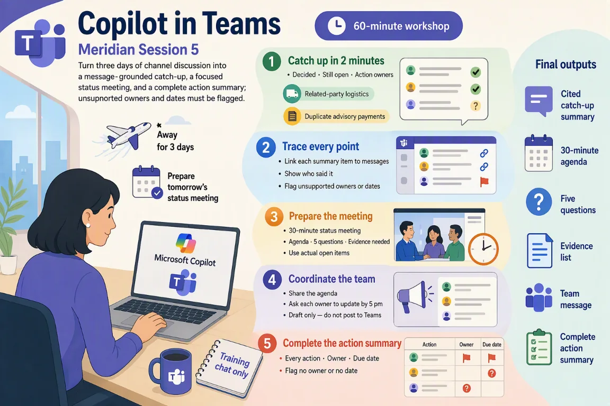

# Session 5: Copilot in Teams — Catch up on the engagement and prepare a meeting

[Workshop home](../README.md) · **Session 5 of 6** · [← Previous: Outlook](./04-outlook.md) · [Next: Copilot Chat →](./06-copilot-chat.md)

|   |   |
| --- | --- |
| **Time** | 60 minutes: about 35 minutes of hands-on work, plus the story, setup and review |
| **You will produce** | a cited catch-up; a status-meeting plan; an action summary |
| **You need** | A Microsoft 365 Copilot licence, Teams, and the sample file for this session |
| **Files** | [`Meridian-Teams-channel-transcript.txt`](../sample-files/Meridian-Teams-channel-transcript.txt)<br>or the ZIP: [Meridian-Teams-sample-files.zip](../sample-files/session-packs/Meridian-Teams-sample-files.zip) |

> [!IMPORTANT]
> All Meridian names, entities, amounts, transactions, emails, chats and findings are fictional training data. Copilot proposes; the team verifies. This is a training exercise, not audit or tax advice.



## The flow of this session

| # | Stage | What you do |
| --- | --- | --- |
| 1 | Catch up in 2 minutes | Try Out 9 · decided, open, owned |
| 2 | Trace every point | Try Out 9 · every item linked to a message |
| 3 | Prepare the meeting | Try Out 10 · 30-minute agenda, 5 questions |
| 4 | Coordinate the team | Try Out 10 · team message, draft only |
| 5 | Complete the action summary | Refine · every action, owner and due date |

## The story in three beats

1. **You were away for three days.** The Meridian engagement chat kept moving. Catch up in two minutes, every point linked to a message.
2. **Tomorrow is the status meeting.** A 30-minute agenda, five questions and an evidence list, built from the real open items.
3. **Then close the loop.** Every action gets an owner and a due date, and every gap is flagged. Nothing is posted.

## Your role and your job today

You have just joined the engagement team reviewing Meridian’s FY2026 results. Copilot is your assistant.

You were away for three days. The Meridian engagement chat kept moving. Catch up and prepare for tomorrow’s status meeting.

| You will produce | What good looks like |
| --- | --- |
| A cited catch-up | What is decided, open and owned, with every point linked to a message |
| A status-meeting plan | A 30-minute agenda, five questions and the evidence list, from real open items |
| An action summary | Every action with an owner and a due date, and every gap flagged |

New to Meridian? Read [Meet Meridian](../README.md#meet-meridian) first. It takes two minutes, and every session starts with the same story.

### Words you will meet today

| Word | What it means |
| --- | --- |
| Catch-up summary | A short recap of a busy chat: what was decided, what is open, who owns what. |
| Citation | A link from a point in the summary back to the exact message it came from. |
| Open item | Something still unresolved: evidence not yet received, a question not yet answered. |
| Action owner | The one named person responsible for an action. No name means no owner. |
| Status meeting | A short meeting to check progress on open items with the client. Tomorrow’s lasts 30 minutes. |
| Training chat | A practice chat with fictional data only. Never a real client or team conversation. |

## Step 1 — What is in the channel, and how far to trust it

There is no file to open. Your source is one channel chat: three days, seven topics, 25 messages.

| Source | Role | How far to trust it | Watch for | Used in |
| --- | --- | --- | --- | --- |
| 1 · What people say | Claims, not proof | Messages from the engagement team and from Meridian staff. They report what someone believes or intends. | Two claims here are uncorroborated: “commercial terms” and the shared account that “may explain” it. | Try Out 9 |
| 2 · The evidence list ER-01 to ER-06 | Requests and their status | The Audit Senior and Engagement Leader quote each request with an owner, a due date and a status. | Status is as stated in chat: Open or Partial. Nothing here says the evidence arrived. | Try Out 10 |
| 3 · What is not in the chat | Gaps are findings too | Several items have no owner or no date, and one date conflict. Gaps are not Copilot’s to fill. | Do not let Copilot invent an owner, a date, an approval or a completion. | Refine |

> [!NOTE]
> Example: the draft finding F-05 has a target date of 28 Feb, but the board meets on 20 Feb. Flag the conflict. Do not fix it silently.

> [!IMPORTANT]
> When two messages disagree, say so. Do not pick one silently.

## Step 2 — Get the channel as a text file

A facilitator posts it in a training chat, so that Copilot in Teams has a conversation to read.

**DO:** Download the channel transcript, or the ZIP.

> [!NOTE]
> Use a training chat, never a real client conversation.

- [Meridian-Teams-channel-transcript.txt](../sample-files/Meridian-Teams-channel-transcript.txt) (TXT, 7 KB): The mock channel “Meridian Retail – Engagement Team” as plain text, for facilitators who want a real training chat.

Or use the ZIP: [Meridian-Teams-sample-files.zip](../sample-files/session-packs/Meridian-Teams-sample-files.zip).

## Step 3 — Open the channel in a training chat

Paste the text into a training chat, never a real one. Name the chat “Meridian Retail – Engagement Team” so the steps below match.

**DO:** Post the transcript text in a training chat. Use fictional data only.

> [!NOTE]
> Steps differ by company. Check in your own environment.

## Step 4 — Learn the prompt formula and three habits

A prompt is what you type to Copilot. A good one has seven parts: role, task, source, focus, format, limit, check.

**READ:** Read the formula and the three habits. Then spot each part in the Meridian example.

**The prompt formula**

```text
Act as [role]. [Task] using /[file]. Focus on [what matters]. Give me [format]. Keep it [length / tone / audience]. Show where each point comes from.
```

**Example for Meridian**

```text
Act as an audit senior. Summarise the three most significant findings using /03_Audit_Findings_Draft.docx. Focus on financial exposure and evidence still outstanding. Give me 3 bullet points. Keep it under 100 words for the engagement leader. Show where each point comes from.
```

**Three habits**

- Say who it is for, what you want and the format
- Point Copilot at the source file (type / to reference it)
- Always check the answer against the source

Then: **Always ask a follow-up — the first answer is a starting point.**

See the [prompt formula and review questions](../reference.md) for the seven parts, the status labels and the ground rules.

## Step 5 — Read the channel before you ask

Read first. Spot what is clear, what is only a claim, and what has no owner or date.

**READ:** Scan the three days. Mark one message with a clear owner and date, one claim, and one gap.

> [!NOTE]
> Scan the three days. Notice who owns what.

**Day 1 · Revenue, advisory, logistics**

|   | What to notice |
| --- | --- |
| ✓ | ER-01 revenue evidence: Finance, due 10 Feb |
| ⚠ | Controller calls the SGD 1.25m entry a cut-off adjustment |
| ○ | Daniel can pull the support, but gives no date |
| ✓ | ER-03 invoice and approval: Accounts Payable, 8 Feb |
| ○ | Harbour Legal scope and duplicate check: no owner |
| ⚠ | Finance Director: “commercial terms”, no contract yet |

**Day 2 · Logistics, inventory, access**

|   | What to notice |
| --- | --- |
| ⚠ | A shared account “may explain” the same preparer and approver |
| ○ | SGD 99,900: declaration, benefit, benchmarking: no owner |
| ○ | Slow-moving report: nobody owns the review |
| ⚠ | In-transit SGD 2.3m: approver not known |
| ✓ | ER-06 access logs: IT, due 9 Feb |
| ○ | Two approvers for PAY-9041: no answer |

**Day 3 · Tax and deadlines**

|   | What to notice |
| --- | --- |
| ○ | Tax support, four items: no owner |
| ○ | F-04 has no owner or date; F-02 has no date |
| ⚠ | F-05 target 28 Feb is after the 20 Feb board |
| ○ | Status-meeting agenda: nobody has taken it |

- ✓ A named owner and a due date.
- ⚠ A claim, not evidence yet. Check it.
- ○ No owner, no date, or evidence missing.

## Step 6 — Open Copilot in the channel

Open the channel, then click Copilot. There is no file to attach in this session.

**DO:** Open the channel in Teams and click Copilot. See where you type your prompt.

> [!NOTE]
> The channel is your source. Buttons may differ, so check in your own environment.

## Step 7 — Try Out 9: Catch up in 2 minutes

Ask Copilot what is decided, what is open and who owns each action. Then ask who said what.

**Where:** Teams › Meridian engagement chat › Copilot · **Suggested time:** 7 min to do, 4 min to check

**File:** [Meridian-Teams-channel-transcript.txt](../sample-files/Meridian-Teams-channel-transcript.txt)

1. Open the Meridian Retail – Engagement Team channel in Teams.
2. Click Copilot to open the Copilot pane.
3. Paste prompt 1 and press Send. Then paste the follow-up.

**Prompt**

```text
Summarise this conversation. What has been decided, what is still open, and who owns each action?
```

**Follow-up**

```text
What has been said about the related-party logistics arrangement and the duplicate advisory payments? Show who said it.
```

**Look for:** Citations that take you back to the original messages

> [!NOTE]
> Copilot works on the conversation. Buttons may differ, so check in your own environment.

### Check the summary

Follow each citation back to its message. Flag any owner or date the chat does not give.

**EXAMINE:** Click each citation. Does the message say what the summary says?

**Check**

- [ ] Does every item link to a message?
- [ ] Is each owner named in the chat, or flagged?
- [ ] Is the related-party speaker right?
- [ ] Is “may explain” still unresolved?

> [!NOTE]
> A summary is easy to read and easy to get wrong. The messages are the source.

<details>
<summary>Illustrative example (your Copilot answer will differ)</summary>

**Catch-up summary (message numbers in the last column)**

| Topic | Status | Summary | Owner and date | Flag | Messages |
| --- | --- | --- | --- | --- | --- |
| Decided | ✓ Confirmed | Revenue cut-off goes first tomorrow. No conclusion before the evidence arrives. | Engagement Leader | — | #5, #25 |
| Revenue cut-off | … Unresolved | SGD 1.25m journal, reversed 3 Jan. Dispatch evidence outstanding. | Finance · 10 Feb | — | #1, #2, #3, #4 |
| Duplicate advisory | … Unresolved | Two SGD 100,000 Harbour Legal payments. Scope, duplicate check needed. | Accounts Payable · 8 Feb | Scope, check: no owner | #6, #7, #8 |
| Related-party logistics | … Unresolved | SGD 99,900 invoice. Contract, benefit, declaration missing. | Finance Director · 12 Feb | Declaration: no owner | #9, #10, #11, #12 |
| Inventory | … Unresolved | SGD 2.3m in-transit added manually. Slow-moving report unreviewed. | Operations · 14 Feb | Slow-moving: no owner | #13, #14, #15, #16 |
| Access and vendor | … Unresolved | Late access removal. SGD 450,000 to dormant OldTech. Approvers unknown. | IT · 9 Feb; Accounts Payable · 8 Feb | — | #17, #18, #19, #20 |
| Tax review | … Unresolved | Four items lack support: entertainment, related-party fee, inventory provision, digital development. | — | No owner · no date | #21, #22 |
| Deadline | ⇄ Conflicting | Board 20 Feb 2027. F-05 target 28 Feb is later. F-04: no owner or date. | — | No owner · no date | #23, #24 |

**Who said what: Related-party logistics**

| Who | Said | Status | Message |
| --- | --- | --- | --- |
| Finance Director (role only) | The urgent December deliveries were on commercial terms. The contract is not to hand yet. | ? Assumed | #9 |
| Audit Senior (role only) | Invoice MEL-261231 is SGD 99,900. Vendor list marks a related party. No declaration shown. | ✓ Confirmed | #10 |
| Alicia Tan (Financial Controller) | Her ID is preparer and approver of the 27 Dec journal. A shared account “may explain” it. | ? Assumed | #11 |
| Engagement Leader (role only) | That stays unresolved. ER-02 is with the Finance Director, due 12 Feb. | ✓ Confirmed | #12 |

**Who said what: Duplicate advisory payments**

| Who | Said | Status | Message |
| --- | --- | --- | --- |
| Priya Rao (AP Analyst) | PAY-8891 and PAY-8892, SGD 100,000 each. Invoice HL-88310, no purchase order. | ✓ Confirmed | #6 |
| Daniel Lim (Senior Accountant) | Prepared both entries, two minutes apart. A second invoice is not checked. | ✓ Confirmed | #7 |
| Audit Senior (role only) | Needs invoice, scope, duplicate check, approval. ER-03: Accounts Payable, 8 Feb, Partial. | ✓ Confirmed | #8 |

</details>

## Step 8 — Try Out 10: Prepare tomorrow’s status meeting

Ask for a 30-minute agenda, five questions and the evidence list. Then ask for a team message.

**Where:** Teams › Meridian engagement chat › Copilot · **Suggested time:** 8 min to do, 4 min to check

**File:** [Meridian-Teams-channel-transcript.txt](../sample-files/Meridian-Teams-channel-transcript.txt)

1. Stay in the same channel and click Copilot.
2. Paste prompt 2 and press Send. Check each agenda item against the channel.
3. Paste the follow-up. Read the draft message. Do not post it.

**Prompt**

```text
Help me prepare a 30-minute status meeting with the Finance Director: an agenda, the five questions we must ask, and the evidence we still need.
```

**Follow-up**

```text
Draft a short message to the team sharing the agenda and asking each owner to update their status by 5 pm.
```

**Look for:** An agenda built from the real open items, not generic topics

> [!NOTE]
> The agenda must come from the open items, the things still unsettled. Nothing is posted.

### Check the agenda and the message

Match every agenda item to an open item. Leave the message unposted.

**EXAMINE:** Match each agenda item and question to an open item. Which evidence has no ER number yet?

**Check**

- [ ] Is every agenda item an open item?
- [ ] Does each question name an amount or ID?
- [ ] Is each evidence item linked to a message?
- [ ] Was the message left unposted?

> [!NOTE]
> Generic topics are a warning sign. Real open items from the chat are the test.

<details>
<summary>Illustrative example (your Copilot answer will differ)</summary>

**30-minute agenda**

| Minutes | Item | Focus | Messages |
| --- | --- | --- | --- |
| 00–05 | Revenue cut-off | SGD 1.25m journal: ER-01, due 10 Feb | #1, #4 |
| 05–10 | Related-party logistics | SGD 99,900: contract, declaration (ER-02) | #10, #12 |
| 10–15 | Duplicate advisory | Two SGD 100,000 payments (ER-03) | #6, #8 |
| 15–20 | OldTech and access | SGD 450,000 (ER-04), access logs (ER-06) | #17, #19, #20 |
| 20–25 | Inventory and tax | SGD 2.3m in transit (ER-05), tax support | #13, #15, #21 |
| 25–30 | Owners, dates, board | Owner and date gaps. Board 20 Feb 2027 | #23, #24, #25 |

**Five questions**

1. When will the SGD 1.25m dispatch evidence arrive? _(#1, #4)_
2. Where are the contract and declaration for SGD 99,900? _(#10, #12)_
3. Who approved the two SGD 100,000 payments? _(#6, #8)_
4. Who were the two approvers for the SGD 450,000 OldTech payment? _(#19, #20)_
5. Who owns the tax support and slow-moving review, and by when? _(#15, #21)_

**Evidence we still need**

| Ref | Evidence | Owner | Due | Status | Message |
| --- | --- | --- | --- | --- | --- |
| ER-01 | Dispatch and acceptance evidence | Finance | 10 Feb | Open | #4 |
| ER-02 | Contract and pricing support | Finance Director | 12 Feb | Open | #12 |
| ER-03 | Invoice and approval, advisory | Accounts Payable | 8 Feb | Partial | #8 |
| ER-04 | Reactivation and bank change | Accounts Payable | 8 Feb | Open | #20 |
| ER-05 | Count sheets and ageing analysis | Operations | 14 Feb | Partial | #15 |
| ER-06 | Access logs, former employee | IT | 9 Feb | Open | #18 |

_No ER number: declaration, approval, duplicate check, slow-moving review, tax support (#12, #8, #15, #21)_

**Team message (leave it unposted)**

> Hi team, tomorrow’s 30-minute status meeting with the Finance Director will cover: revenue cut-off, related-party logistics, the duplicate advisory payments, OldTech and access, inventory and tax, then owners and dates. Please update the status of your open items by 5 pm. If an item has no owner or no date, say so.

</details>

## Step 9 — Refine: Action summary

Mandatory. Ask for every action with its owner and due date, and flag the gaps. Then post in the training chat only.

**Where:** Teams › Meridian engagement chat › Copilot · **Suggested time:** 6 min to do, 3 min to check · **Mandatory**

**File:** [Meridian-Teams-channel-transcript.txt](../sample-files/Meridian-Teams-channel-transcript.txt)

1. Stay in the same channel and click Copilot.
2. Paste the Refine prompt and press Send.
3. Paste the follow-up. Post in the training chat only, never a real chat.

**Refine prompt**

```text
Based on this chat, list every action with owner and due date. Flag anything with no owner or no date.
```

**Follow-up**

```text
Post your action list in the training chat (training chat only).
```

**Look for:** Every action with an owner and a date, and the gaps flagged

> [!NOTE]
> Refine is where a first answer becomes a checked answer.

### Check the action list

Mandatory. Check each owner and date against the chat. Then post it in the training chat.

**EXAMINE:** Mandatory. Check every owner and date against the chat. Flag, do not fill in.

**Check**

- [ ] Is every owner named in the chat?
- [ ] Is every gap flagged?
- [ ] Is the F-05 date conflict visible?
- [ ] Was it posted in training chat only?

> [!NOTE]
> Post only in a training chat, never in a real client conversation.

<details>
<summary>Illustrative example (your Copilot answer will differ)</summary>

**Action list: 14 actions, 8 with a gap (6 with no owner, 8 with no date)**

| Action | Owner | Due | Messages |
| --- | --- | --- | --- |
| ER-01 · Dispatch and acceptance evidence | Finance | 10 Feb | #4 |
| ER-03 · Invoice and approval, advisory | Accounts Payable | 8 Feb | #8 |
| Harbour Legal scope and a duplicate check | _missing_ | _missing_ | #8 |
| ER-02 · Contract and pricing, related-party | Finance Director | 12 Feb | #12 |
| Declaration, benefit, benchmarking, approval | _missing_ | _missing_ | #10, #12 |
| ER-04 · Reactivation and bank-change evidence | Accounts Payable | 8 Feb | #20 |
| Name the two approvers, SGD 450,000 payment | _missing_ | _missing_ | #20 |
| ER-06 · Access logs, former employee | IT | 9 Feb | #18 |
| ER-05 · Count sheets and ageing analysis | Operations | 14 Feb | #15 |
| Who counted TH-AX14 and TH-KL31 (no initials) | Somchai Prasert | _missing_ | #14 |
| In-transit listing and who approved the entry | Narin Chai | _missing_ | #16 |
| Review the slow-moving inventory report | _missing_ | _missing_ | #13, #15 |
| Chase the tax team: four unsupported items | _missing_ | _missing_ | #21, #22 |
| F-04 owner and date, F-02 date, F-05 28 Feb ⇄ | _missing_ | _missing_ | #24 |

**Example post in the training chat**

> Action list from the Meridian channel: 14 actions, 8 with a gap. 6 have no owner and 8 have no date.

</details>

## Step 10 — Review: The six questions

Mandatory. Ask the same six questions of your final result, every time.

**EXAMINE:** Mandatory. Run your final result through the six questions and mark each one.

| Dimension | Question | In this session |
| --- | --- | --- |
| Source | Did the learner use the correct controlling file or mock content record? | The summary came from the channel messages, each cited by number. |
| Evidence | Can each fact, number, owner, date, and conclusion be traced to the source? | Every item links back to one or more messages. Nothing is cited from memory. |
| Status | Are confirmed, inferred, assumed, conflicting, and unresolved points distinguished? | Chips are on: confirmed, inferred, assumed, conflicting, unresolved. |
| Audience | Is the result suitable for the intended engagement leader, CFO, Finance Director, or team? | Written for the engagement team and the Finance Director meeting. |
| Action | Does the output identify the decision, evidence request, owner, due date, or next step? | Each action shows an owner and a date, or flags that one is missing. |
| Professional boundary | Does the result avoid an audit opinion, tax advice, unsupported approval, or invented completion claim? | Nothing was posted for real. No approval invented, no completion claimed. |

> [!IMPORTANT]
> Completing the checks does not approve the result. A person decides.

## What you learned today

Five skills you can use on Monday, and three habits to keep.

| Skill | Where you practised it |
| --- | --- |
| Catch up on a busy conversation | Try Out 9: decided, open and owned, each linked to a message |
| Trace who said what | Follow-up: the related-party and duplicate-advisory messages, by speaker |
| Plan a meeting from real open items | Try Out 10: a 30-minute agenda, five questions and the evidence list |
| Draft a team message without posting it | Try Out 10 follow-up: the 5 pm status ask, reviewed first |
| Expose missing owners and dates | Refine: every action with an owner and date, and every gap flagged |

**Three habits to keep**

- **Check against the source.** Every figure, name, owner and date must trace to a file.
- **Keep the gaps visible.** Mark what is inferred, assumed, conflicting or unresolved.
- **The team decides.** Copilot proposes. A person makes the final call.

**Think about it:** Which busy chat or channel at work could you catch up on with Copilot this week, and check against the original messages?

## Microsoft Learn references

- <https://learn.microsoft.com/microsoft-365/copilot/copilot-overview>

> [!NOTE]
> Copilot menus and button names change often. When a step says to check in your own environment, follow your tenant’s current behaviour.

[Workshop home](../README.md) · **Session 5 of 6** · [← Previous: Outlook](./04-outlook.md) · [Next: Copilot Chat →](./06-copilot-chat.md)
