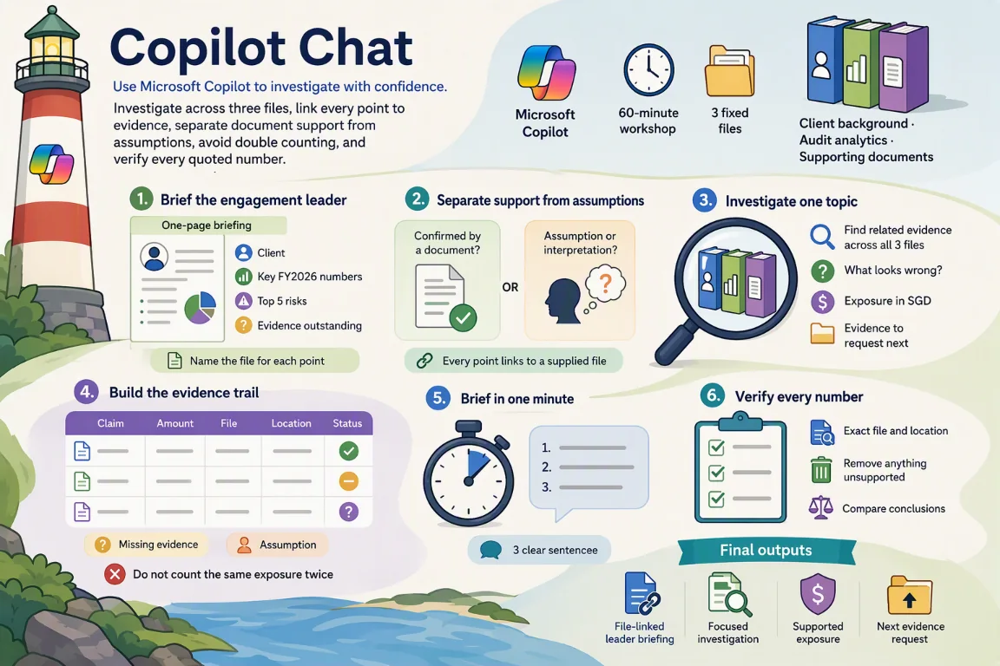

# Session 6: Copilot Chat on the web — Investigate evidence across multiple files

[Workshop home](../README.md) · **Session 6 of 6** · [← Previous: Teams](./05-teams.md)

|   |   |
| --- | --- |
| **Time** | 60 minutes: about 37 minutes of hands-on work, plus the story, setup and review |
| **You will produce** | a one-page briefing; a group investigation; a verified set of numbers |
| **You need** | A Microsoft 365 Copilot licence, Copilot Chat on the web, and the sample files for this session |
| **Files** | [`01_Client_Background.docx`](../sample-files/01_Client_Background.docx)<br>[`04_Audit_Analytics.xlsx`](../sample-files/04_Audit_Analytics.xlsx)<br>[`06_Supporting_Documents.pdf`](../sample-files/06_Supporting_Documents.pdf)<br>or the ZIP: [Meridian-Chat-sample-files.zip](../sample-files/session-packs/Meridian-Chat-sample-files.zip) |

> [!IMPORTANT]
> All Meridian names, entities, amounts, transactions, emails, chats and findings are fictional training data. Copilot proposes; the team verifies. This is a training exercise, not audit or tax advice.



## The flow of this session

| # | Stage | What you do |
| --- | --- | --- |
| 1 | Brief the engagement leader | Try Out 11 · one page, a file for each point |
| 2 | Separate support from assumptions | Try Out 11 · confirmed by a document, or not |
| 3 | Investigate one topic | Try Out 12 · one of six topics, across 3 files |
| 4 | Build the evidence trail | Try Out 12 · claim, amount, file, status |
| 5 | Brief in one minute | Try Out 12 · the three-sentence follow-up |
| 6 | Verify every number | Refine · exact file and location for each |

## The story in three beats

1. **The engagement leader needs a briefing today.** One page: the client, the key numbers, the top five risks and the evidence still outstanding.
2. **Six suspicious matters, three files.** Pick one topic and follow it across the client file, the transaction data and the supporting documents.
3. **Then verify every number.** Give the exact file and place for each one, and remove what you cannot support.

## Your role and your job today

You have just joined the engagement team reviewing Meridian’s FY2026 results. Copilot is your assistant.

The engagement leader needs a briefing today and wants six suspicious matters investigated across the client file, the transaction data and the supporting documents.

| You will produce | What good looks like |
| --- | --- |
| A one-page briefing | Client, key numbers, top five risks and the evidence still outstanding |
| A group investigation | One of six topics, followed across all three files, in three sentences |
| A verified set of numbers | The exact file and place for every number, with the unsupported ones removed |

New to Meridian? Read [Meet Meridian](../README.md#meet-meridian) first. It takes two minutes, and every session starts with the same story.

### Words you will meet today

| Word | What it means |
| --- | --- |
| Evidence trail | The same amount followed from file to file, to see what supports it. |
| Exposure | The money that could be wrong or at risk. A possible amount, not a proven loss. |
| Confirmed or assumed | Confirmed means a document says it. Assumed means someone, or Copilot, supplied it without proof. |
| Year-end revenue | A sale booked right at the year end. The team checks it truly belongs in that year. |
| Related party | A company linked to the client or its leaders. Deals with them need extra care. |
| Dormant vendor | A supplier marked inactive in the records. Paying one is unusual and needs a reason. |

## Step 1 — Which file do you trust?

Three files go into one chat. Each has a different authority, and each has a warning.

| Source | Role | How far to trust it | Watch for | Used in |
| --- | --- | --- | --- | --- |
| [`01_Client_Background.docx`](../sample-files/01_Client_Background.docx) · Client Background | Controls the client facts | The controlling record for facts about Meridian: group, FY2026 figures (unaudited), events and objectives. | The document says it intentionally contains some inconsistencies. | Try Out 11 and 12, and the Refine check |
| [`04_Audit_Analytics.xlsx`](../sample-files/04_Audit_Analytics.xlsx) · Audit Analytics | Transaction evidence | The transaction record for the investigation. A training extract, not a full ledger. | Do not reconcile it to the financial statements. It contains a trainer sheet; leave it closed until the lab reveals it. | Try Out 11 and 12, and the Refine check |
| [`06_Supporting_Documents.pdf`](../sample-files/06_Supporting_Documents.pdf) · Supporting Documents | Evidence to check against | Supporting evidence. Some pages are incomplete, so gaps are findings too. | Training extract: a count sheet with missing initials, an invoice with no PO, no related-party declaration shown. | Try Out 11 and 12, and the Refine check |

> [!NOTE]
> Example: ledger entry JRN-000002 in `04_Audit_Analytics.xlsx` is posted on 27 Dec, but the SGD 99,900 invoice MEL-261231 in `06_Supporting_Documents.pdf` is dated 31 Dec. Do not pick one. Ask for the approval and the payment.

> [!IMPORTANT]
> When two files disagree, say so. Do not pick one silently.

## Step 2 — Download the three files

Fictional Meridian files, made for practice. Download each file, or take them all.

**DO:** Download the three files, or the ZIP with all three, to your computer.

> [!NOTE]
> These are the same files the other Meridian sessions use.

- [01_Client_Background.docx](../sample-files/01_Client_Background.docx) (DOCX, 30 KB): Company, group structure, FY2026 financials, events, prior-year findings, objectives and training questions.
- [04_Audit_Analytics.xlsx](../sample-files/04_Audit_Analytics.xlsx) (XLSX, 207 KB): 1,800 general-ledger transactions, vendors, employees, expenses, budget vs actual and an output sheet for your findings.
- [06_Supporting_Documents.pdf](../sample-files/06_Supporting_Documents.pdf) (PDF, 14 KB): Invoices, hotel receipt, bank extract, inventory count sheet and evidence request list.

Or take them all: [Meridian-Chat-sample-files.zip](../sample-files/session-packs/Meridian-Chat-sample-files.zip).

## Step 3 — Save all three in OneDrive

Copilot can only read files saved in OneDrive or SharePoint. Make a folder for them.

**DO:** Upload the three files to a OneDrive folder called Meridian Chat.

> [!NOTE]
> Open OneDrive in your browser, create the folder, then upload or drag the three files into it.

## Step 4 — The prompt formula and three habits

A good prompt names a role, a task, a source, a focus, a format, a limit and a check.

**READ:** Read the formula and the three habits. Then spot each part in the Meridian example.

**The prompt formula**

```text
Act as [role]. [Task] using /[file]. Focus on [what matters]. Give me [format]. Keep it [length / tone / audience]. Show where each point comes from.
```

**Example for Meridian**

```text
Act as an audit senior. Summarise the three most significant findings using /03_Audit_Findings_Draft.docx. Focus on financial exposure and evidence still outstanding. Give me 3 bullet points. Keep it under 100 words for the engagement leader. Show where each point comes from.
```

**Three habits**

- Say who it is for, what you want and the format
- Point Copilot at the source file (type / to reference it)
- Always check the answer against the source

Then: **Always ask a follow-up — the first answer is a starting point.**

See the [prompt formula and review questions](../reference.md) for the seven parts, the status labels and the ground rules.

## Step 5 — Explore the three files

Know what is in each file before you ask across all three.

**READ:** Open each file. Note one amount you could find in more than one file.

> [!NOTE]
> Look for an amount that could appear in more than one file.

**01 · Client Background**

|   | What to notice |
| --- | --- |
| ✓ | Revenue SGD 151.8m; PBT SGD 5.5m, down 28.6% |
| ✓ | Payments above SGD 25,000 need two approvers |
| ✓ | Manual journals above SGD 50,000: controller review |
| ✓ | Online revenue is recognised on dispatch |
| ⚠ | Inventory up 42.8%; receivables up 67.5% |

**04 · Audit Analytics**

|   | What to notice |
| --- | --- |
| ✓ | General_Ledger: 1,800 transactions |
| ✓ | Vendors: V0006 Dormant, V0005 Related Party |
| ✓ | Expenses: claims, receipts, approvers |
| ✓ | Employees: E001 to E008 |
| ⚠ | A training extract. Do not try to match it to the statements |

**06 · Supporting Documents**

|   | What to notice |
| --- | --- |
| ✓ | A and B: logistics and advisory invoices |
| ✓ | C: hotel receipt |
| ✓ | D: bank statement extract, December |
| ⚠ | E: count sheet 4 of 12, Thailand |
| ⚠ | F: evidence requests ER-01 to ER-06 |

- ✓ What the file holds. Quote it exactly.
- ⚠ A gap or warning to remember.

## Step 6 — Open Copilot Chat and add your files

Add all three files to one chat, with + Add files or with a forward slash.

**DO:** Open [https://copilot.cloud.microsoft/chat](https://copilot.cloud.microsoft/chat). Click + Add files, or type / and pick each of the three files.

> [!NOTE]
> Go to [https://copilot.cloud.microsoft/chat](https://copilot.cloud.microsoft/chat) and sign in with your work account. Check the exact method in your own environment.

## Step 7 — Try Out 11: Brief the engagement leader

Ask for a one-page briefing, then ask what is confirmed and what is assumed.

**Where:** Chat (Web) › + Add files · **Suggested time:** 6 min to do, 4 min to check

**Add these files to the chat:** [01_Client_Background.docx](../sample-files/01_Client_Background.docx), [04_Audit_Analytics.xlsx](../sample-files/04_Audit_Analytics.xlsx), [06_Supporting_Documents.pdf](../sample-files/06_Supporting_Documents.pdf)

1. Open [https://copilot.cloud.microsoft/chat](https://copilot.cloud.microsoft/chat) and sign in.
2. Add all three files: click + Add files, or type / and pick each one.
3. Paste prompt 1 and press Send. Then paste the follow-up.

**Prompt**

```text
Act as an audit senior. Using only the attached files, write a one-page briefing for an engagement leader joining today: the client, the key FY2026 numbers, the top 5 risks and the evidence still outstanding. Name the file for each point.
```

**Follow-up**

```text
Which of these points are confirmed by a document and which are your assumptions?
```

**Look for:** Every point linked to a file you supplied

> [!NOTE]
> Everything happens in Copilot Chat on the web, with all three files added.

### Check the briefing

Every point must link to a file you supplied.

**EXAMINE:** Match each point to its file. Which are confirmed, and which assumed?

**Check**

- [ ] Does every point name a file?
- [ ] Do the amounts match the files exactly?
- [ ] Which points are confirmed, and which assumed?
- [ ] Is all the outstanding evidence listed?

> [!NOTE]
> Copilot works from the files. You check that nothing is missing or invented.

<details>
<summary>Illustrative example (your Copilot answer will differ)</summary>

**Prompt 11 · One-page briefing**

| Point | Status | Source |
| --- | --- | --- |
| 18 shops plus an online store, in 3 countries | ✓ Confirmed | 01 §1–2 |
| FY2026: sales SGD 151.8m (+20.1%); profit before tax SGD 5.5m (−28.6%) | ✓ Confirmed | 01 §4 |
| Risk 1: SGD 1,250,000 manual online sale, 31 Dec 23:48 | ✓ Confirmed | 04 · 06 D |
| Risk 2: 2 × SGD 100,000 to Harbour Legal, one invoice | ✓ Confirmed | 04 · 06 B |
| Risk 3: SGD 99,900 to related party V0005, no declaration | ✓ Confirmed | 04 · 06 A |
| Risk 4: SGD 450,000 paid to dormant vendor OldTech | ✓ Confirmed | 04 · 06 D |
| Risk 5: inventory +42.8%; Thailand count sheet gaps | ✓ Confirmed | 01 §4 · 06 E |
| Outstanding: ER-01 to ER-06, all Open or Partial | ✓ Confirmed | 06 F |

**Follow-up · Confirmed or assumed?**

| Point | Status | Source |
| --- | --- | --- |
| Confirmed: amounts, dates and IDs, risks 1 to 4 | ✓ Confirmed | 04 · 06 |
| Ledger entry and bank credit (SGD 1,250,000) are one event | ≈ Inferred | 04 · 06 D |
| SGD 100,000 is a duplicate: one invoice only | ≈ Inferred | 06 B |
| The order of the top 5 is Copilot’s own ranking. You decide. | ? Assumed | — |
| Dispatch proof, contracts, second approvals still missing | … Unresolved | 06 F |

</details>

## Step 8 — Choose your group topic

Pick one of the six topics. See how the same amount shows up in more than one file.

**DO:** Pick your topic. Find the amount that appears in more than one file.

> [!NOTE]
> The trail is an illustrative example. Your own Copilot answer must be checked against the files.

| # | Topic | Amount | Files that show it |
| --- | --- | --- | --- |
| 1 | Year-end revenue | SGD 1,250,000 | `04_Audit_Analytics.xlsx`, `06_Supporting_Documents.pdf`, `01_Client_Background.docx` |
| 2 | Duplicate advisory payments | SGD 100,000 × 2 | `04_Audit_Analytics.xlsx`, `06_Supporting_Documents.pdf` |
| 3 | Related-party logistics | SGD 99,900 | `04_Audit_Analytics.xlsx`, `06_Supporting_Documents.pdf`, `01_Client_Background.docx` |
| 4 | Employee hotel expense | SGD 18,420 | `04_Audit_Analytics.xlsx`, `06_Supporting_Documents.pdf` |
| 5 | Inventory | SGD 29.7m | `01_Client_Background.docx`, `06_Supporting_Documents.pdf`, `04_Audit_Analytics.xlsx` |
| 6 | Dormant vendor | SGD 450,000 | `04_Audit_Analytics.xlsx`, `06_Supporting_Documents.pdf`, `01_Client_Background.docx` |

> [!TIP]
> Pick one topic for your group, then use it in place of the square brackets in prompt 2.

## Step 9 — Try Out 12: Group investigation

Investigate your topic across all three files, then ask for a one-minute pitch.

**Where:** Chat (Web) › same conversation · **Suggested time:** 7 min to do, 4 min to check

**Add these files to the chat:** [01_Client_Background.docx](../sample-files/01_Client_Background.docx), [04_Audit_Analytics.xlsx](../sample-files/04_Audit_Analytics.xlsx), [06_Supporting_Documents.pdf](../sample-files/06_Supporting_Documents.pdf)

1. Stay in the same conversation as Try Out 11. If you start a new chat, add all three files again.
2. Choose your group topic from the topics table first.
3. Replace [our group topic], paste prompt 2 and press Send. Then paste the follow-up.

**Prompt**

```text
Investigate [our group topic]. Find all related evidence across the three files, explain what looks wrong, quantify the exposure in SGD and list the evidence we should request next.
```

**Follow-up**

```text
Turn this into three sentences I can present to the engagement leader in one minute.
```

**Look for:** The same amount appearing in more than one file — that is your evidence trail

> [!NOTE]
> The prompt has a gap for your topic. Fill it in before you paste.

### Check the evidence trail

Find the same amount in more than one file. That is the evidence trail. Mark each point: confirmed, inferred, assumed, conflicting or unresolved.

**EXAMINE:** Trace each point to a file and a place. Which amounts appear in more than one file?

> [!NOTE]
> Two files showing the same amount is an evidence trail. One file alone is only a claim.

**Evidence trails, one per topic (answer key)**

<details>
<summary>Topic 1: Year-end revenue (SGD 1,250,000)</summary>

| Status | File | Where | Evidence |
| --- | --- | --- | --- |
| ✓ Confirmed | `04_Audit_Analytics.xlsx` | General_Ledger · JRN-000001 | Manual credit to Online sales of SGD 1,250,000, posted 31 Dec at 23:48. Reversal = Yes. Prepared E002, approved E001. |
| ≈ Inferred | `06_Supporting_Documents.pdf` | D · Bank extract · REC-7719 | Online settlement, credit SGD 1,250,000.00 on 31 Dec. Same amount, same day. Inferred to be the same event. |
| ✓ Confirmed | `01_Client_Background.docx` | §3 Business model | Online revenue is recognised when goods are dispatched. |
| … Unresolved | `06_Supporting_Documents.pdf` | F · Evidence list · ER-01 | Dispatch evidence and customer acceptance for JRN-000001. Owner Finance, due 10 Feb, status Open. |
| … Unresolved | `04_Audit_Analytics.xlsx` | General_Ledger · Reversal | The ledger says only “Yes”. No reversal date or journal appears in `01_Client_Background.docx`, `04_Audit_Analytics.xlsx` or `06_Supporting_Documents.pdf`. |

**Exposure:** Up to SGD 1,250,000 of year-end revenue is in question.

**Evidence to request:** Dispatch evidence and customer acceptance (ER-01); the reversal journal and date.

**One-minute pitch**

> A manual SGD 1,250,000 online-sales journal (JRN-000001) was posted at 23:48 on 31 December, and the bank extract shows an SGD 1,250,000 online settlement the same day (REC-7719). Meridian recognises online revenue when goods are dispatched, but dispatch evidence and customer acceptance are still open (ER-01, due 10 February). Exposure is up to SGD 1,250,000 until that evidence arrives.

</details>

<details>
<summary>Topic 2: Duplicate advisory payments (SGD 100,000 × 2)</summary>

| Status | File | Where | Evidence |
| --- | --- | --- | --- |
| ✓ Confirmed | `04_Audit_Analytics.xlsx` | General_Ledger · JRN-000008, JRN-000009 | Harbour Legal (V0007), SGD 100,000 each, posted 15 Dec at 23:01 and 23:03. Prepared E002, approved E001. |
| ✓ Confirmed | `06_Supporting_Documents.pdf` | B · Invoice HL-88310 | One invoice dated 15 Dec, total SGD 100,000.00. Purchase order: not provided. |
| ✓ Confirmed | `06_Supporting_Documents.pdf` | D · Bank extract · PAY-8891, PAY-8892 | Two debits to Harbour Legal on 15 Dec, SGD 100,000.00 each. |
| ⇄ Conflicting | `04_Audit_Analytics.xlsx` | GL vs invoice | Two SGD 100,000 entries and two payments, but only one SGD 100,000 invoice in `06_Supporting_Documents.pdf`. |
| … Unresolved | `06_Supporting_Documents.pdf` | F · Evidence list · ER-03 | Invoice and approval for the duplicate advisory entries. Owner Accounts Payable, due 8 Feb, status Partial. |

**Exposure:** SGD 100,000 possible overpayment: SGD 200,000 paid against one SGD 100,000 invoice.

**Evidence to request:** The invoice and approval for each payment (ER-03); the purchase order.

**One-minute pitch**

> Harbour Legal was paid SGD 100,000 twice on 15 December: two journals (JRN-000008 and JRN-000009, at 23:01 and 23:03) and two bank payments (PAY-8891 and PAY-8892). `06_Supporting_Documents.pdf` holds one invoice, HL-88310 for SGD 100,000, with no purchase order. The possible overpayment is SGD 100,000 until Accounts Payable supplies the invoice and approval (ER-03, due 8 February).

</details>

<details>
<summary>Topic 3: Related-party logistics (SGD 99,900)</summary>

| Status | File | Where | Evidence |
| --- | --- | --- | --- |
| ✓ Confirmed | `04_Audit_Analytics.xlsx` | General_Ledger · JRN-000002 | Meridian Executive Logistics (V0005), SGD 99,900, manual, posted 27 Dec at 22:55. Prepared and approved by E001. |
| ✓ Confirmed | `04_Audit_Analytics.xlsx` | Vendors · V0005 | Meridian Executive Logistics: Related Party = Yes. |
| ✓ Confirmed | `06_Supporting_Documents.pdf` | A · Invoice MEL-261231 | SGD 99,900.00 (74,900.00 + 25,000.00), dated 31 Dec, service period 20–31 Dec. Related-party declaration: not shown. |
| ⇄ Conflicting | `04_Audit_Analytics.xlsx` | Posting vs invoice date | The journal is posted 27 Dec. The invoice is dated 31 Dec. Ask why the posting came first. |
| ≈ Inferred | `01_Client_Background.docx` | §3 Controls | Manual journals above SGD 50,000 need controller review. E001 prepared and approved this one, so it is not independent. |
| … Unresolved | `06_Supporting_Documents.pdf` | F · Evidence list · ER-02 | Contract and pricing support for related-party logistics. Owner Finance Director, due 12 Feb, status Open. |

**Exposure:** SGD 99,900 booked to a related party without a declaration.

**Evidence to request:** Contract and pricing support (ER-02); the related-party declaration; the approval and payment.

**One-minute pitch**

> Meridian Executive Logistics (V0005), a related party in the vendor master, was booked SGD 99,900 in JRN-000002 at 22:55 on 27 December, with E001 as both preparer and approver. The matching invoice, MEL-261231 for SGD 99,900, is dated 31 December and shows no related-party declaration, and no SGD 99,900 payment appears in the bank extract. Exposure is SGD 99,900 until the contract and pricing support is received (ER-02, due 12 February).

</details>

<details>
<summary>Topic 4: Employee hotel expense (SGD 18,420)</summary>

| Status | File | Where | Evidence |
| --- | --- | --- | --- |
| ✓ Confirmed | `06_Supporting_Documents.pdf` | C · Receipt MH-55192 | Metro Hotels, stay 14–16 Nov: suite 9,200 + weekend family package 7,800 + dining 1,420 = SGD 18,420.00. Two adults, two children. |
| ✓ Confirmed | `04_Audit_Analytics.xlsx` | Expenses · EXP-00001, EXP-00002 | Two SGD 18,420 accommodation claims on 15 Nov by E007. EXP-00001: no receipt, approved by E007. EXP-00002: receipt, approved by E001. |
| ✓ Confirmed | `04_Audit_Analytics.xlsx` | General_Ledger · JRN-000006 | Metro Hotels (V0008), SGD 18,420, “Executive family weekend hotel package”. Prepared and approved by E007. |
| ⇄ Conflicting | `04_Audit_Analytics.xlsx` | Claims vs receipt | Two claims and one journal for SGD 18,420 each, against one receipt. |
| ≈ Inferred | `04_Audit_Analytics.xlsx` | Employees · E007 | E007 is Wei Jian, Regional Sales Lead. Receipt guest: Regional Sales Lead. Inferred to be the same person. |
| … Unresolved | `06_Supporting_Documents.pdf` | No evidence request | No business purpose for the stay appears in `01_Client_Background.docx`, `04_Audit_Analytics.xlsx` or `06_Supporting_Documents.pdf`. |

**Exposure:** SGD 36,840 claimed (2 × 18,420) against one SGD 18,420 receipt, plus a journal of SGD 18,420.

**Evidence to request:** The business purpose and approval for the stay; why there are two claims and one journal.

**One-minute pitch**

> Two SGD 18,420 accommodation claims (EXP-00001 and EXP-00002) were submitted on 15 November for a Metro Hotels stay, but `06_Supporting_Documents.pdf` holds one receipt, MH-55192 for SGD 18,420, which includes a weekend family package. EXP-00001 has no receipt and is approved by the claimant, and journal JRN-000006 books a further SGD 18,420, also self-approved. The claims total SGD 36,840 against one receipt, and the business purpose of the stay is not documented in these files.

</details>

<details>
<summary>Topic 5: Inventory (SGD 29.7m)</summary>

| Status | File | Where | Evidence |
| --- | --- | --- | --- |
| ✓ Confirmed | `01_Client_Background.docx` | §4 Financial info | Inventory SGD 29.7m, up 42.8% on FY2025 (SGD 20.8m). Budget SGD 22.0m. |
| ✓ Confirmed | `01_Client_Background.docx` | §5, §6 | Costing moved to daily weighted average in September. Prior year: Thailand used a local count template. |
| ✓ Confirmed | `06_Supporting_Documents.pdf` | E · Count sheet 4 of 12 | TH-AX14 −122, TH-KL31 −30, TH-QP90 +40, TH-BZ08 0. TH-AX14 and TH-KL31 lack second-counter initials. |
| ✓ Confirmed | `04_Audit_Analytics.xlsx` | General_Ledger · JRN-000007 | Thailand inventory, THB 2,100,000 at 0.041 = SGD 86,100, 30 Sep. Prepared E006, approved E001. |
| ? Assumed | — | Not in 01, 04 or 06 | An SGD 2.3m in-transit figure appears only in the interview notes (`02_Audit_Interview_Notes.docx`), which are not uploaded here. `06_Supporting_Documents.pdf` says in-transit stock is recorded separately. |
| … Unresolved | `06_Supporting_Documents.pdf` | F · Evidence list · ER-05 | Complete inventory count sheets and ageing analysis. Owner Operations, due 14 Feb, status Partial. |

**Exposure:** Only SGD 86,100 (JRN-000007) can be quantified. Count variances are in units with no cost.

**Evidence to request:** The other 11 count sheets and the ageing analysis (ER-05); support for in-transit stock.

**One-minute pitch**

> Inventory is SGD 29.7m, up 42.8%, after a September switch to daily weighted-average costing. `06_Supporting_Documents.pdf` sheet 4 of 12 for the Thailand service centre shows variances on three SKUs, two with missing second-counter initials, and JRN-000007 adjusts Thai inventory by SGD 86,100 (THB 2,100,000 at 0.041). Only that SGD 86,100 can be quantified from these files, and the other count sheets and the ageing analysis are still outstanding (ER-05, due 14 February).

</details>

<details>
<summary>Topic 6: Dormant vendor (SGD 450,000)</summary>

| Status | File | Where | Evidence |
| --- | --- | --- | --- |
| ✓ Confirmed | `04_Audit_Analytics.xlsx` | Vendors · V0006 | OldTech Supplies, Singapore, Electronics. Status: Dormant. Related Party: No. |
| ✓ Confirmed | `04_Audit_Analytics.xlsx` | General_Ledger · JRN-000010 | Trade payables, SGD 450,000, “Payment to dormant vendor”, 30 Dec at 20:15. Prepared E008, approved E001. |
| ✓ Confirmed | `06_Supporting_Documents.pdf` | D · Bank extract · PAY-9041 | OldTech Supplies, debit SGD 450,000.00 on 30 Dec. |
| … Unresolved | `01_Client_Background.docx` | §3 Controls | Payments above SGD 25,000 need two approvers. `04_Audit_Analytics.xlsx` shows one approver (E001). The second is not shown. |
| … Unresolved | `06_Supporting_Documents.pdf` | No OldTech invoice | `06_Supporting_Documents.pdf` has no invoice for OldTech Supplies. |
| … Unresolved | `06_Supporting_Documents.pdf` | F · Evidence list · ER-04 | Vendor reactivation and bank-change evidence for OldTech. Owner Accounts Payable, due 8 Feb, status Open. |

**Exposure:** SGD 450,000 paid to a vendor marked Dormant.

**Evidence to request:** Vendor reactivation and bank-change evidence (ER-04); the invoice; the second approval.

**One-minute pitch**

> OldTech Supplies (V0006), marked Dormant in the vendor master, was paid SGD 450,000 on 30 December: journal JRN-000010 at 20:15 and bank payment PAY-9041. `06_Supporting_Documents.pdf` has no invoice for OldTech, and the ledger shows one approver (E001) although payments above SGD 25,000 need two. Exposure is SGD 450,000 until vendor reactivation and bank-change evidence arrive (ER-04, due 8 February).

</details>

## Step 10 — Refine: Verify every number

Mandatory. Make Copilot show the exact file and place for every number it quoted.

**Where:** Chat (Web) › same conversation · **Suggested time:** 6 min to do, 3 min to check · **Mandatory**

**Add these files to the chat:** [01_Client_Background.docx](../sample-files/01_Client_Background.docx), [04_Audit_Analytics.xlsx](../sample-files/04_Audit_Analytics.xlsx), [06_Supporting_Documents.pdf](../sample-files/06_Supporting_Documents.pdf)

1. Stay in the same conversation, with all three files.
2. Paste the Refine prompt and press Send.
3. Then paste the follow-up and compare with another group.

**Refine prompt**

```text
Check your investigation again. For each number you quoted, tell me the exact file and where it appears. Remove anything you cannot support.
```

**Follow-up**

```text
Compare your answer with another group's — did Copilot reach the same conclusion?
```

**Look for:** Every number has an exact file and place; unsupported numbers are removed

> [!NOTE]
> Refine is where a first answer becomes a checked answer.

### Check the numbers

Mandatory. Remove every number you cannot support.

**EXAMINE:** Mandatory. Match every number to a file and a place. Remove what you cannot support.

> [!NOTE]
> A number with no file and no place is an assumption. Take it out.

**What to keep and what to remove, per topic (answer key)**

<details>
<summary>Topic 1: Year-end revenue</summary>

**Keep: number, file and place**

| Number and place | File |
| --- | --- |
| SGD 1,250,000 → General_Ledger, JRN-000001, Credit | `04_Audit_Analytics.xlsx` |
| 23:48 → General_Ledger, JRN-000001, Posting Time | `04_Audit_Analytics.xlsx` |
| SGD 1,250,000.00 → D Bank extract, REC-7719, Credit | `06_Supporting_Documents.pdf` |
| 10 Feb → F Evidence list, ER-01, Due | `06_Supporting_Documents.pdf` |

**Remove: cannot be supported**

- “Reversed on 3 January” → not in 01, 04 or 06. The ledger says only “Yes” (`04_Audit_Analytics.xlsx`)

</details>

<details>
<summary>Topic 2: Duplicate advisory payments</summary>

**Keep: number, file and place**

| Number and place | File |
| --- | --- |
| SGD 100,000 × 2 → General_Ledger, JRN-000008 and JRN-000009, Debit | `04_Audit_Analytics.xlsx` |
| SGD 100,000.00 → B Invoice HL-88310, Total | `06_Supporting_Documents.pdf` |
| PAY-8891, PAY-8892 → D Bank extract, 15 Dec, Debit | `06_Supporting_Documents.pdf` |
| 8 Feb → F Evidence list, ER-03, Due | `06_Supporting_Documents.pdf` |

**Remove: cannot be supported**

- “Each payment had two approvers” → not found. `04_Audit_Analytics.xlsx` shows one approver, E001 (`04_Audit_Analytics.xlsx`)

</details>

<details>
<summary>Topic 3: Related-party logistics</summary>

**Keep: number, file and place**

| Number and place | File |
| --- | --- |
| SGD 99,900 → General_Ledger, JRN-000002, Debit | `04_Audit_Analytics.xlsx` |
| Related Party = Yes → Vendors, V0005 | `04_Audit_Analytics.xlsx` |
| SGD 74,900 + 25,000 → A Invoice MEL-261231, lines | `06_Supporting_Documents.pdf` |
| 12 Feb → F Evidence list, ER-02, Due | `06_Supporting_Documents.pdf` |

**Remove: cannot be supported**

- “A signed contract supports the fee” → not found. ER-02 is Open (`06_Supporting_Documents.pdf`)

</details>

<details>
<summary>Topic 4: Employee hotel expense</summary>

**Keep: number, file and place**

| Number and place | File |
| --- | --- |
| SGD 18,420 × 2 → Expenses, EXP-00001 and EXP-00002, Amount | `04_Audit_Analytics.xlsx` |
| SGD 18,420 → General_Ledger, JRN-000006, Debit | `04_Audit_Analytics.xlsx` |
| 9,200 + 7,800 + 1,420 → C Receipt MH-55192, lines | `06_Supporting_Documents.pdf` |
| 14–16 Nov → C Receipt MH-55192, Stay | `06_Supporting_Documents.pdf` |

**Remove: cannot be supported**

- “The stay had a documented business purpose” → not found in 01, 04 or 06 (`06_Supporting_Documents.pdf`)

</details>

<details>
<summary>Topic 5: Inventory</summary>

**Keep: number, file and place**

| Number and place | File |
| --- | --- |
| SGD 29.7m, +42.8% → 01 §4, Inventory | `01_Client_Background.docx` |
| SGD 86,100 = THB 2,100,000 × 0.041 → General_Ledger, JRN-000007 | `04_Audit_Analytics.xlsx` |
| −122, −30, +40 → E Count sheet 4 of 12, Variance | `06_Supporting_Documents.pdf` |
| 14 Feb → F Evidence list, ER-05, Due | `06_Supporting_Documents.pdf` |

**Remove: cannot be supported**

- “About SGD 2.3m in transit” → not in 01, 04 or 06. `06_Supporting_Documents.pdf` says in-transit stock is recorded separately (`06_Supporting_Documents.pdf`)

</details>

<details>
<summary>Topic 6: Dormant vendor</summary>

**Keep: number, file and place**

| Number and place | File |
| --- | --- |
| SGD 450,000 → General_Ledger, JRN-000010, Debit | `04_Audit_Analytics.xlsx` |
| SGD 450,000.00 → D Bank extract, PAY-9041, Debit | `06_Supporting_Documents.pdf` |
| Dormant → Vendors, V0006, Status | `04_Audit_Analytics.xlsx` |
| 8 Feb → F Evidence list, ER-04, Due | `06_Supporting_Documents.pdf` |

**Remove: cannot be supported**

- “The vendor was reactivated with approved bank details” → not found. ER-04 is Open (`06_Supporting_Documents.pdf`)

</details>

## Step 11 — Review: The six questions

Mandatory. Run your final result through the same six questions every time.

**EXAMINE:** Mandatory. Run your final result through the six questions and mark each one.

| Dimension | Question | In this session |
| --- | --- | --- |
| Source | Did the learner use the correct controlling file or mock content record? | All three files were added and named. Each point says which one. |
| Evidence | Can each fact, number, owner, date, and conclusion be traced to the source? | Every number has a file and a place: a journal, an invoice, a bank line. |
| Status | Are confirmed, inferred, assumed, conflicting, and unresolved points distinguished? | Chips are on: confirmed, inferred, assumed, conflicting, unresolved. |
| Audience | Is the result suitable for the intended engagement leader, CFO, Finance Director, or team? | Written for the engagement leader: one page, then three sentences. |
| Action | Does the output identify the decision, evidence request, owner, due date, or next step? | Evidence requests have an owner and a date (ER-01 to ER-06). |
| Professional boundary | Does the result avoid an audit opinion, tax advice, unsupported approval, or invented completion claim? | No audit opinion and no accusation. Exposure is possible, not proven. |

> [!IMPORTANT]
> Completing the checks does not approve the result. A person decides.

## What you learned today

Five skills you can use on Monday, and three habits to keep.

| Skill | Where you practised it |
| --- | --- |
| Work across three files | Add the client file, the ledger and the supporting PDF to one chat |
| Brief a leader in one page | Try Out 11: client, key numbers, top five risks and outstanding evidence, with a file for each point |
| Follow an amount across files | Try Out 12: the same amount in the ledger, the bank extract and an invoice |
| Separate evidence from assumption | Mark each point confirmed, inferred, assumed, conflicting or unresolved |
| Verify every number | Refine: the exact file and place for each number, and remove what you cannot support |

**Three habits to keep**

- **Check against the source.** Every figure, name, owner and date must trace to a file.
- **Keep the gaps visible.** Mark what is inferred, assumed, conflicting or unresolved.
- **The team decides.** Copilot proposes. A person makes the final call.

**Think about it:** Which briefing at work could you rebuild from its source files this week, with a file named for every number?

## Microsoft Learn references

- <https://learn.microsoft.com/microsoft-365/copilot/>
- <https://learn.microsoft.com/microsoft-365/copilot/previous-year-release-notes#february-4,-2025>

> [!NOTE]
> Copilot menus and button names change often. When a step says to check in your own environment, follow your tenant’s current behaviour.

[Workshop home](../README.md) · **Session 6 of 6** · [← Previous: Teams](./05-teams.md)
